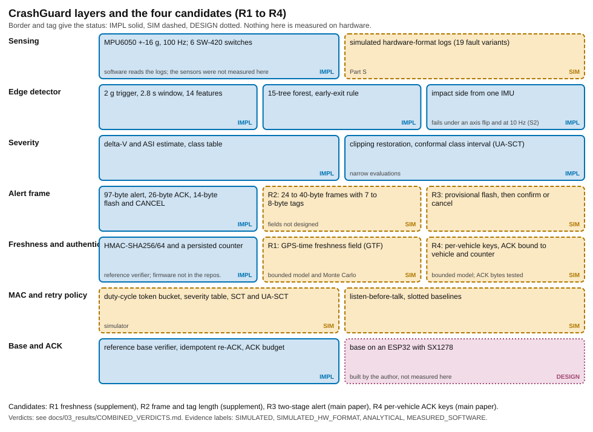

# Architecture and protocol layers (combined run)

<!-- header:start -->
| Field | Value |
|---|---|
| Status | current |
| Date | 2026-11-14 |
| Owner | Mritula S |
| Scope | Layered architecture with the status of every element, what each candidate changes, and where each result goes (generated). |
| Evidence labels used | MEASURED_SOFTWARE, SIMULATED_HW_FORMAT, TRACE_DRIVEN, SIMULATED, FORMAL, ANALYTICAL, NOT_RUN |
| Abbreviations | ACK = acknowledgement frame; ASI = acceleration severity index; ESP32 = a Wi-Fi microcontroller family (Espressif); GPS = Global Positioning System; GTF = GPS-time freshness field; HMAC = hash-based message authentication code; IEEE = Institute of Electrical and Electronics Engineers; IMU = inertial measurement unit; KDF = key derivation function; MAC = message authentication code; MPU6050 = an accelerometer and gyroscope chip; NHTSA = National Highway Traffic Safety Administration; SCT = severity-classified transmission; SW-420 = a vibration switch module; SX1278 = a 433 MHz LoRa radio chip; UA-SCT = uncertainty-aware SCT; UTC = Coordinated Universal Time; WSL = Windows Subsystem for Linux |
<!-- header:end -->

Generated by `python -m crashguard.ar_arch`. The older module and data-flow description is `docs/00_overview/ARCHITECTURE.md`. Every element is marked IMPLEMENTED (code in this repository, run on data), SIMULATED (a simulation or model with stated assumptions) or DESIGN-ONLY (written down, not built). No element is measured on hardware; Part S uses simulated hardware-format logs (SIMULATED_HW_FORMAT).

## Layers and elements

| Layer | Element | Status | Note |
|---|---|---|---|
| Sensing | MPU6050 +-16 g, 100 Hz; 6 SW-420 switches | IMPLEMENTED | software reads the logs; the sensors were not measured here |
| Sensing | simulated hardware-format logs (19 fault variants) | SIMULATED | Part S |
| Edge detector | 2 g trigger, 2.8 s window, 14 features | IMPLEMENTED |  |
| Edge detector | 15-tree forest, early-exit rule | IMPLEMENTED |  |
| Edge detector | impact side from one IMU | IMPLEMENTED | fails under an axis flip and at 10 Hz (S2) |
| Severity | delta-V and ASI estimate, class table | IMPLEMENTED |  |
| Severity | clipping restoration, conformal class interval (UA-SCT) | IMPLEMENTED | narrow evaluations |
| Alert frame | 97-byte alert, 26-byte ACK, 14-byte flash and CANCEL | IMPLEMENTED |  |
| Alert frame | R2: 24 to 40-byte frames with 7 to 8-byte tags | SIMULATED | fields not designed |
| Alert frame | R3: provisional flash, then confirm or cancel | SIMULATED |  |
| Freshness and authentication | HMAC-SHA256/64 and a persisted counter | IMPLEMENTED | reference verifier; firmware not in the repository |
| Freshness and authentication | R1: GPS-time freshness field (GTF) | SIMULATED | bounded model and Monte Carlo |
| Freshness and authentication | R4: per-vehicle keys, ACK bound to vehicle and counter | SIMULATED | bounded model; ACK bytes tested |
| MAC and retry policy | duty-cycle token bucket, severity table, SCT and UA-SCT | SIMULATED | simulator |
| MAC and retry policy | listen-before-talk, slotted baselines | SIMULATED |  |
| Base and ACK | reference base verifier, idempotent re-ACK, ACK budget | IMPLEMENTED |  |
| Base and ACK | base on an ESP32 with SX1278 | DESIGN-ONLY | built by the author, not measured here |

## What each candidate changes

| Candidate | Layer | Change | Verdicts (held-out data, Holm) | Placement |
|---|---|---|---|---|
| R1 GTF | Freshness and authentication | the 32-bit freshness field is GPS UTC seconds (a boot-epoch marker plus counter without a fix); the base checks a window and a ring of seen triples; no counter is persisted | H-R1a SUPPORTED, H-R1b NOT SUPPORTED, H-R1c SUPPORTED | supplement; the ring sizing failure is in the negatives register |
| R2 frame and tag | Alert frame | a 24 to 40-byte frame with a 7 or 8-byte tag instead of 97 bytes | H-R2a NOT SUPPORTED, H-R2b SUPPORTED | supplement; H-R2a in the negatives register |
| R3 two-stage | Alert frame and MAC | a 14-byte flash from the early-exit rule about 1.9 s before the full-window alert, then the full alert or an authenticated CANCEL | H-R3 SUPPORTED | main paper |
| R4 per-vehicle keys | Freshness and authentication; Base and ACK | K_i = HMAC(master, id); the alert and the ACK of vehicle i use K_i; the ACK names (vehicle, counter): 0 extra bytes, one KDF per new id | H-R4 SUPPORTED | main paper |

R2 figure: `results/figures/ar_r2_frame_vs_delivery.png` (and `.pdf`): burst delivery against time on air for every frame and tag length (SIMULATED delivery, ANALYTICAL time on air).

## Which results go where

- **Main paper:** R3 and R4 (all their hypotheses are supported), and the statements of Part S that are supported: the latency decomposition (H-S4) and the security suite on the simulated scenarios (H-S5), worded as results on simulated hardware-format logs.
- **Supplement:** R1 and R2 (partly supported), the failure map of the side rule (H-S1), the trigger result (H-S2), the link-policy table (H-S3) and the SW-420 sensitivity (H-S6).
- **Negatives register:** H-S1, H-S2, H-S3, H-S6, H-R1b and H-R2a (`docs/03_results/NEGATIVES_REGISTER.md`).

## Reading limits

- R1 to R4 are tested in models and simulations, not in firmware. The firmware source is not in this repository, so what the ESP32 persists is NOT_RUN.
- R2 changes only the frame length in the simulator; the fields that would be dropped (position, delta-V detail) were not designed, so the delivery gain is not a design claim.
- R3's timing is the window length of the early-exit rule (SIMULATED), not an ESP32 timing; the single-stage baseline waits for the full window, and an early-exit alert without a cancel path would be as fast.
- R4 is a design correction found by the bounded check (per-device keys are standard in LoRaWAN); a holder of the master key can still stop every vehicle.

## Redesign round: components added (session 2)

- `src/crashguard/rd_policy.py` (D1 table, Beta counters, cluster ACK), `rd_d3.py` (slot rule), `world_sim.py` (hooks under `world["rd"]`, all off by default), `rd_eval.py` (grids and paired statistics).
- `firmware_rd/` (C99 decision path: airtime, HMAC, alert frame, freshness, D1 lookup, Ed25519 verification of the cluster ACK, D2 decision, D3 slot rule; host build; TweetNaCl vendored) with the differential test in `src/crashguard/rd_firmware.py`.
- `xsim/ns3/xsim_alert.cc` (ns-3 application for D1 and baselines; includes the same C D1 code) and `src/crashguard/rd_x13.py` (cross-simulator analysis).
- `firmware_rd/bench/` and `src/crashguard/rd_bench.py` (bench logging hooks and parser for the two-stage alert; not compiled for the ESP32).
Data flow: events and class pools (real out-of-fold pairs) -> simulator policy -> per-event delivery -> paired bootstrap -> `results/results.json` (`rd.*`). The decision path in C is a separate implementation of the policy logic, checked against the Python reference, not a second simulator.

<!-- r3:start -->
## Round 3: evidence that does not depend on one simulator

| Component | Files | Evidence | Where it goes |
|---|---|---|---|
| Trace replay of the retry policies | `r3_t1_extract.py` (frame-counter gaps to loss sequences), `r3_t1.py` (single-link reductions of the frozen policies, R3 replay) | TRACE_DRIVEN, LoED, split by hashed device | main text with the zero-spacing control |
| Tamarin models | `formal/crash_alert_auth.spthy`, `formal/crash_alert_fresh.spthy`, `formal/out/`, `r3_t2_formal.py` | FORMAL (symbolic, perfect cryptography) | main text for L1 to L4b and the M0 attack; the unfinished lemma in the limits |
| Timed check | `r3_t2_timed.py` (exhaustive enumeration of the frozen policy code) | FORMAL (not UPPAAL) | main text with the tool named |
| Detection side of the two-stage alert | `r3_t3.py` (stored `s6_early` decisions, NHTSA truncation) | MEASURED_SOFTWARE | main text; class agreement in the supplement |
| Energy budget | `r3_t4.py` | ANALYTICAL, datasheet inputs | supplement |
| Literature | `lit_search.py`, `lit_bib.py`, `lit_docs.py`, `docs/06_references/NOVELTY_MATRIX_2021PLUS.md` | OpenAlex and Crossref (IEEE Xplore not run) | claim wording |

Data flow: LoED daily files -> device sequences (`data/processed/r3_t1_links.pkl`) -> policy replay -> paired bootstrap over devices -> `results.json` (`r3.*`) -> `r3_decide.py` (Holm) -> `ROUND3_DECISION_TABLE.md`. The Tamarin runs are made in WSL (Tamarin 1.12.0, Maude 3.5.1, one thread: the default thread count crashed the WSL virtual machine) by `scripts/wsl_tamarin_lemmas.sh`.
<!-- r3:end -->
