# CrashGuard: software results (paper-style draft)

<!-- header:start -->
| Field | Value |
|---|---|
| Status | current |
| Date | 2026-11-11 |
| Owner | Mritula S |
| Scope | Paper-style draft of the software results (generated). |
| Evidence labels used | MEASURED_SOFTWARE, SIMULATED, ANALYTICAL, HARDWARE, NOT_RUN |
| Abbreviations | ACK = acknowledgement frame; AP = average precision; ASI = acceleration severity index; CPU = central processing unit; CV = cross-validation; CoAP = Constrained Application Protocol; DoT = Department of Telecommunications (India); EN = European standard; ESP32 = a Wi-Fi microcontroller family (Espressif); FMVSS = Federal Motor Vehicle Safety Standards; FPR = false-positive rate; HIC = head injury criterion; HMAC = hash-based message authentication code; HTTP = Hypertext Transfer Protocol; IMU = inertial measurement unit; ISO = International Organization for Standardization; LoRa = long-range radio modulation; MEMS = micro-electromechanical system; MQTT = Message Queuing Telemetry Transport; NHTSA = National Highway Traffic Safety Administration; PPV = positive predictive value; RAM = random-access memory; RF = random forest; SCT = severity-classified transmission; SF = spreading factor (LoRa); SW-420 = a vibration switch module; THIV = theoretical head impact velocity; TLC = the TLA+ model checker; UA-SCT = uncertainty-aware SCT; WPC = Wireless Planning and Coordination wing (India) |
<!-- header:end -->

Generated by `make report` from `results/results.json`. Every number below comes from code run in this repository. Each table and figure names its origin: MEASURED_SOFTWARE (computed from a dataset), SIMULATED (a simulation with stated assumptions), ANALYTICAL (a formula or a datasheet value), HARDWARE (the author's logs) or NOT_RUN. Tables and Figures are numbered in order of appearance and indexed in `docs/05_data_code/FIGURES_TABLES.md`. This is a software-only draft: nothing here is a measurement on the car, the ESP32 or the radios.

## 1. Introduction

A vehicle crash alert has to be sent within seconds, from a device that costs little and runs on a small processor. CrashGuard detects a crash on an ESP32 with one IMU, estimates how hard the vehicle's velocity changed, and sends an authenticated alert over LoRa to a base station that answers with a signed acknowledgement. The hardware part of the project is measured separately by the author. This report covers the software and data-science part: what can be learned from public crash data and from simulation before any car is crashed.

Why a microcontroller-sized model. The detector must run inside the sensor node, where flash and RAM are counted in kilobytes, and it must keep working when the network does not. A 15-tree forest of depth 6 fits in about 15741 bytes (a host estimate). The question is how much accuracy this costs against larger models, and how the result depends on the sensor.

What this draft reports, in plain words:

- **Detector.** On a public dataset of real vehicle events (VZCrash), the deployable forest finds crashes with system recall 0.900 [0.892 to 0.909] and a system false-alarm rate of 0.042 [0.039 to 0.044] (mean of seeds 0 to 4, with a 95% bootstrap interval for that mean; seed 42 alone gives 0.909 [0.901 to 0.918] and 0.044 [0.041 to 0.047], each with its own interval). The trigger in front of the model is a second trigger: the dataset was already selected on the device.
- **Sensor.** On 176 NHTSA crash tests, a 16 g accelerometer at 100 Hz estimates the velocity change within 10% on only 0.07 of the tests. At least ±64 g and 200 Hz are needed to reach 80% of tests inside 10% (Section 4.5).
- **Security and delivery.** The alert carries an 8-byte HMAC tag and a counter. Our own attack suite found that strict replay rejection blocks the retry of an alert whose ACK was lost; an idempotent re-ACK repairs it. An end-to-end replay of real events through the whole chain, with a lossy channel, is simulated (Section 4.7).
- **Three proposed methods**, each judged only by whether its gain clears the 95% bootstrap interval on data it was not tuned on (Section 4.8). The saturation-aware estimator (N14) clears it at ±16 g only, against both plain integration and spline restoration, on re-splits that are not blind tests; trigger-aware training (N15) does not clear it; the scheduler (N16) is simulated, beats a weak fixed policy but not the severity table, and is supporting evidence only.
- **Precision at real prevalence.** At a crash share near the real-world one, almost every alert would be false (Section 4.1, Table on precision: 0.012 for the deployed forest at the 1% operating point; ANALYTICAL). Results on a dataset with roughly `16%` crashes do not describe precision in real driving.
- **Where the forest sits against the VZCrash paper.** The paper benchmarks neural and transformer models and a peak-acceleration baseline, tested no tree models and ran no embedded test; the forest is evaluated where the paper left a gap.

The software results are not hardware results. The trigger level and the sensor range are placeholders until they are confirmed from the firmware, and every system-level number is a function of them.

## 2. Dataset and audit

### What was run

- **Data.** VZCrash, 189303 events, each a 16 s window at 100 Hz. Labels: crash (31079), near_miss (28681) and normal_driving (129543). near_miss counts as a negative class. The licence is CC BY-NC 4.0 (non-commercial; cite the paper).
- **Corrupt events.** 15 events with a peak above the sensor range were dropped. Signals were clipped to the sensor range.
- **Window.** The firmware-style trigger is the earliest sample with |a| above the trigger level. The window is 1.0 s before to 1.8 s after it (2.8 s). The trigger level (2.0 g) and sensor range (16 g) are placeholders until they are confirmed from firmware v2.
- **Features.** 14 window features (`docs/05_data_code/FEATURES.md`), with two subsets: no gyro (13) and scale-free (5).
- **Models.** A 15-tree depth-6 random forest (the one that fits on the ESP32), a 200-tree forest, logistic regression, gradient-boosted trees and a peak-and-duration rule. Seed 42 is the headline run; seeds 0 to 4 give mean ± standard deviation. The logistic regression and the rule have no randomness, so their standard deviation is zero. All training is on the CPU.
- **Splits and thresholds.** The train, validation and test splits supplied with the dataset. The VZCrash paper (Section III-B) states that the splits are `72/14/14`, "strictly separated by vehicle" and stratified by vehicle size; the release has no vehicle or trip ID, so we cannot check this, and we do not claim leakage by vehicle. The primary test set leaves out the 150 test events that also appear (nearly) in train or validation. Thresholds are chosen on the validation split only. The test set is scored once per model and seed.
- **Two levels.** *Model level* uses only events that pass the trigger. *System level* counts events that never trigger as predicted negative, as the car would.
- **Caveat on the trigger.** The VZCrash paper says its events were already selected on the device by threshold heuristics (hard braking and shock events). Our trigger is therefore a second trigger applied to events that were already triggered once. The trigger rates describe these selected events, not continuous driving.

### Table 1. Dataset profile (events per split and class) (MEASURED_SOFTWARE)

| Split | crash | near_miss | normal_driving |
|---|---|---|---|
| train | 22603 | 20802 | 94549 |
| validation | 4255 | 4246 | 18674 |
| test | 4221 | 3633 | 16320 |
| test, de-duplicated (primary) | 4107 | 3632 | 16283 |

Events dropped as corrupt: 15 (listed in `results/tables/dropped_events.csv`). Kept events that are not 1600 samples long: 415. Events whose gyro length differs from the accelerometer length: 6.

**Dataset audit.** 217 groups of identical accelerometer recordings appear in more than one split (437 duplicate events in total). In the supplied test split, 150 events (114 crash, 1 near_miss and 35 normal_driving) have an identical or near-identical recording in train or validation. They are removed from the primary test set; the supplied split is a secondary result. We say only that identical recordings appear across the released splits and ask the authors whether they come from the export. The paper reports no licence; the CC BY-NC 4.0 licence used here is the one on the dataset card (Hugging Face README, `license: cc-by-nc-4.0`). A draft email to the dataset authors with the event IDs is in `docs/04_audits/vzcrash_email_draft.md`; nothing has been sent.

**NHTSA crash tests.** For the severity work we use the NHTSA Vehicle Crash Test Database (US government, public domain): 116 frontal barrier tests and 60 side impactor tests, read from the ISO MME files (vehicle-centre-of-gravity accelerometer, or a front sill accelerometer when there is none). 668 candidate tests were skipped because they have no such channel or no pre-trigger baseline, and 0 because the channel showed no pulse. The list is in `docs/05_data_code/DATASET.md`. The tests are split by vehicle group (make, model and model year) into a tuning part and a held-out part before any result was looked at (every third group, by smallest test number, is held out, with all its tests).

## 3. Method

**Trigger, window, features, model.** The node keeps a ring buffer. At the earliest sample where |a| exceeds the trigger level, 1.0 s before and 1.8 s after are cut as one window; 14 features (peak, rms, jerk, energy, duration above 2 g, peak ratio, horizontal share, kurtosis, crest factor, post-quiet ratio, gyro peak) go to a random forest whose threshold is chosen on validation. The forest is exported to C as constant arrays, and a compiled check compares it with scikit-learn. Because the trigger is a design choice, it is varied and evaluated at system level.

**Severity.** From the same window the code computes: delta-V (the integral of acceleration over the crash pulse after removing the pre-trigger mean), ASI (the EN 1317-2 formula with a 13 Hz filter and a 50 ms average), peak and mean pulse acceleration, a gravity-frame tilt for rollover, and a four-class severity (Low, Moderate, Severe, Critical) from delta-V and ASI. The pulse ends when horizontal acceleration stays below the larger of 0.5 g and a tenth of the pulse peak for 50 ms, or after 250 ms; the fraction was chosen on the NHTSA tuning tests. THIV (a free-head model) is also computed, but it is UNVERIFIED (its flail distances are in doubt) and is not used in any claim here. These classes describe crash severity, not injury. Constants and their status (read, secondary source, unverified, ours) are in `docs/05_data_code/SEVERITY.md`: the ASI level C limit 1.9 was read in a secondary source; the 13 Hz filter and the THIV flail distances are unverified; the delta-V class limits and names are our choice.

**Packet and security.** The alert is 97 bytes: ids, a 32-bit counter, severity, impact side, position, peak, model probability, delta-V and ASI, then an 8-byte tag (HMAC-SHA256 truncated). The tag covers bytes `0 to 88`. The base accepts an alert only if the tag and the counter are right, and answers with a signed 26-byte ACK. A retry repeats the same bytes; the base remembers the last accepted alerts and re-sends the identical ACK for an exact repeat (idempotent re-ACK), at most once per event per retry interval, paying every ACK from its duty-cycle budget. One key is shared by both nodes; there is no key rotation (`docs/01_protocol/PACKET_FORMAT.md`).

**Delivery policy.** Under a 10% duty cycle a token bucket pays for every transmission. Three policies are compared: no retry; a fixed policy with three retries; and a severity table (2, 4, 8 and 12 tries for Low, Moderate, Severe and Critical, the most severe waiting alert served next). A scheduler proposed in Section 4.8 adds a reserved share, age ordering and back-off.

**Evaluation rules.** Thresholds and every choice are made on validation (VZCrash) or on a tuning set of NHTSA tests; the test or held-out part is scored once. Confidence intervals are 95% percentile bootstrap intervals from 1,000 resamples of test events, tests or simulated hours (seed 42). A proposed method counts as an improvement only if its paired gain clears the interval on data it was not tuned on.

## 4. Results

### 4.1 Detector

### Table 2. Model level, triggered events of the de-duplicated test set (MEASURED_SOFTWARE)

| Model | AP | ROC-AUC | Precision | Recall | F1 | FPR (triggered negatives) | Brier |
|---|---|---|---|---|---|---|---|
| RF, 15 trees, depth 6 (deployable) | 0.931 ± 0.001 | 0.869 ± 0.002 | 0.817 ± 0.008 | 0.934 ± 0.009 | 0.872 ± 0.001 | 0.462 ± 0.030 | 0.132 ± 0.001 |
| RF, 200 trees | 0.952 ± 0.000 | 0.904 ± 0.000 | 0.854 ± 0.008 | 0.924 ± 0.012 | 0.888 ± 0.001 | 0.349 ± 0.026 | 0.114 ± 0.000 |
| Logistic regression | 0.930 ± 0.000 | 0.864 ± 0.000 | 0.830 ± 0.000 | 0.909 ± 0.000 | 0.868 ± 0.000 | 0.412 ± 0.000 | 0.134 ± 0.000 |
| Gradient-boosted trees | 0.952 ± 0.000 | 0.903 ± 0.000 | 0.846 ± 0.009 | 0.931 ± 0.012 | 0.886 ± 0.001 | 0.375 ± 0.031 | 0.114 ± 0.000 |
| Rule (peak and duration) | 0.888 ± 0.000 | 0.797 ± 0.000 | 0.786 ± 0.000 | 0.904 ± 0.000 | 0.841 ± 0.000 | 0.545 ± 0.000 | n/a |

Precision, recall and F1 use the threshold that maximises F1 on validation. Crashes are 0.688 of the triggered test events, so AP has a high floor here and should be read with the system-level table.

### Table 3. System level, de-duplicated test set (MEASURED_SOFTWARE)

| Model | Recall | FPR (all negatives) | FPR near_miss | FPR normal | Recall at val. recall 0.95 threshold | FPR at that threshold |
|---|---|---|---|---|---|---|
| RF, 15 trees, depth 6 (deployable) | 0.900 ± 0.009 | 0.042 ± 0.003 | 0.033 ± 0.003 | 0.043 ± 0.003 | 0.917 ± 0.002 | 0.046 ± 0.001 |
| RF, 200 trees | 0.891 ± 0.011 | 0.031 ± 0.002 | 0.024 ± 0.002 | 0.033 ± 0.003 | 0.918 ± 0.001 | 0.040 ± 0.001 |
| Logistic regression | 0.876 ± 0.000 | 0.037 ± 0.000 | 0.031 ± 0.000 | 0.038 ± 0.000 | 0.914 ± 0.000 | 0.048 ± 0.000 |
| Gradient-boosted trees | 0.897 ± 0.011 | 0.034 ± 0.003 | 0.026 ± 0.002 | 0.035 ± 0.003 | 0.918 ± 0.001 | 0.040 ± 0.000 |
| Rule (peak and duration) | 0.871 ± 0.000 | 0.049 ± 0.000 | 0.039 ± 0.000 | 0.051 ± 0.000 | 0.934 ± 0.000 | 0.071 ± 0.000 |

In this table, the number after the plus-minus sign is the standard deviation across the five seeds (spread between model fits). It is not an interval for the mean; the interval for the 5-seed mean is in Section 1 (detector.head5). FPR is the share of negative events that raise an alarm. The leading columns use the maximum-F1 validation threshold; the last two use the validation threshold that gives recall 0.95 on validation.

### Table 4. Headline detector metrics with 95% bootstrap intervals (seed 42, de-duplicated test) (MEASURED_SOFTWARE)

| Model | AP (triggered) | System AP | System recall | System false-alarm rate |
|---|---|---|---|---|
| RF, 15 trees, depth 6 (deployable) | 0.931 [0.923 to 0.938] | 0.903 [0.895 to 0.912] | 0.909 [0.901 to 0.918] | 0.044 [0.041 to 0.047] |
| RF chosen on validation (trees and depth from Table 17) | 0.938 [0.931 to 0.944] | 0.910 [0.902 to 0.918] | 0.902 [0.892 to 0.910] | 0.039 [0.036 to 0.041] |
| RF, 200 trees | 0.952 [0.946 to 0.957] | 0.924 [0.917 to 0.931] | 0.884 [0.875 to 0.894] | 0.030 [0.028 to 0.032] |
| Gradient-boosted trees | 0.952 [0.947 to 0.957] | 0.924 [0.917 to 0.931] | 0.913 [0.904 to 0.921] | 0.039 [0.036 to 0.041] |
| Logistic regression | 0.930 [0.923 to 0.937] | 0.902 [0.894 to 0.910] | 0.876 [0.867 to 0.885] | 0.037 [0.035 to 0.040] |
| Rule (peak and duration) | 0.888 [0.878 to 0.897] | 0.862 [0.851 to 0.872] | 0.871 [0.861 to 0.881] | 0.049 [0.046 to 0.052] |

24022 test events, of which 5750 pass the trigger. Thresholds come from the validation split (maximum F1).

**Cost of fitting on the ESP32.** 
### Table 5. Larger models minus the 15-tree forest (MEASURED_SOFTWARE)

| Difference | AP | F1 (triggered) | System recall | System FPR |
|---|---|---|---|---|
| RF 200 trees minus RF 15 trees | 0.0206 | 0.0162 | -0.0095 | -0.0102 |
| Gradient-boosted trees minus RF 15 trees | 0.0208 | 0.0147 | -0.0031 | -0.0079 |

A positive AP, F1 or recall difference means the larger model is better; a positive FPR difference means more false alarms. The larger models have a higher AP and fewer false alarms, but they do not have a higher system recall at the maximum-F1 threshold.

### Table 6. Operating point chosen on validation for a fixed false-alarm rate, test recall scored once (mean ± std over seeds 0 to 4) (MEASURED_SOFTWARE)

| Model | Recall at 1% target | Achieved FPR | Seed 42 recall with interval | Recall at 5% target | Achieved FPR | Seed 42 recall with interval |
|---|---|---|---|---|---|---|
| RF, 15 trees, depth 6 (deployable) | 0.626 ± 0.004 | 0.011 ± 0.000 | 0.615 [0.599 to 0.628] | 0.934 ± 0.003 | 0.053 ± 0.000 | 0.930 [0.922 to 0.938] |
| RF chosen on validation (trees and depth from Table 17) | 0.655 ± 0.007 | 0.010 ± 0.000 | 0.657 [0.643 to 0.670] | 0.939 ± 0.002 | 0.054 ± 0.000 | 0.935 [0.927 to 0.942] |
| RF, 200 trees | 0.702 ± 0.003 | 0.009 ± 0.000 | 0.697 [0.684 to 0.710] | 0.944 ± 0.001 | 0.053 ± 0.000 | 0.944 [0.937 to 0.951] |
| Gradient-boosted trees | 0.699 ± 0.004 | 0.010 ± 0.000 | 0.700 [0.686 to 0.713] | 0.944 ± 0.001 | 0.054 ± 0.000 | 0.944 [0.936 to 0.951] |
| Logistic regression | 0.627 ± 0.000 | 0.011 ± 0.000 | 0.627 [0.612 to 0.641] | 0.928 ± 0.000 | 0.053 ± 0.000 | 0.928 [0.920 to 0.935] |
| Rule (peak and duration) | 0.481 ± 0.000 | 0.011 ± 0.000 | 0.481 [0.465 to 0.495] | 0.894 ± 0.000 | 0.054 ± 0.000 | 0.894 [0.885 to 0.903] |

The threshold is the smallest one whose false-alarm rate on all validation non-crash events (trigger-discarded ones included) does not exceed the target. The achieved test false-alarm rate is shown next to it.

### Table 7. Calibration of the probability models (seed 42, triggered de-duplicated test events) (MEASURED_SOFTWARE)

| Model | Brier score | Expected calibration error (10 bins) |
|---|---|---|
| RF, 15 trees, depth 6 (deployable) | 0.1323 [0.1272 to 0.1375] | 0.0321 [0.0257 to 0.0415] |
| RF chosen on validation (trees and depth from Table 17) | 0.1255 [0.1205 to 0.1307] | 0.0218 [0.0164 to 0.0318] |
| RF, 200 trees | 0.1139 [0.1091 to 0.1188] | 0.0243 [0.0190 to 0.0337] |
| Gradient-boosted trees | 0.1135 [0.1085 to 0.1189] | 0.0114 [0.0090 to 0.0221] |
| Logistic regression | 0.1338 [0.1283 to 0.1394] | 0.0144 [0.0109 to 0.0258] |

### Table 8. Feature ablation (MEASURED_SOFTWARE)

| Model | AP, all 14 | System recall, all 14 | AP, no gyro | System recall, no gyro | AP, scale-free | System recall, scale-free |
|---|---|---|---|---|---|---|
| RF, 15 trees, depth 6 (deployable) | 0.931 ± 0.001 | 0.900 ± 0.009 | 0.930 ± 0.001 | 0.910 ± 0.007 | 0.923 ± 0.001 | 0.889 ± 0.005 |
| RF, 200 trees | 0.952 ± 0.000 | 0.891 ± 0.011 | 0.948 ± 0.000 | 0.889 ± 0.013 | 0.938 ± 0.001 | 0.890 ± 0.016 |
| Logistic regression | 0.930 ± 0.000 | 0.876 ± 0.000 | 0.929 ± 0.000 | 0.895 ± 0.000 | 0.892 ± 0.000 | 0.888 ± 0.000 |
| Gradient-boosted trees | 0.952 ± 0.000 | 0.897 ± 0.011 | 0.948 ± 0.000 | 0.892 ± 0.007 | 0.936 ± 0.000 | 0.894 ± 0.007 |

**Figure 1.** Precision against recall on triggered, de-duplicated test events, seed 42. (MEASURED_SOFTWARE)  
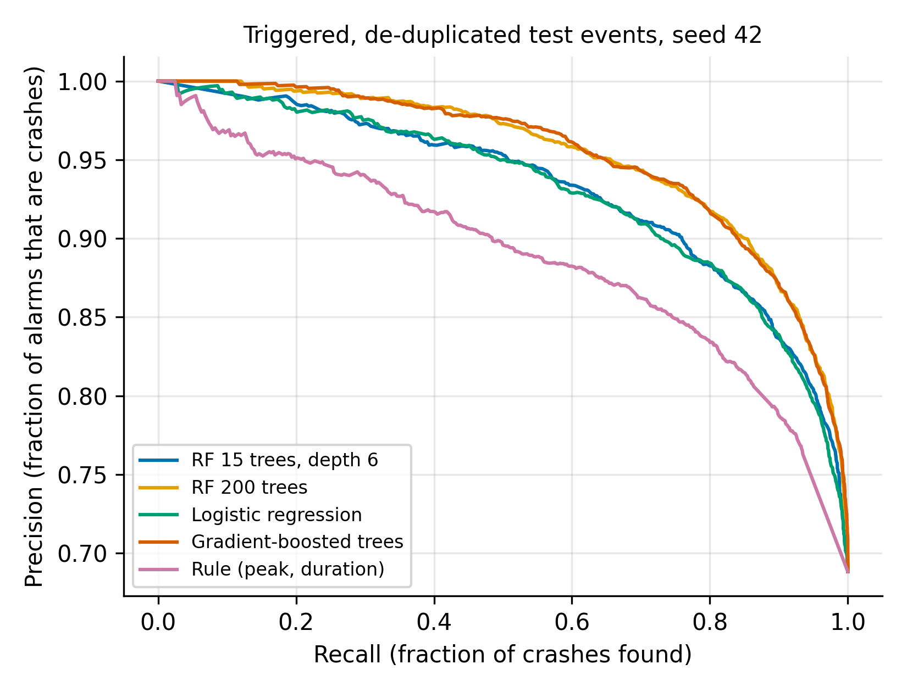

**Figure 2.** Reliability curves of the probability models. (MEASURED_SOFTWARE)  
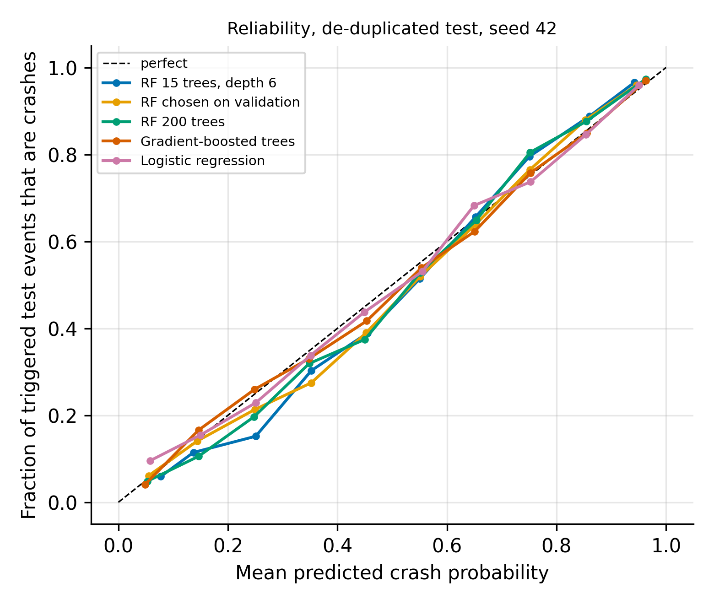

**Figure 3.** System recall when the false-alarm rate is fixed on validation. (MEASURED_SOFTWARE)  
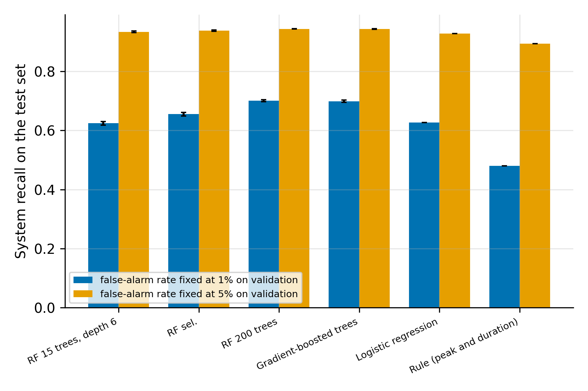

#### Precision at lower crash prevalence

The VZCrash test set has 0.17 crashes among its events. The VZCrash paper reports `143` confirmed crashes among `735,000` real-world harsh-driving events (Section III-D), a share of 0.00019 (under `0.02%`), and its best model's average precision falls from about `97.5%` on the benchmark to about `86%` there. Precision (positive predictive value) at other prevalences is computed from the measured system recall and false-alarm rate (mean of seeds 0 to 4) with the formula PPV = r p / (r p + f (1 - p)). It assumes that the false-alarm rate measured on VZCrash non-crash events also holds at the stated prevalence; that is an assumption, not a measurement (ANALYTICAL).

### Table 9. Precision (PPV) of the deployed forest, the 10-tree depth-9 candidate and the rule detector at three crash prevalences, at the 1% and 5% false-alarm operating points (ANALYTICAL)

| Detector | False-alarm target | System recall | Achieved false-alarm rate | PPV at `0.02%` prevalence | PPV at 1% | PPV at 16% |
|---|---|---|---|---|---|---|
| deployed forest (15 trees, depth 6) | 1% | 0.626 | 0.0105 | 0.0118 | 0.3760 | 0.9191 |
| deployed forest (15 trees, depth 6) | 5% | 0.934 | 0.0533 | 0.0035 | 0.1505 | 0.7696 |
| 10-tree depth-9 candidate | 1% | 0.655 | 0.0101 | 0.0128 | 0.3958 | 0.9251 |
| 10-tree depth-9 candidate | 5% | 0.939 | 0.0537 | 0.0035 | 0.1501 | 0.7691 |
| rule detector | 1% | 0.481 | 0.0113 | 0.0084 | 0.3005 | 0.8901 |
| rule detector | 5% | 0.894 | 0.0545 | 0.0033 | 0.1422 | 0.7576 |

At the real-world prevalence most alerts would be false for every detector here (precision 0.012 for the deployed forest at the 1% operating point). **Results on a dataset with roughly `16%` crashes do not describe precision in real driving.** A usable alert system at that prevalence needs a false-alarm rate several orders lower, or a second confirmation step such as the cancel window, a phone check or a second sensor.

### 4.2 Trigger-aware evaluation

The trigger decides which events the model ever sees. System-level recall therefore includes the crashes the trigger discards. Because VZCrash events were already selected on the device, these rates describe a second trigger.

### Table 10. Trigger rate per class (MEASURED_SOFTWARE)

| Trigger level | crash | near_miss | normal_driving |
|---|---|---|---|
| 1.5 g | 0.996 | 0.324 | 0.301 |
| 2 g | 0.961 | 0.073 | 0.091 |
| 2.5 g | 0.888 | 0.034 | 0.055 |
| 3 g | 0.789 | 0.019 | 0.038 |

### Table 11. Trigger level sweep, 15-tree forest (seed 42, 95% intervals) (MEASURED_SOFTWARE)

| Trigger level | System recall | System false-alarm rate | System AP | Share of crashes that pass the trigger |
|---|---|---|---|---|
| 1.5 g | 0.792 [0.779 to 0.803] | 0.036 [0.034 to 0.039] | 0.880 [0.871 to 0.888] | 0.997 [0.995 to 0.998] |
| 2 g | 0.909 [0.901 to 0.918] | 0.044 [0.041 to 0.047] | 0.903 [0.895 to 0.912] | 0.964 [0.958 to 0.969] |
| 2.5 g | 0.846 [0.836 to 0.857] | 0.032 [0.030 to 0.035] | 0.857 [0.846 to 0.866] | 0.890 [0.881 to 0.900] |
| 3 g | 0.763 [0.749 to 0.775] | 0.025 [0.022 to 0.027] | 0.784 [0.772 to 0.796] | 0.785 [0.772 to 0.798] |

### Table 12. Crash events below each trigger, by VZCrash vehicle-size category (seed-independent counts, 95% intervals) (MEASURED_SOFTWARE)

| Trigger level | Light | Medium | Heavy | Unknown |
|---|---|---|---|---|
| 1.5 g | 1 of 803 (0.001) | 9 of 2146 (0.004) | 3 of 914 (0.003) | 0 of 244 (0.000) |
| 2 g | 25 of 803 (0.031) | 77 of 2146 (0.036) | 38 of 914 (0.042) | 9 of 244 (0.037) |
| 2.5 g | 83 of 803 (0.103) | 226 of 2146 (0.105) | 115 of 914 (0.126) | 26 of 244 (0.107) |
| 3 g | 173 of 803 (0.215) | 455 of 2146 (0.212) | 213 of 914 (0.233) | 42 of 244 (0.172) |

Each cell: crashes that never reach the trigger, of all crashes in that category, and the share. 'Unknown' is a mix of vehicles with no size recorded.

### Table 13. Secondary comparison: window centred on the peak (MEASURED_SOFTWARE)

This window cannot be built on the car (it needs the peak in advance); it is shown only to see what the trigger-based window costs.

| Model | AP | F1 | FPR near_miss |
|---|---|---|---|
| RF, 15 trees, depth 6 (deployable) | 0.920 ± 0.001 | 0.857 ± 0.001 | 0.035 ± 0.002 |
| RF, 200 trees | 0.945 ± 0.000 | 0.877 ± 0.001 | 0.025 ± 0.003 |
| Logistic regression | 0.918 ± 0.000 | 0.858 ± 0.000 | 0.038 ± 0.000 |
| Gradient-boosted trees | 0.946 ± 0.001 | 0.879 ± 0.001 | 0.026 ± 0.002 |
| Rule (peak and duration) | 0.865 ± 0.000 | 0.830 ± 0.000 | 0.040 ± 0.000 |

### Table 14. Three-class outcome, 15-tree forest, seed 42, de-duplicated test split (MEASURED_SOFTWARE)

| True class | Not triggered | Triggered, predicted negative | Triggered, predicted crash |
|---|---|---|---|
| crash | 149 | 223 | 3735 |
| near_miss | 3353 | 149 | 130 |
| normal_driving | 14770 | 762 | 751 |

**Figure 4.** Trigger rate per class, and system recall and FPR, as the trigger level changes. (MEASURED_SOFTWARE)  
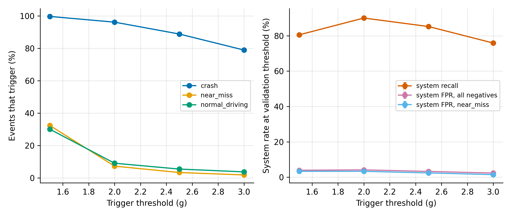

**Figure 5.** What happens to each true class: not triggered, triggered but predicted negative, or predicted crash. (MEASURED_SOFTWARE)  
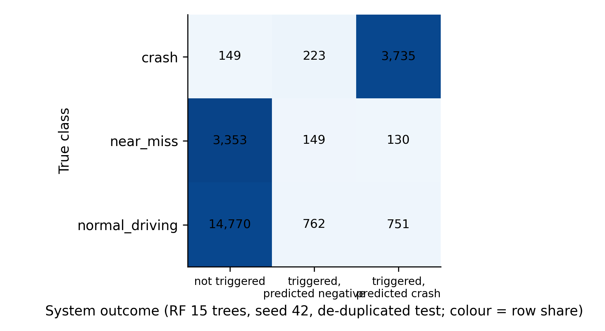

### 4.3 Robustness to sensor errors

The perturbations are ours, not measured on a car, and are applied to the raw signals before the sensor clip and the trigger, so the trigger rate changes too. The models are trained on the unperturbed training split (seed 42), and thresholds come from the unperturbed validation split. Gain error: ±5% and ±10%. Constant offset: 0.5 g on one axis (x, y, z and -z) and `0.25 g` on all axes (the car's resting reading showed 0.5 g). Axis misalignment: ±5, ±10 and ±20 degrees about each axis. Added noise: three levels. A 50 Hz down-sample.

### Table 15. Sensor-error robustness: AP, system recall and false-alarm rate (seed 42; change in recall against the unperturbed run with a paired 95% interval) (SIMULATED)

| Perturbation | Trigger rate | AP (RF15) | System recall (RF15) | Change in recall, 95% interval | System FPR (RF15) | System recall (RF 10 trees, depth 9) | System recall (rule) |
|---|---|---|---|---|---|---|---|
| `baseline` | 0.239 | 0.931 | 0.909 | baseline | 0.044 | 0.902 | 0.871 |
| `gain_-0.10` | 0.218 | 0.935 | 0.876 | -0.040 to -0.027 | 0.037 | 0.865 | 0.812 |
| `gain_-0.05` | 0.228 | 0.932 | 0.896 | -0.019 to -0.009 | 0.040 | 0.888 | 0.842 |
| `gain_+0.05` | 0.252 | 0.927 | 0.917 | 0.003 to 0.013 | 0.048 | 0.907 | 0.889 |
| `gain_+0.10` | 0.269 | 0.924 | 0.924 | 0.008 to 0.021 | 0.051 | 0.913 | 0.899 |
| `offset_x+0.5g` | 0.248 | 0.911 | 0.874 | -0.043 to -0.027 | 0.044 | 0.858 | 0.834 |
| `offset_y+0.5g` | 0.263 | 0.921 | 0.932 | 0.016 to 0.028 | 0.057 | 0.928 | 0.878 |
| `offset_z+0.5g` | 0.386 | 0.880 | 0.801 | -0.119 to -0.098 | 0.036 | 0.771 | 0.846 |
| `offset_z-0.5g` | 0.213 | 0.928 | 0.890 | -0.028 to -0.012 | 0.043 | 0.858 | 0.821 |
| `offset_all+0.25g` | 0.292 | 0.910 | 0.885 | -0.032 to -0.017 | 0.046 | 0.877 | 0.875 |
| `misalign_x-20deg` | 0.239 | 0.924 | 0.916 | 0.002 to 0.012 | 0.050 | 0.911 | 0.871 |
| `misalign_x-10deg` | 0.239 | 0.929 | 0.911 | -0.002 to 0.005 | 0.045 | 0.905 | 0.871 |
| `misalign_x-5deg` | 0.239 | 0.930 | 0.909 | -0.004 to 0.002 | 0.044 | 0.898 | 0.871 |
| `misalign_x+5deg` | 0.239 | 0.930 | 0.910 | -0.003 to 0.004 | 0.045 | 0.902 | 0.871 |
| `misalign_x+10deg` | 0.239 | 0.930 | 0.910 | -0.004 to 0.004 | 0.046 | 0.903 | 0.871 |
| `misalign_x+20deg` | 0.239 | 0.927 | 0.914 | -0.001 to 0.009 | 0.051 | 0.906 | 0.871 |
| `misalign_y-20deg` | 0.239 | 0.923 | 0.897 | -0.018 to -0.007 | 0.045 | 0.883 | 0.871 |
| `misalign_y-10deg` | 0.239 | 0.929 | 0.903 | -0.010 to -0.002 | 0.044 | 0.894 | 0.871 |
| `misalign_y-5deg` | 0.239 | 0.930 | 0.906 | -0.006 to 0.000 | 0.044 | 0.898 | 0.871 |
| `misalign_y+5deg` | 0.239 | 0.930 | 0.912 | -0.000 to 0.005 | 0.045 | 0.901 | 0.871 |
| `misalign_y+10deg` | 0.239 | 0.930 | 0.913 | 0.000 to 0.008 | 0.046 | 0.903 | 0.871 |
| `misalign_y+20deg` | 0.239 | 0.926 | 0.910 | -0.004 to 0.006 | 0.047 | 0.896 | 0.871 |
| `misalign_z-20deg` | 0.239 | 0.928 | 0.911 | -0.002 to 0.004 | 0.046 | 0.904 | 0.871 |
| `misalign_z-10deg` | 0.239 | 0.930 | 0.910 | -0.002 to 0.003 | 0.045 | 0.900 | 0.871 |
| `misalign_z-5deg` | 0.239 | 0.931 | 0.911 | -0.001 to 0.003 | 0.045 | 0.899 | 0.871 |
| `misalign_z+5deg` | 0.239 | 0.931 | 0.912 | 0.000 to 0.005 | 0.044 | 0.902 | 0.871 |
| `misalign_z+10deg` | 0.239 | 0.931 | 0.911 | -0.002 to 0.004 | 0.045 | 0.901 | 0.871 |
| `misalign_z+20deg` | 0.239 | 0.929 | 0.913 | -0.000 to 0.006 | 0.046 | 0.906 | 0.871 |
| `noise_0.02g` | 0.240 | 0.931 | 0.909 | -0.002 to 0.001 | 0.044 | 0.901 | 0.870 |
| `noise_0.05g` | 0.241 | 0.931 | 0.908 | -0.005 to 0.002 | 0.044 | 0.900 | 0.871 |
| `noise_0.10g` | 0.246 | 0.930 | 0.913 | -0.000 to 0.008 | 0.045 | 0.901 | 0.875 |
| `downsample_50Hz` | 0.229 | 0.933 | 0.886 | -0.030 to -0.018 | 0.038 | 0.875 | 0.838 |

The unperturbed re-processing triggers on the same events as the main pipeline (check flag 1; largest feature difference 0.00e+00). Origin: the events are VZCrash (MEASURED_SOFTWARE inputs); the perturbations make the results SIMULATED.

**Figure 6.** Change in system recall and false-alarm rate under each perturbation, for three detectors. (SIMULATED)  
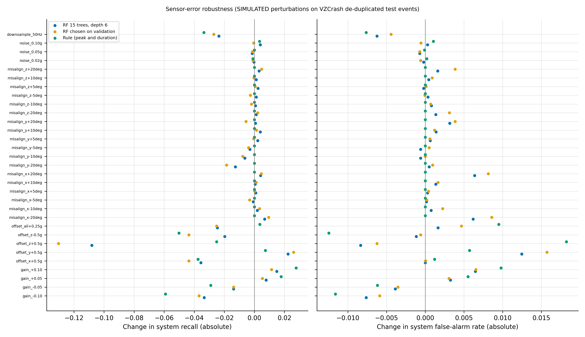

### 4.4 Size against accuracy

### Table 16. Model size against performance, depth 6 (AP: MEASURED_SOFTWARE, bytes: ANALYTICAL) (MEASURED_SOFTWARE)

| Trees | Nodes | Estimated bytes | AP |
|---|---|---|---|
| 1 | 117 | 1053 | 0.901 ± 0.006 |
| 3 | 355 | 3191 | 0.923 ± 0.003 |
| 5 | 594 | 5344 | 0.928 ± 0.002 |
| 10 | 1184 | 10652 | 0.931 ± 0.002 |
| 15 | 1771 | 15939 | 0.931 ± 0.001 |
| 30 | 3540 | 31864 | 0.932 ± 0.001 |
| 60 | 7061 | 63551 | 0.932 ± 0.001 |
| 100 | 11738 | 105638 | 0.933 ± 0.001 |
| 200 | 23486 | 211374 | 0.933 ± 0.000 |

Bytes are the node count times 9 bytes per node, a host estimate, not an ESP32 compile report. At depth 6, 200 trees reach AP 0.933, no better than 15 trees (0.931). With depth 8 and 15 trees, AP is 0.939.

### Table 17. Depth against size sweep, chosen on the validation split (AP and nodes: MEASURED_SOFTWARE, flash: ANALYTICAL) (MEASURED_SOFTWARE)

| Trees | Depth | Validation AP | Nodes | Estimated flash (bytes) | C header file (bytes of text) | Marks |
|---|---|---|---|---|---|---|
| 10 | 6 | 0.926 ± 0.001 | 1184 | 10672 | 37473 | Pareto |
| 10 | 7 | 0.929 ± 0.001 | 2141 | 19291 | 66276 | Pareto |
| 10 | 8 | 0.932 ± 0.001 | 3759 | 33849 | 113439 | Pareto |
| 10 | 9 | 0.933 ± 0.001 | 6269 | 56443 | 184696 | Pareto, recommended |
| 10 | 10 | 0.934 ± 0.001 | 9696 | 87284 | 279032 |  |
| 15 | 6 | 0.926 ± 0.001 | 1771 | 15969 | 56124 | Pareto |
| 15 | 7 | 0.929 ± 0.000 | 3218 | 28990 | 99625 | Pareto |
| 15 | 8 | 0.933 ± 0.000 | 5634 | 50734 | 170034 | Pareto |
| 15 | 9 | 0.935 ± 0.000 | 9348 | 84160 | 275248 | Pareto |
| 15 | 10 | 0.936 ± 0.001 | 14495 | 130489 | 421743 | Pareto |
| 20 | 6 | 0.926 ± 0.001 | 2358 | 21258 | 74678 |  |
| 20 | 7 | 0.930 ± 0.001 | 4272 | 38488 | 132318 |  |
| 20 | 8 | 0.933 ± 0.001 | 7529 | 67799 | 227339 |  |
| 20 | 9 | 0.935 ± 0.001 | 12361 | 111287 | 366472 | Pareto |
| 20 | 10 | 0.937 ± 0.001 | 19217 | 172991 | 562714 | Pareto |

Every AP here is on the validation split; the test set was not used to choose the configuration. The rule was fixed before the sweep. Result: **10 trees at depth 9**, estimated 56443 bytes; scored once on the de-duplicated test set it has AP 0.939 ± 0.001. The deployed model is not changed. Validation events can repeat training events, so validation AP may be optimistic.

### Table 18. Leave one vehicle-size category out, 15-tree forest (MEASURED_SOFTWARE)

| Category | AP, standard test | AP, held out | System recall, held out | System FPR, held out |
|---|---|---|---|---|
| Light | 0.941 | 0.949 ± 0.001 | 0.907 ± 0.010 | 0.040 ± 0.005 |
| Medium | 0.959 | 0.958 ± 0.000 | 0.843 ± 0.016 | 0.024 ± 0.002 |
| Heavy | 0.903 | 0.881 ± 0.001 | 0.889 ± 0.004 | 0.095 ± 0.001 |
| Unknown | 0.843 | 0.827 ± 0.002 | 0.893 ± 0.008 | 0.032 ± 0.002 |

### Table 19. C export of the 15-tree forest and of the validation-selected candidate (MEASURED_SOFTWARE)

| Item | Deployed (15 trees, depth 6) | Candidate (validation choice) |
|---|---|---|
| Nodes in all trees | 1749 | 5744 |
| Estimated size (bytes, ANALYTICAL) | 15741 | 51696 |
| Triggered test events compared | 5863 | 5863 |
| Maximum difference, compiled C against scikit-learn | 1.86e-07 | 1.39e-07 |
| Maximum difference, pure-Python float32 mirror of the C code, against scikit-learn | 1.86e-07 | see `docs/05_data_code/FIRMWARE_SYNC.md` |
| Time per call on the ESP32 (microseconds) | NOT_RUN (`benchmark_rf.ino` is built, not yet measured) | NOT_RUN |

The compiled C check is built into `build/` and retried up to five times because Windows Application Control sometimes blocks a freshly built program; if it still cannot run, the row says NOT_RUN with the reason and the pure-Python mirror remains. `docs/05_data_code/FIRMWARE_SYNC.md` lists what the firmware author must set or check before the candidate header replaces the deployed one.

**Figure 7.** Validation AP against estimated flash for the depth sweep. (MEASURED_SOFTWARE)  
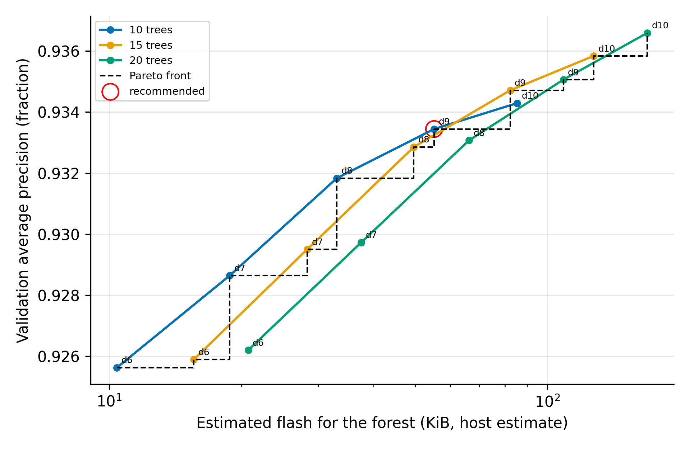

**Figure 8.** AP against estimated model size for forests of different depth and tree count. (MEASURED_SOFTWARE)  
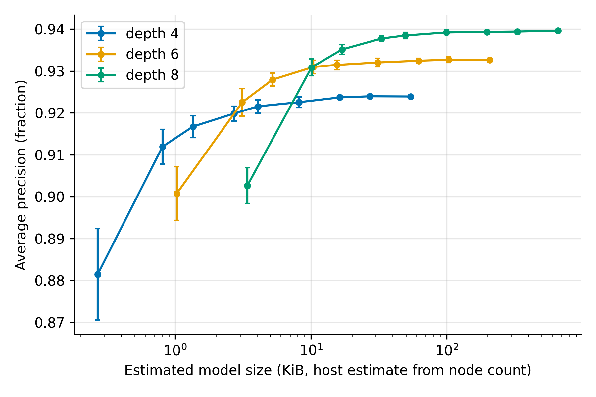

### 4.5 Severity: delta-V, ASI and the sensor range and rate

This section asks what an IMU has to measure for the severity code to work. Delta-V is checked against crash tests, and the effect of the accelerometer range, sample rate and bandwidth is measured on the tests. VZCrash has no severity labels, so on VZCrash the severity measures are described, not scored. **The classes indicate crash severity (how hard the velocity changed), not injury.**

**Reference and error.** The reference delta-V of a test is the largest resultant of the running integral of the original-rate, unclipped, baseline-removed horizontal acceleration within `300 ms` of the trigger. The 'error' of a sensor setting is the estimate against this reference, not against a true vehicle velocity change, which the database does not give. The sensor model is generic and ours: a 4th-order zero-phase low-pass at the front-end bandwidth (260 Hz unless stated), saturation at the range, a digital low-pass at `0.4` of the sample rate, then sampling. It is not the model of any one part.

### Table 20. Severity code on synthetic pulses with known answers (95% intervals on the shares) (SIMULATED)

| Sample rate | Clipping | Pulse duration | Windows | Median delta-V error (%) | 90th percentile (%) | Share within the delta-V tolerance | Median ASI error (%) | Share within the ASI tolerance |
|---|---|---|---|---|---|---|---|---|
| 100 Hz | no clipping | 80 ms and longer | 540 | 3.1 | 6.2 | 0.99 [0.98 to 1.00] | 0.3 | 1.00 [1.00 to 1.00] |
| 100 Hz | no clipping | shorter (40 ms) | 180 | 12.5 | 17.0 | 0.39 [0.32 to 0.46] | 0.5 | 1.00 [1.00 to 1.00] |
| 100 Hz | clipped at the sensor range | 80 ms and longer | 540 | 6.5 | 46.5 | 0.55 [0.51 to 0.59] | 1.6 | 0.58 [0.54 to 0.62] |
| 100 Hz | clipped at the sensor range | shorter (40 ms) | 180 | 19.6 | 50.6 | 0.16 [0.11 to 0.21] | 2.5 | 0.59 [0.52 to 0.67] |
| 50 Hz | no clipping | 80 ms and longer | 540 | 6.3 | 12.5 | 0.77 [0.74 to 0.81] | 1.9 | 0.99 [0.99 to 1.00] |
| 50 Hz | no clipping | shorter (40 ms) | 180 | 25.0 | 46.2 | 0.02 [0.01 to 0.04] | 8.7 | 0.85 [0.79 to 0.90] |
| 50 Hz | clipped at the sensor range | 80 ms and longer | 540 | 12.7 | 48.7 | 0.39 [0.35 to 0.43] | 6.8 | 0.57 [0.53 to 0.61] |
| 50 Hz | clipped at the sensor range | shorter (40 ms) | 180 | 38.9 | 65.5 | 0.01 [0.00 to 0.02] | 11.7 | 0.47 [0.39 to 0.53] |

Half-sine, triangular and square pulses in front, side and oblique directions, with gravity, noise, a tilted frame and a random sampling phase. The delta-V truth is analytic (half-sine: 2 A T / pi). Stated tolerances: 10% for delta-V (the allowance for event data recorders in 49 CFR 563.7) and 10% for ASI, claimed for pulses of 80 ms and longer at 100 Hz. This proves the code, not real-world accuracy.

### Table 21. NHTSA frontal rigid-barrier tests: the physical band v <= delta-V <= 2 v (MEASURED_SOFTWARE)

| Signal | Inside the band | Share with 95% interval | Below v | Above 2 v | Restitution e = delta-V / v - 1: median (10th to 90th percentile) | Correlation of delta-V with v |
|---|---|---|---|---|---|---|
| original sample rate, after the 260 Hz front end, unclipped | 113 of 116 | 0.97 [0.94 to 1.00] | 3 | 0 | 0.088 (0.031 to 0.172) | 0.93 |
| resampled to 100 Hz, unclipped | 111 of 116 | 0.96 [0.92 to 0.99] | 5 | 0 | 0.078 (0.020 to 0.177) | 0.92 |
| 100 Hz and the sensor range (sensor model) | 8 of 116 | 0.07 [0.03 to 0.12] | 108 | 0 | -0.177 (-0.343 to -0.019) | 0.63 |

The median peak horizontal acceleration of these tests after the front-end filter is 42.1 g, and 1.00 of the frontal tests exceed the 16 g range.

### Table 22. Change in delta-V against the original recording, by sensor range at 100 Hz (95% intervals) (MEASURED_SOFTWARE)

| Sensor model | Median change in delta-V (%) | 90th percentile of the absolute change (%) | Largest absolute change (%) | Median change in ASI (%) |
|---|---|---|---|---|
| 100 Hz, no clipping (sample rate only) | -0.9 [-1.4 to -0.4] | 4.8 [4.0 to 6.0] | 8.0 | 0.2 [0.1 to 0.4] |
| 100 Hz, range 64 g | -1.0 [-1.6 to -0.5] | 5.7 [4.2 to 6.8] | 18.4 | 0.1 [0.0 to 0.3] |
| 100 Hz, range 32 g | -2.8 [-3.8 to -2.2] | 12.4 [7.4 to 17.4] | 40.4 | -1.6 [-3.0 to -1.1] |
| 100 Hz, range 16 g (our sensor) | -23.5 [-25.1 to -21.7] | 41.5 [35.4 to 47.2] | 60.8 | -30.7 [-32.9 to -28.9] |
| 100 Hz, range 8 g | -52.6 [-54.4 to -51.3] | 68.6 [63.9 to 73.6] | 85.3 | -59.4 [-60.6 to -57.5] |
| 100 Hz, range 16 g, 100 Hz front end (sensitivity) | -20.7 [-22.8 to -19.9] | 37.8 [31.9 to 42.3] | 60.1 | -29.0 [-30.6 to -25.7] |
| original rate, range 16 g (clipping only) | -23.8 [-25.8 to -21.0] | 38.6 [34.3 to 42.6] | 77.0 | -31.1 [-33.1 to -29.4] |

**Sensor range and rate study.** All 176 tests (116 frontal, 60 side), range `{16, 32, 64, 100, 200}` g by rate `{100, 200, 400, 800, 1600}` Hz, 260 Hz front end, the pulse-release rule of the next paragraph. Error is against the reference delta-V.

### Table 23. Share of tests with delta-V within ±10% of the reference, by range and rate (95% intervals) (MEASURED_SOFTWARE)

| Range | `100 Hz` | `200 Hz` | `400 Hz` | `800 Hz` | `1600 Hz` |
|---|---|---|---|---|---|
| ±16 g | 0.07 [0.03 to 0.11] | 0.07 [0.03 to 0.11] | 0.08 [0.04 to 0.12] | 0.08 [0.04 to 0.12] | 0.09 [0.05 to 0.13] |
| ±32 g | 0.66 [0.59 to 0.73] | 0.73 [0.66 to 0.80] | 0.74 [0.68 to 0.81] | 0.75 [0.68 to 0.82] | 0.75 [0.68 to 0.82] |
| ±64 g | 0.78 [0.72 to 0.84] | 0.88 [0.83 to 0.93] | 0.90 [0.85 to 0.94] | 0.89 [0.84 to 0.93] | 0.90 [0.86 to 0.94] |
| ±100 g | 0.80 [0.74 to 0.86] | 0.90 [0.85 to 0.94] | 0.89 [0.84 to 0.93] | 0.89 [0.84 to 0.93] | 0.90 [0.85 to 0.94] |
| ±200 g | 0.80 [0.74 to 0.86] | 0.91 [0.86 to 0.95] | 0.91 [0.86 to 0.95] | 0.90 [0.85 to 0.94] | 0.91 [0.86 to 0.95] |

### Table 24. Median and 90th-percentile absolute delta-V error (%), by range and rate (MEASURED_SOFTWARE)

| Range | `100 Hz` | `200 Hz` | `400 Hz` | `800 Hz` | `1600 Hz` |
|---|---|---|---|---|---|
| ±16 g | 25.7 / 51.0 | 25.0 / 47.4 | 25.3 / 47.4 | 25.0 / 46.3 | 24.8 / 46.2 |
| ±32 g | 6.8 / 26.4 | 4.9 / 22.4 | 4.7 / 19.7 | 4.1 / 19.3 | 4.1 / 19.6 |
| ±64 g | 3.9 / 17.3 | 2.9 / 10.3 | 2.7 / 9.9 | 2.5 / 10.3 | 2.6 / 9.5 |
| ±100 g | 3.5 / 15.2 | 2.9 / 9.8 | 2.7 / 10.7 | 2.5 / 10.3 | 2.6 / 10.0 |
| ±200 g | 3.5 / 15.4 | 2.9 / 9.1 | 2.7 / 8.6 | 2.5 / 8.4 | 2.5 / 8.5 |

### Table 25. Share of frontal tests inside v <= delta-V <= 2 v, by range and rate (MEASURED_SOFTWARE)

| Range | `100 Hz` | `200 Hz` | `400 Hz` | `800 Hz` | `1600 Hz` |
|---|---|---|---|---|---|
| ±16 g | 0.07 | 0.07 | 0.08 | 0.09 | 0.09 |
| ±32 g | 0.76 | 0.82 | 0.81 | 0.81 | 0.81 |
| ±64 g | 0.95 | 0.97 | 0.97 | 0.96 | 0.96 |
| ±100 g | 0.97 | 0.97 | 0.97 | 0.97 | 0.97 |
| ±200 g | 0.96 | 0.97 | 0.97 | 0.97 | 0.97 |

**Answer.** At least ±64 g and 200 Hz give delta-V within ±10% on at least 80% of the tests (14 of `25` cells reach 80%; 12 also have the lower end of the interval at or above 80%). The current setting, ±16 g at 100 Hz, reaches 0.07 [0.03 to 0.11]. At 32 g, the share is 0.74 at `400 Hz`: not enough on this front end.

### Table 26. The same study for frontal and side tests separately: share within ±10% at `400 Hz` (MEASURED_SOFTWARE)

| Range | Frontal tests | Side tests |
|---|---|---|
| ±16 g | 0.06 | 0.12 |
| ±32 g | 0.84 | 0.57 |
| ±64 g | 0.97 | 0.75 |
| ±100 g | 0.97 | 0.73 |
| ±200 g | 0.98 | 0.77 |

### Table 27. Front-end bandwidth sweep at 1600 Hz sampling: median absolute delta-V error (%) and share within ±10% (MEASURED_SOFTWARE)

| Front-end bandwidth | ±16 g | ±32 g | ±64 g | ±200 g |
|---|---|---|---|---|
| `50 Hz` | 20.4 / 0.17 | 3.4 / 0.81 | 2.9 / 0.87 | 2.7 / 0.88 |
| `100 Hz` | 21.0 / 0.14 | 3.1 / 0.81 | 2.4 / 0.90 | 2.4 / 0.91 |
| `260 Hz` | 24.8 / 0.09 | 4.1 / 0.75 | 2.6 / 0.90 | 2.5 / 0.91 |
| `500 Hz` | 28.5 / 0.06 | 5.8 / 0.69 | 2.7 / 0.88 | 2.6 / 0.89 |
| `1000 Hz` | 32.3 / 0.02 | 7.8 / 0.56 | 2.9 / 0.85 | 2.6 / 0.89 |

A narrower front end smooths the spikes before they reach the range limit, so ±32 g is enough at 100 Hz bandwidth or below, while a wide front end needs the wider range. The front-end filter is our generic model, not a part's measured response.

### Table 28. Named accelerometers through the same model (range, rate and resolution from the datasheets; 95% intervals) (MEASURED_SOFTWARE)

| Part and setting | Median absolute error (%) | Share within ±10% | Share within ±20% | Frontal share in the physical band |
|---|---|---|---|---|
| `MPU-6050 +-16 g, 100 Hz (current setting)` | 25.7 [24.4 to 27.9] | 0.07 [0.03 to 0.11] | 0.27 | 0.07 |
| `MPU-6050 +-16 g, 1000 Hz` | 24.8 [23.2 to 27.4] | 0.08 [0.04 to 0.12] | 0.31 | 0.09 |
| `ADXL345 +-16 g, 100 Hz` | 25.7 [24.3 to 27.8] | 0.07 [0.03 to 0.11] | 0.27 | 0.07 |
| `ADXL345 +-16 g, 3200 Hz` | 24.8 [23.3 to 27.6] | 0.09 [0.05 to 0.13] | 0.32 | 0.09 |
| `H3LIS331DL +-100 g, 1000 Hz` | 2.6 [2.2 to 2.9] | 0.90 [0.85 to 0.94] | 0.94 | 0.97 |
| `H3LIS331DL +-200 g, 1000 Hz` | 2.4 [2.1 to 3.0] | 0.91 [0.86 to 0.95] | 0.96 | 0.97 |
| `ADXL375 +-200 g, 800 Hz` | 2.5 [2.2 to 2.9] | 0.90 [0.85 to 0.94] | 0.97 | 0.97 |
| `ADXL375 +-200 g, 3200 Hz` | 2.5 [2.1 to 2.9] | 0.91 [0.86 to 0.95] | 0.96 | 0.97 |

### Table 29. Datasheet values of the four parts (read from the PDFs opened on `2026-11-11`) (ANALYTICAL)

| Part | Largest range (g) | Resolution at the largest range (mg per count) | Highest output rate (Hz) | Other |
|---|---|---|---|---|
| MPU-6050 | 16 | 0.488 | 1000 | `accelerometer low-pass programmable up to 260 Hz; noise 400 ug/sqrt(Hz)` |
| ADXL345 | 16 | 3.900 | 3200 | `bandwidth = output rate / 2; noise 0.75 LSB rms (x, y) and 1.1 LSB rms (z) at 100 Hz` |
| ADXL375 | 200 | 49.000 | 3200 | `bandwidth = output rate / 2` |
| H3LIS331DL | 400 | 195.000 | 1000 | `bandwidth = output rate / 2; ranges 100, 200 and 400 g` |

Sensor noise and quantisation are small against the pulses here (quantisation is included in the part runs; noise is not). A recommendation: a ±64 g or wider accelerometer sampled at 200 Hz or faster if severity is to be measured; the MPU-6050 and ADXL345 (±16 g) do not meet it on these tests.

**Release rule.** The old rule ended the pulse when horizontal acceleration stayed below 0.5 g for 50 ms. The new rule ends it when it stays below the larger of 0.5 g and a fraction of the pulse peak. The fraction was chosen on the 118 tuning tests only (median absolute delta-V error at 100 Hz without clipping) and scored once on the 58 held-out tests.

### Table 30. Release rule: tuning scores and the held-out result (MEASURED_SOFTWARE)

| Rule | Median absolute delta-V error on the tuning tests (%) |
|---|---|
| `absolute 0.5 g (old rule)` | 6.69 |
| `absolute 1.0 g` | 5.50 |
| `absolute 1.5 g` | 3.99 |
| `0.02 x peak` | 6.37 |
| `0.05 x peak` | 4.70 |
| `0.1 x peak (chosen)` | 3.45 |
| `0.15 x peak` | 4.27 |
| `0.2 x peak` | 4.91 |
| `0.3 x peak` | 6.84 |
| `0.4 x peak` | 10.34 |

| Held-out tests, 100 Hz, no clipping | Median absolute error (%) | Share within ±10% |
|---|---|---|
| old rule (0.5 g) | 7.53 [4.19 to 15.64] | 0.52 [0.38 to 0.64] |
| new rule | 3.76 [2.41 to 6.44] | 0.79 [0.67 to 0.90] |

The paired difference in the median absolute error (new minus old, same held-out tests) is -3.76 points with a 95% interval of -10.25 to -1.36: the whole interval is below zero. On VZCrash crash pulses, a share of 0.67 [0.66 to 0.67] still run to the 250 ms cap (descriptive: the noisy dashcam signal rarely stays quiet; with the old rule it was 0.67).

**Rollover.** The gyro-angle flag fires on normal driving, so a drift correction was tried: the gravity direction before the trigger is carried through the crash with the gyro, and the part of the final tilt that the gravity vector at the quiet end of the window does not confirm is removed. VZCrash has no rollover labels, so this is a false-alarm check, not an accuracy result.

### Table 31. Rollover flag rate by VZCrash class, before and after the drift correction (95% intervals) (MEASURED_SOFTWARE)

| Class | Integrated roll or pitch of 90 degrees or more | Gravity-frame tilt after the correction | Share of events where the correction could be applied |
|---|---|---|---|
| crash | 0.0146 [0.0133 to 0.0160] | 0.0147 [0.0133 to 0.0160] | 0.70 |
| near_miss | 0.0005 [0.0000 to 0.0014] | 0.0005 [0.0000 to 0.0014] | 0.86 |
| normal_driving | 0.0203 [0.0178 to 0.0228] | 0.0177 [0.0154 to 0.0202] | 0.77 |

On normal driving the corrected flag still fires on 0.0177 of events, above 0.5%, so **the rollover flag is kept out of the severity rule** (`SEV_ROLLOVER_IN_CLASS` is off). The same share of normal-driving windows reach a tilt of 90 degrees without the correction (0.0200), so the false alarms are not mainly drift; likely causes are gyro scale or unit differences between devices (the dataset mixes gyro resolutions).

### Table 32. VZCrash triggered events: severity measures by class (95% intervals on the medians and shares) (MEASURED_SOFTWARE)

| Class | Delta-V median (km/h) | Delta-V 95th percentile | ASI median | ASI 95th percentile | Peak pulse median (g) | Share of pulses at the maximum length |
|---|---|---|---|---|---|---|
| crash | 4.37 [4.32 to 4.43] | 13.1 | 0.206 [0.204 to 0.208] | 0.415 | 3.1 | 0.67 [0.66 to 0.67] |
| near_miss | 1.29 [1.19 to 1.39] | 6.4 | 0.083 [0.082 to 0.086] | 0.192 | 1.4 | 0.34 [0.32 to 0.36] |
| normal_driving | 1.10 [1.07 to 1.13] | 5.8 | 0.092 [0.091 to 0.093] | 0.218 | 1.6 | 0.36 [0.35 to 0.37] |

| Class | Low | Moderate | Severe | Critical |
|---|---|---|---|---|
| crash | 0.999 [0.999 to 0.999] | 0.001 [0.001 to 0.002] | 0.000 [0.000 to 0.000] | 0.000 [0.000 to 0.000] |
| near_miss | 1.000 [1.000 to 1.000] | 0.000 [0.000 to 0.000] | 0.000 [0.000 to 0.000] | 0.000 [0.000 to 0.000] |
| normal_driving | 1.000 [1.000 to 1.000] | 0.000 [0.000 to 0.000] | 0.000 [0.000 to 0.000] | 0.000 [0.000 to 0.000] |

43756 triggered events, all splits; no severity labels exist, so no accuracy claim is made. THIV is UNVERIFIED (its flail distances are in doubt) and is left out of the tables and of every claim; it does not enter the class.

### Table 33. Delta-V and ASI used alone as a crash score, de-duplicated test set (MEASURED_SOFTWARE)

| Score | AP | ROC-AUC |
|---|---|---|
| ASI | 0.924 | 0.852 |
| Resultant delta-V | 0.899 | 0.813 |
| Peak pulse acceleration | 0.888 | 0.794 |
| Mean pulse acceleration | 0.851 | 0.731 |
| Specific energy | 0.899 | 0.813 |
| Pulse duration | 0.786 | 0.688 |
| Peak acceleration of the window (baseline) | 0.882 | 0.787 |
| Delta-V with a looser release level (1.0 g, absolute) | 0.908 | 0.825 |
| Delta-V with a looser release level (1.5 g, absolute) | 0.896 | 0.804 |

Crashes are 0.688 of these 5750 triggered test events, so an AP near that value means no skill.

### Table 34. Class mix when each class limit is moved by ±20% (NHTSA tests with the reference delta-V; VZCrash crash events) (MEASURED_SOFTWARE)

| Limit moved | NHTSA reference: Low | NHTSA reference: Moderate | NHTSA reference: Severe | NHTSA reference: Critical | VZCrash crash: Low | VZCrash crash: Moderate |
|---|---|---|---|---|---|---|
| `base` | 0.01 | 0.26 | 0.16 | 0.56 | 0.999 | 0.001 |
| `dv_low_moderate.x0.8` | 0.00 | 0.27 | 0.16 | 0.56 | 0.994 | 0.006 |
| `dv_low_moderate.x1.2` | 0.03 | 0.24 | 0.16 | 0.56 | 1.000 | 0.000 |
| `dv_moderate_severe.x0.8` | 0.01 | 0.25 | 0.18 | 0.56 | 0.999 | 0.001 |
| `dv_moderate_severe.x1.2` | 0.01 | 0.28 | 0.15 | 0.56 | 0.999 | 0.001 |
| `dv_severe_critical.x0.8` | 0.01 | 0.26 | 0.08 | 0.65 | 0.999 | 0.001 |
| `dv_severe_critical.x1.2` | 0.01 | 0.26 | 0.30 | 0.43 | 0.999 | 0.001 |
| `asi_A_B.x0.8` | 0.00 | 0.27 | 0.16 | 0.56 | 0.999 | 0.001 |
| `asi_A_B.x1.2` | 0.04 | 0.23 | 0.16 | 0.56 | 0.999 | 0.001 |
| `asi_B_C.x0.8` | 0.01 | 0.06 | 0.37 | 0.56 | 0.999 | 0.001 |
| `asi_B_C.x1.2` | 0.01 | 0.32 | 0.10 | 0.56 | 0.999 | 0.001 |
| `asi_C_over.x0.8` | 0.01 | 0.26 | 0.10 | 0.62 | 0.999 | 0.001 |
| `asi_C_over.x1.2` | 0.01 | 0.26 | 0.17 | 0.56 | 0.999 | 0.001 |
| `all_dv.x0.8` | 0.00 | 0.26 | 0.09 | 0.65 | 0.994 | 0.006 |
| `all_dv.x1.2` | 0.03 | 0.26 | 0.28 | 0.43 | 1.000 | 0.000 |
| `all_asi.x0.8` | 0.00 | 0.07 | 0.31 | 0.62 | 0.999 | 0.001 |
| `all_asi.x1.2` | 0.04 | 0.30 | 0.11 | 0.56 | 0.999 | 0.001 |

`dv_low_moderate` is the 24 km/h limit, `dv_moderate_severe` 40 km/h, `dv_severe_critical` 56 km/h; `asi_A_B`, `asi_B_C`, `asi_C_over` are the ASI limits; `x0.8` and `x1.2` move the limit by minus and plus 20%.

### Table 35. C version of the severity code against Python; pure-Python float32 mirror of the C code against Python (MEASURED_SOFTWARE)

| Windows | Count | C: max difference in delta-V (km/h) | C: max difference in ASI | C: different class | Mirror: delta-V | Mirror: ASI | Mirror: different class | Mirror: different rollover flag |
|---|---|---|---|---|---|---|---|---|
| VZCrash test windows | 5863 | 1.80e-05 | 3.07e-07 | 0 | 1.38e-05 | 2.37e-07 | 0 | 0 |
| NHTSA windows (100 Hz, sensor model) | 176 | 1.35e-05 | 4.06e-07 | 0 | 1.35e-05 | 4.31e-07 | 0 | 0 |

The C header is `firmware_export/severity.h` (no heap). It was compiled and run on the host; it has not been run on the ESP32. If Windows blocks the compiled program the C columns say NOT_RUN and the mirror columns remain.

**Figure 9.** Median delta-V error, share within ±10%, and physical-band share for each range and sample rate. (MEASURED_SOFTWARE)  
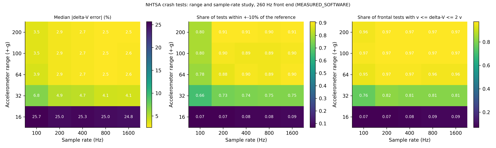

**Figure 10.** Median absolute delta-V error against front-end bandwidth for four ranges. (MEASURED_SOFTWARE)  
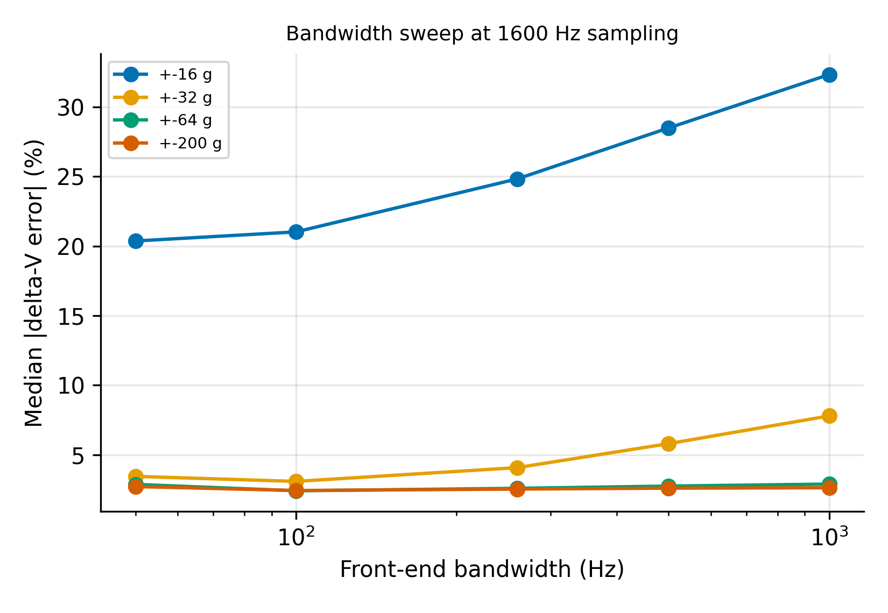

**Figure 11.** NHTSA frontal tests: delta-V against impact speed with the v and 2 v lines, the change for different sensor ranges, and ASI against peak acceleration. (MEASURED_SOFTWARE)  
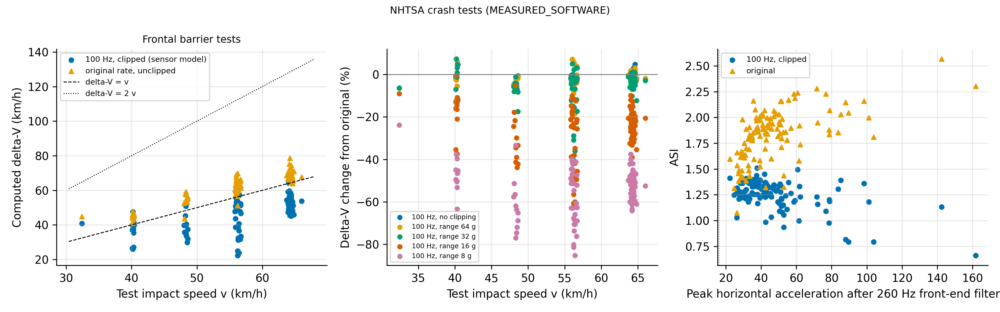

**Figure 12.** Severity code on synthetic pulses: delta-V error against pulse duration. (SIMULATED)  
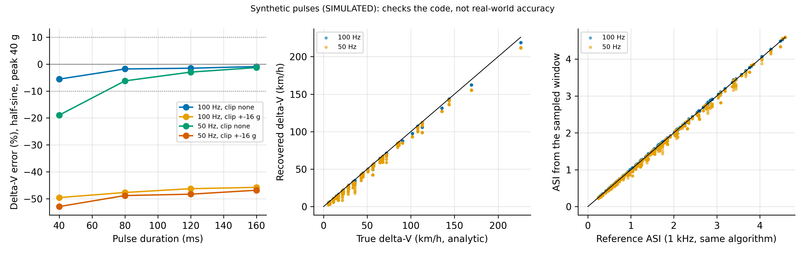

**Figure 13.** VZCrash triggered events: distributions of delta-V, ASI and THIV (UNVERIFIED, not used in any claim) by class, and the share of each severity class. (MEASURED_SOFTWARE)  
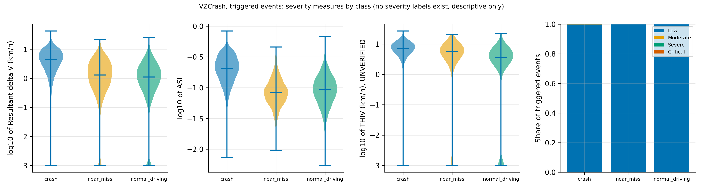

### 4.6 Security

### Table 36. Attack suite (software simulation of the reference verifier) (SIMULATED)

| Case | Expected | Observed | Match |
|---|---|---|---|
| packet length | 97 | 97 | yes |
| ACK length | 26 | 26 | yes |
| Valid alert | accept | accept | yes |
| Valid alert gets a valid ACK | True | True | yes |
| Forged tag | reject_tag | reject_tag | yes |
| Alert signed with the wrong key | reject_tag | reject_tag | yes |
| Tampered field (severity) | reject_tag | reject_tag | yes |
| Tampered field (counter) | reject_tag | reject_tag | yes |
| Tampered field (delta-V, bytes 38-39) | reject_tag | reject_tag | yes |
| Tampered field (ASI, bytes 40-41) | reject_tag | reject_tag | yes |
| Delta-V and ASI fields round-trip in the 97-byte alert | True | True | yes |
| Replay (same packet again): not processed again, same ACK re-sent | reack | reack | yes |
| Replay leaves the base state unchanged | True | True | yes |
| Strict verifier (before the fix): ACK lost, car retries the same packet | reject_counter | reject_counter | yes |
| ACK lost, car retries same packet: re-ACKed | reack | reack | yes |
| The re-ACK is accepted by the car | True | True | yes |
| Old counter, different content: rejected | reject_counter | reject_counter | yes |
| Same counter, different content (event changed): rejected | reject_counter | reject_counter | yes |
| Replay of an alert older than the re-ACK window: rejected | reject_counter | reject_counter | yes |
| Retry of the same event with a fresh counter | accept | accept | yes |
| Forged alert does not advance the counter | True | True | yes |
| Wrong length (truncated) | reject_length | reject_length | yes |
| Wrong message type (alert with type 2) | reject_type | reject_type | yes |
| Wrong version | reject_version | reject_version | yes |
| Valid ACK fed to the base as an alert (reflection) | reject_length | reject_length | yes |
| Spoofed ACK (attacker key) | reject | reject | yes |
| Spoofed ACK (random tag) | reject | reject | yes |
| Old ACK replayed for a later alert | reject | reject | yes |
| Genuine ACK for the waiting alert | accept | accept | yes |
| Alert bytes presented as an ACK | reject | reject | yes |
| Base reboot, counter persisted: replay not processed again | reack | reack | yes |
| Base reboot, counter persisted: older replay rejected | reject_counter | reject_counter | yes |
| Base reboot, counter lost: replay | accept | accept | yes |
| Replay flood, no limit: the base keeps ACKing until its duty-cycle budget is gone | budget exhausted | budget exhausted | yes |
| Replay flood, no limit: a genuine alert arriving during the flood gets no ACK | accept_no_ack | accept_no_ack | yes |
| Replay flood, with limit: at most one re-ACK per retry interval | True | True | yes |
| Replay flood, with limit: the base never runs out of budget | True | True | yes |
| Replay flood, with limit: a genuine alert arriving during the flood is ACKed | accept | accept | yes |
| Replay flood, with limit: re-ACK airtime is lower than without the limit | True | True | yes |
| Limit on: a retry inside the retry interval is not re-ACKed | reack_limited | reack_limited | yes |
| Limit on: a genuine retry one interval after the ACK is still re-ACKed | reack | reack | yes |
| Every single-bit flip of a valid alert is rejected | True | True | yes |
| Truncated or padded alerts (every other length) are rejected | True | True | yes |
| All-zero packet of the alert length is rejected | reject_version | reject_version | yes |
| All-ones packet of the alert length is rejected | reject_version | reject_version | yes |
| Every single-bit flip of a valid ACK is rejected by the node | True | True | yes |
| Counter exhausted (largest value seen): a node whose counter wraps to 0 is rejected | reject_counter | reject_counter | yes |
| Alert for another node_id signed with the shared key is accepted | accept | accept | yes |

'reack' means the base sends the identical ACK again without processing the alert a second time. Our own testing found that a strict anti-replay rule blocks the retry of an alert whose ACK was lost (the row marked 'before the fix'); the idempotent re-ACK repairs this. Documented limits, not fixed: a recorded alert is accepted again if the base loses its counter store; the 32-bit counter cannot wrap without a key change; one key is shared, so anyone holding it can sign for any node. A property-based test (hypothesis) checks that the counter never goes backwards, that a re-ACK is idempotent, that any single-bit flip and any truncation or padding is rejected, and the parser is fuzzed with random and mutated input: every outcome is accept or reject and nothing crashes. These are software tests, not measurements on the radios.

### Table 37. Replay flood against the re-ACK, with and without the limit (SIMULATED)

| Base station | Replayed packets | Re-ACKs sent | Re-ACK airtime (s) | Refused: no budget | Refused: limit | Genuine alert during the flood | Budget left (s) |
|---|---|---|---|---|---|---|---|
| no limit | 2400 | 679 | 41.9 | 1721 | 0 | accept_no_ack | 0.0 |
| one re-ACK per event per retry interval | 2400 | 266 | 16.4 | 0 | 2134 | accept | 25.4 |

One captured alert is replayed 20 times a second for 120 s against a base station at SF7 with 30 s of duty-cycle budget left. A flood long enough still uses up the budget.

### Table 38. Forgery and counter analysis (ANALYTICAL)

| Spreading factor | 97 B alert airtime (ms) | Forgery attempts per second at the airtime limit | Expected years to one accepted forgery, airtime limit | Same at the 10% duty cycle |
|---|---|---|---|---|
| SF7 | 169.2 | 5.910 | 9.89e+10 | 9.89e+11 |
| SF9 | 533.5 | 1.874 | 3.12e+11 | 3.12e+12 |
| SF12 | 3940.4 | 0.254 | 2.30e+12 | 2.30e+13 |

The tag has 64 bits, so one blind attempt is accepted with probability 5.42e-20 and one expected success needs 1.84e+19 attempts. This assumes the key stays secret; it says nothing about key theft. The counter has 4.29e+09 values. At the fastest legal rate (SF7, 10% duty cycle: 2127 alerts per hour) it wraps after 230 years; at one alert per minute after 8166 years. A replay flood and a counter store that is lost are the real limits (above); there is no key rotation.

### 4.7 End-to-end software replay

Real VZCrash test events are replayed through the whole chain in software: trigger, window, features, the deployed model, the severity class, the cancel window, a signed alert (real HMAC), the duty-cycle limiter, a lossy channel, the base verifier with idempotent re-ACK, and the signed ACK back. The event pool (model probabilities, severity classes) is MEASURED_SOFTWARE; arrivals, losses and stage times are SIMULATED with the assumptions below. **These are not hardware measurements; hardware test H3 would replace them.**

Assumptions: Poisson alert arrivals at a stated rate, each alert a random draw from the events the model called a crash (4616 alerts, of which 881 are false alarms); window fill 1.8 s; on-device compute 0.05 s (not measured: NOT_RUN on the ESP32); cancel windows of 10, 8, 6 and 5 s for Low to Critical; no driver cancels; one node and one base; no collisions. Loss is independent per transmission, or a two-state burst model (Gilbert-Elliott: bad-state loss 0.9, a burst ends with probability 0.3 per transmission) with the same mean loss; alert and ACK directions have separate chains. The re-ACK limit is on. Each cell is 100 simulated hours (20 hours for each of five seeds) with bootstrap intervals over hours.

### Table 39. Severity mix of the alerts the replay sends (MEASURED_SOFTWARE)

| Source | Low | Moderate | Severe | Critical |
|---|---|---|---|---|
| VZCrash alerts (real replay mix) | 0.999 | 0.001 | 0.000 | 0.000 |
| NHTSA tests through the 16 g sensor | 0.193 | 0.307 | 0.432 | 0.068 |
| Stress mix (assumed) | `0.4` | `0.3` | `0.2` | `0.1` |

The VZCrash mix comes from the deployed model's alerts and the severity code (the rollover flag is out of the class rule). The NHTSA mix shows what the 16 g sensor would report for full-speed crashes. The stress mix is an assumption (the mix used in the earlier delivery simulation) so that all four classes appear.

### Table 40. Replay with the stress mix at 30% loss: delivery, latency and budget, by spreading factor, loss model and policy (SIMULATED)

| SF | Loss model | Policy | Alerts acknowledged | Critical alerts acknowledged | Median trigger-to-ACK, critical (s) | 95th percentile (s) | Mean retries | Share of the node's duty-cycle budget used |
|---|---|---|---|---|---|---|---|---|
| SF7 | independent | none | 0.48 [0.46 to 0.50] | 0.45 [0.38 to 0.53] | 7.2 | 7.2 | 0.00 | 0.010 |
| SF7 | independent | fixed3 | 0.94 [0.93 to 0.95] | 0.96 [0.94 to 0.98] | 7.5 | 7.7 | 0.90 | 0.019 |
| SF7 | independent | severity | 0.86 [0.85 to 0.88] | 1.00 [1.00 to 1.00] | 7.6 | 8.0 | 0.81 | 0.018 |
| SF7 | burst | none | 0.50 [0.46 to 0.53] | 0.45 [0.36 to 0.53] | 7.2 | 7.2 | 0.00 | 0.009 |
| SF7 | burst | fixed3 | 0.87 [0.85 to 0.89] | 0.81 [0.75 to 0.87] | 7.3 | 7.4 | 0.82 | 0.017 |
| SF7 | burst | severity | 0.84 [0.82 to 0.86] | 0.97 [0.94 to 0.99] | 7.6 | 8.0 | 0.81 | 0.017 |
| SF9 | independent | none | 0.51 [0.49 to 0.53] | 0.52 [0.43 to 0.59] | 7.7 | 7.7 | 0.00 | 0.028 |
| SF9 | independent | fixed3 | 0.94 [0.93 to 0.95] | 0.92 [0.87 to 0.96] | 8.4 | 8.8 | 0.91 | 0.054 |
| SF9 | independent | severity | 0.89 [0.87 to 0.90] | 1.00 [1.00 to 1.00] | 8.5 | 9.3 | 0.77 | 0.050 |
| SF9 | burst | none | 0.47 [0.44 to 0.50] | 0.48 [0.41 to 0.57] | 7.7 | 7.7 | 0.00 | 0.031 |
| SF9 | burst | fixed3 | 0.87 [0.85 to 0.89] | 0.89 [0.85 to 0.94] | 8.0 | 8.5 | 0.75 | 0.054 |
| SF9 | burst | severity | 0.86 [0.84 to 0.88] | 0.99 [0.98 to 1.00] | 8.6 | 9.6 | 0.72 | 0.053 |
| SF12 | independent | none | 0.49 [0.46 to 0.51] | 0.47 [0.40 to 0.55] | 12.6 | 12.6 | 0.00 | 0.216 |
| SF12 | independent | fixed3 | 0.93 [0.92 to 0.94] | 0.93 [0.88 to 0.97] | 16.3 | 18.8 | 0.90 | 0.410 |
| SF12 | independent | severity | 0.86 [0.85 to 0.88] | 1.00 [1.00 to 1.00] | 17.1 | 20.3 | 0.78 | 0.385 |
| SF12 | burst | none | 0.48 [0.45 to 0.52] | 0.42 [0.34 to 0.50] | 12.7 | 12.7 | 0.00 | 0.218 |
| SF12 | burst | fixed3 | 0.86 [0.84 to 0.88] | 0.84 [0.77 to 0.90] | 15.2 | 17.6 | 0.84 | 0.401 |
| SF12 | burst | severity | 0.81 [0.79 to 0.83] | 0.98 [0.96 to 0.99] | 20.6 | 28.1 | 0.91 | 0.414 |

Trigger-to-ACK time includes the window fill, the compute time and the cancel window (about 5 s for critical alerts), so it is dominated by those stages; the radio part is the remainder. Per-class results for every class, loss from 0 to 60%, and the real VZCrash and NHTSA mixes are in `results/tables/replay_grid.csv`.

### Table 41. Replay with the real VZCrash mix at 30% loss (all alerts are Low): delivery by policy (SIMULATED)

| SF | Policy | Alerts acknowledged | Median trigger-to-ACK (s) | 95th percentile (s) | Mean retries | Share of budget used |
|---|---|---|---|---|---|---|
| SF7 | none | 0.48 [0.46 to 0.50] | 12.2 | 12.2 | 0.00 | 0.010 |
| SF7 | fixed3 | 0.94 [0.93 to 0.95] | 12.4 | 13.2 | 0.91 | 0.018 |
| SF7 | severity | 0.73 [0.71 to 0.75] | 12.2 | 12.6 | 0.53 | 0.015 |
| SF12 | none | 0.49 [0.47 to 0.51] | 17.5 | 18.1 | 0.00 | 0.213 |
| SF12 | fixed3 | 0.93 [0.92 to 0.94] | 20.1 | 32.0 | 0.90 | 0.402 |
| SF12 | severity | 0.74 [0.72 to 0.76] | 18.4 | 23.4 | 0.51 | 0.320 |

### Table 42. Base station already near its duty-cycle budget (2 s left), 60 alerts per hour, 30% loss: critical alerts (SIMULATED)

| SF | Policy | Base budget | Critical alerts acknowledged | Median trigger-to-ACK (s) | Base ACK airtime (share of budget) | Critical alerts never sent |
|---|---|---|---|---|---|---|
| SF7 | fixed3 | full budget | 0.933 | 7.4 | 0.014 | 0.000 |
| SF7 | fixed3 | 2 s left | 0.931 | 7.5 | 0.014 | 0.000 |
| SF7 | severity | full budget | 0.999 | 7.5 | 0.013 | 0.000 |
| SF7 | severity | 2 s left | 0.999 | 7.5 | 0.013 | 0.000 |
| SF9 | fixed3 | full budget | 0.919 | 8.2 | 0.046 | 0.000 |
| SF9 | fixed3 | 2 s left | 0.933 | 8.1 | 0.046 | 0.000 |
| SF9 | severity | full budget | 1.000 | 8.2 | 0.043 | 0.000 |
| SF9 | severity | 2 s left | 1.000 | 8.4 | 0.043 | 0.000 |
| SF12 | fixed3 | full budget | 0.916 | 17.4 | 0.356 | 0.000 |
| SF12 | fixed3 | 2 s left | 0.899 | 17.6 | 0.364 | 0.000 |
| SF12 | severity | full budget | 1.000 | 17.0 | 0.334 | 0.000 |
| SF12 | severity | 2 s left | 1.000 | 16.6 | 0.341 | 0.000 |

### Table 43. Replay flood inside the replay pipeline: alerts that arrive during the flood (SIMULATED)

| Mix | Re-ACK limit | Alerts acknowledged while the flood runs | Alerts acknowledged outside it | Base ACK airtime (s) | Replayed packets |
|---|---|---|---|---|---|
| stress | limit off | 0.405 [0.344 to 0.460] | 0.985 [0.982 to 0.987] | 53.7 | 2400 |
| stress | limit on | 0.975 [0.957 to 0.990] | 0.983 [0.981 to 0.986] | 24.6 | 2400 |
| vzcrash | limit off | 0.275 [0.224 to 0.323] | 0.963 [0.960 to 0.967] | 53.5 | 2400 |
| vzcrash | limit on | 0.960 [0.932 to 0.983] | 0.965 [0.961 to 0.968] | 24.4 | 2400 |

A captured alert is replayed 20 times a second for 120 s at SF7 with a base station that has 30 s of budget left; genuine alerts arrive at 120 per hour with the severity table. The limit is one re-ACK per event per retry interval.

### Table 44. Which conclusions survive when the assumptions change (cells where the interval condition holds, of all cells) (SIMULATED)

| Conclusion | Stress mix | NHTSA mix | Real VZCrash mix |
|---|---|---|---|
| Retries beat no retry (paired interval above zero) | 64 of 64 | 64 of 64 | 64 of 64 |
| Severity table not worse than fixed for critical alerts (lower bound above `-0.02`) | 64 of 64 | 63 of 64 | n/a (no critical alerts in this mix) |
| Severity table better for critical alerts | 54 of 64 | 54 of 64 | n/a (no critical alerts in this mix) |
| Severity table delivers fewer low alerts | 64 of 64 | 62 of 64 | 64 of 64 |
| Burst loss lowers delivery against independent loss at the same mean | 11 of 18 | 11 of 18 | 11 of 18 |
| Severity table uses less of the budget | 40 of 64 | 2 of 64 | 64 of 64 |

The cells are the grid (three spreading factors, two loss models, six loss levels) and the sensitivity cells (event rate, ACK loss, cancel window, base or node near its budget). Conclusions that do not hold in every cell are the ones that depend on the assumption: the budget saving of the severity table depends on the mix, and the burst-loss effect is not significant at low loss.

### Table 45. Stages from the trigger to the ACK for a lossless exchange at SF7 (ANALYTICAL)

| Class | Window fill (s) | Compute (s) | Cancel window (s) | Alert on air (s) | Base processing (s) | ACK on air (s) | Total (s) |
|---|---|---|---|---|---|---|---|
| low | `1.8` | `0.05` | `10` | `0.169` | `0.1` | `0.062` | 12.18 |
| moderate | `1.8` | `0.05` | `8` | `0.169` | `0.1` | `0.062` | 10.18 |
| severe | `1.8` | `0.05` | `6` | `0.169` | `0.1` | `0.062` | 8.18 |
| critical | `1.8` | `0.05` | `5` | `0.169` | `0.1` | `0.062` | 7.18 |

The stage times are the stated assumptions and the analytical airtime; the table values in the leading columns are the configured constants. H3 on hardware would measure them.

**Figure 14.** Delivery against loss, independent and burst, three policies and three spreading factors. (SIMULATED)  
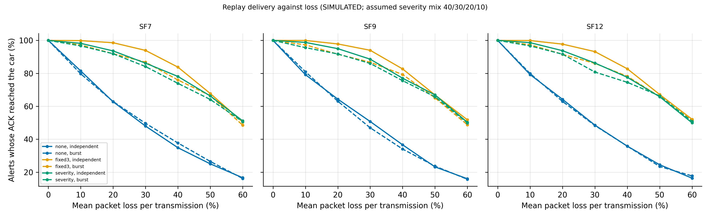

**Figure 15.** Trigger-to-ACK time per severity class. (SIMULATED)  
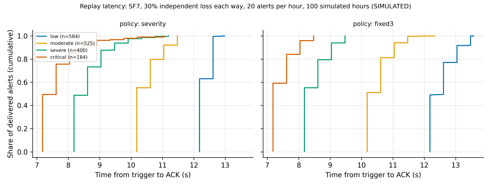

**Figure 16.** Cumulative node airtime during one simulated hour for the three policies. (SIMULATED)  
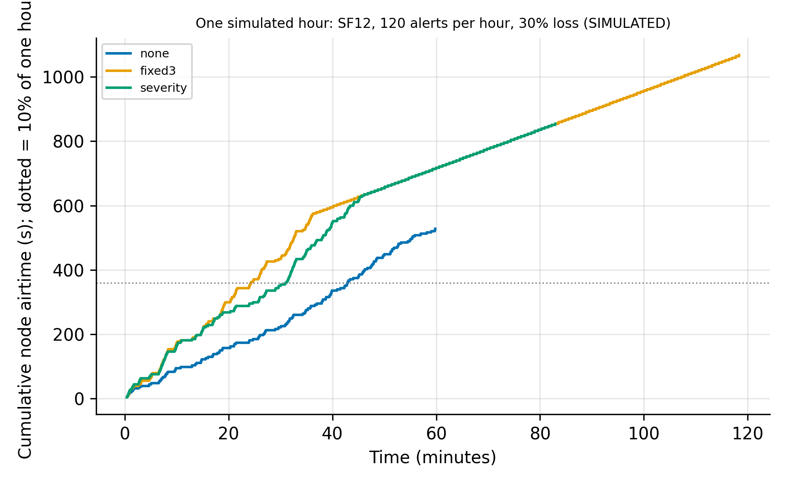

**Figure 17.** Pipeline stage timeline by severity class. (ANALYTICAL)  
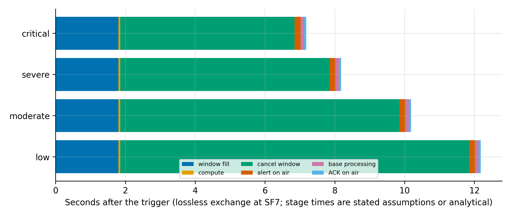

### 4.8 Proposed methods and evaluation

Three methods are proposed. Their baselines, splits, metrics and decision rules were written in `docs/02_preregistration/ALGORITHMS.md` before the runs (with a dated revision log). A method counts as an improvement only if its paired gain clears the 95% bootstrap interval on data it was not tuned on. If it does not, it is reported as no improvement found, with the same detail as a success.

#### N14. Saturation-aware severity estimator

A 16 g accelerometer clips real crash pulses, so plain delta-V is biased low. When a pulse reaches the range, the estimator fits a pulse model to the unsaturated rise and fall and fills the saturated samples (keeping the direction); the ordinary severity code then integrates the repaired signal. A deterministic grid fit is used so that the same rule runs in C. The pulse family (triangle) and the saturation level (0.7 of the range) were chosen on the 118 tuning tests; the 58 held-out tests were scored once. A learned correction (M+) is a ridge regression of the log of reference over estimate on three inputs (delta-V of the clipped signal, saturated share, pulse width); its strength was chosen by leave-one-test-out on the tuning tests.

### Table 46. N14 on the held-out NHTSA tests: baseline (B), fill (M) and fill plus ridge correction (M+), by sensor range at 100 Hz (95% intervals) (MEASURED_SOFTWARE)

| Range | Method | Tests | Median absolute error (%) | 90th percentile (%) | Share within ±10% | Share within ±20% | Frontal share in v <= delta-V <= 2 v |
|---|---|---|---|---|---|---|---|
| ±16 g | baseline (plain integration) | 58 | 22.9 [21.1 to 25.9] | 44.7 | 0.05 [0.00 to 0.10] | 0.33 | 0.03 [0.00 to 0.08] |
| ±16 g | fill | 58 | 15.4 [11.7 to 19.6] | 41.6 | 0.29 [0.17 to 0.41] | 0.64 | 0.49 [0.32 to 0.65] |
| ±16 g | fill + ridge | 58 | 11.5 [8.4 to 13.8] | 51.6 | 0.43 [0.29 to 0.55] | 0.71 | 0.73 [0.59 to 0.86] |
| ±32 g | baseline (plain integration) | 58 | 6.3 [4.4 to 7.6] | 24.4 | 0.69 [0.55 to 0.79] | 0.88 | 0.76 [0.62 to 0.89] |
| ±32 g | fill | 58 | 5.9 [4.1 to 7.6] | 24.4 | 0.69 [0.57 to 0.81] | 0.88 | 0.89 [0.78 to 0.97] |
| ±32 g | fill + ridge | 58 | 6.8 [3.7 to 8.4] | 24.4 | 0.69 [0.57 to 0.81] | 0.88 | 0.95 [0.86 to 1.00] |
| ±64 g | baseline (plain integration) | 58 | 3.8 [2.5 to 6.4] | 20.9 | 0.79 [0.67 to 0.90] | 0.90 | 0.95 [0.86 to 1.00] |
| ±64 g | fill | 58 | 3.8 [2.5 to 6.4] | 20.9 | 0.79 [0.67 to 0.90] | 0.90 | 0.95 [0.86 to 1.00] |
| ±64 g | fill + ridge | 58 | 3.8 [2.5 to 6.4] | 20.9 | 0.79 [0.67 to 0.90] | 0.90 | 0.95 [0.86 to 1.00] |

### Table 47. N14 paired comparison with the baseline on the same held-out tests (method minus baseline; negative median difference is better) (MEASURED_SOFTWARE)

| Range | Method | Difference in median absolute error (points), 95% interval | Difference in share within ±10%, 95% interval | Tests better | Tests worse | Primary endpoint |
|---|---|---|---|---|---|---|
| ±16 g | M | -7.56 [-10.88 to -3.76] | 0.24 [0.12 to 0.36] | 45 | 4 | clears the interval |
| ±16 g | M+ | -11.43 [-14.97 to -8.25] | 0.38 [0.22 to 0.52] | 47 | 9 | clears the interval |
| ±32 g | M | -0.44 [-1.88 to 1.24] | 0.00 [-0.07 to 0.07] | 21 | 10 | does not clear the interval |
| ±32 g | M+ | 0.49 [-2.33 to 2.45] | 0.00 [-0.09 to 0.09] | 19 | 14 | does not clear the interval |
| ±64 g | M | 0.00 [0.00 to 0.00] | 0.00 [0.00 to 0.00] | 0 | 0 | does not clear the interval |
| ±64 g | M+ | 0.00 [0.00 to 0.00] | 0.00 [0.00 to 0.00] | 0 | 0 | does not clear the interval |

**Result.** At ±16 g the fill clears the interval on the held-out tests (median absolute error 22.9% to 15.4%) and the ridge correction clears it (11.5%); the share within ±10% rises from 0.05 to 0.43. This is still far from the 80% target and from what a wider-range sensor gives (±32 g: 0.69), so the estimator repairs a 16 g sensor partly; it does not replace a wider range. The ridge weights are small and its strength was chosen as 100 (the strongest tried), so M+ is mostly a constant correction of about 0.15 in the logarithm. At ±32 g, 0.59 of tests reach the saturation level and at ±64 g only 0.02; the gain does not clear the interval at either range. **Failure cases** (held-out tests where the method is worse than the baseline): at ±16 g, 4 tests for M and 9 for M+ (listed with their errors in `results/tables/n14_failure_cases.csv`); at ±32 g, 10 and 14. They are tests where the model overshoots a pulse that is short or not shaped like the family.

### Table 48. N14 on synthetic saturated pulses with analytic delta-V: median absolute error (%) (SIMULATED)

| Range | Pulse shape | Saturated windows | Baseline | Fill |
|---|---|---|---|---|
| ±16 g | half-sine and triangular (matched) | 96 | 57.7 [46.5 to 65.9] | 47.5 [22.1 to 68.4] |
| ±16 g | square (mismatched) | 48 | 72.8 [61.9 to 81.2] | 72.8 [61.9 to 81.2] |
| ±32 g | half-sine and triangular (matched) | 72 | 44.8 [36.5 to 48.2] | 23.6 [18.5 to 41.7] |
| ±32 g | square (mismatched) | 36 | 62.1 [45.6 to 72.1] | 62.1 [45.6 to 72.1] |
| ±64 g | half-sine and triangular (matched) | 48 | 26.1 [10.9 to 33.8] | 15.1 [4.8 to 21.5] |
| ±64 g | square (mismatched) | 24 | 44.4 [25.0 to 59.1] | 44.4 [25.0 to 59.1] |

**C version.** The saturation test, the grid fit, the fill and the ridge correction are in `firmware_export/severity.h`. On 224 windows (216 saturated; NHTSA sensor windows and synthetic pulses) the pure-Python float32 mirror differs from the Python reference by at most 3.89e-05 km/h in the filled delta-V, with 0 different fit decisions. The compiled C code differs by at most 3.86e-05 km/h with 0 different decisions. Host estimates (ANALYTICAL): about 10360 bytes of static RAM added and 1998 bytes of object code added on the host; an ESP32 build will differ.

**Figure 18.** N14: estimated against reference delta-V on the held-out tests for the three methods and three ranges. (MEASURED_SOFTWARE)  
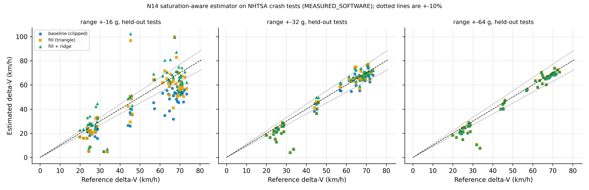

#### N14 against spline restoration, on four splits

Spline restoration of clipped acceleration (Ruder et al.; tested by Chan et al. (`2023`), opened) is the closest method, so it is the baseline N14 has to beat. It is defined in `docs/02_preregistration/ALGORITHMS.md` (N14 extension, written before the run): a 5th-order spline through 3 clean samples on each side of every clipped segment of the horizontal axes, no change where fewer than 3 clean samples exist on a side. Its saturation level (0.5 of the range) was chosen on the tuning tests of split G with the same rule as the fill's level. **No result in this subsection is a blind test.** The grouped held-out set of split G (58 tests in 56 groups; tuning 118 tests in 112 groups) had already been seen in the earlier N14 and release-rule results, so its numbers are called stable under re-splitting. Splits O and A reuse the settings chosen on the tuning tests of G (only the ridge is fitted again), and 30 of the 63 held-out tests of split A and 36 of the 58 of split O were tuning tests of G. Only split R repeats every choice inside the folds (132 make-and-model groups). Split A has 44 held-out groups (63 tests) and 88 tuning groups (113 tests). Intervals resample whole vehicle groups. The primary method for this comparison, set before the run, is fill + ridge; the earlier text named no single primary variant (a fact stated in `docs/02_preregistration/ALGORITHMS.md`).

### Table 49. N14 extension: delta-V error of plain integration, spline restoration, fill and fill + ridge on four splits (95% intervals resample vehicle groups) (MEASURED_SOFTWARE)

| Split | Range | Method | Tests / groups | Median absolute error (%) [95%] | 90th percentile (%) [95%] | Within ±10% | Within ±20% |
|---|---|---|---|---|---|---|---|
| O | ±16 g | plain | 58 / 57 | 26.1 [22.7 to 29.6] | 52.5 [44.4 to 63.6] | 0.02 | 0.24 |
| O | ±16 g | spline restoration | 58 / 57 | 25.5 [21.3 to 28.2] | 52.5 [42.3 to 61.8] | 0.09 | 0.34 |
| O | ±16 g | fill | 58 / 57 | 16.2 [11.9 to 21.8] | 41.0 [27.9 to 63.6] | 0.29 | 0.57 |
| O | ±16 g | fill + ridge | 58 / 57 | 14.4 [9.4 to 18.9] | 59.9 [27.0 to 82.6] | 0.41 | 0.67 |
| O | ±32 g | plain | 58 / 57 | 6.6 [4.2 to 9.1] | 26.3 [17.8 to 40.4] | 0.64 | 0.83 |
| O | ±32 g | spline restoration | 58 / 57 | 6.2 [4.2 to 8.3] | 26.3 [14.5 to 40.4] | 0.69 | 0.84 |
| O | ±32 g | fill | 58 / 57 | 6.1 [4.1 to 8.4] | 26.3 [16.1 to 40.4] | 0.69 | 0.83 |
| O | ±32 g | fill + ridge | 58 / 57 | 5.0 [4.1 to 7.5] | 23.9 [13.1 to 40.4] | 0.71 | 0.86 |
| O | ±64 g | plain | 58 / 57 | 3.4 [2.2 to 5.2] | 14.2 [9.9 to 24.4] | 0.81 | 0.91 |
| O | ±64 g | spline restoration | 58 / 57 | 3.4 [2.2 to 5.2] | 14.2 [9.9 to 24.4] | 0.81 | 0.91 |
| O | ±64 g | fill | 58 / 57 | 3.4 [2.2 to 5.2] | 14.2 [9.9 to 24.4] | 0.81 | 0.91 |
| O | ±64 g | fill + ridge | 58 / 57 | 3.4 [2.2 to 5.2] | 14.2 [9.9 to 24.4] | 0.81 | 0.91 |
| G | ±16 g | plain | 58 / 56 | 22.9 [20.6 to 25.6] | 44.7 [34.6 to 79.3] | 0.05 | 0.33 |
| G | ±16 g | spline restoration | 58 / 56 | 21.2 [16.7 to 24.7] | 43.2 [32.2 to 79.3] | 0.14 | 0.47 |
| G | ±16 g | fill | 58 / 56 | 15.4 [11.7 to 19.8] | 41.6 [26.2 to 84.7] | 0.29 | 0.64 |
| G | ±16 g | fill + ridge | 58 / 56 | 11.5 [8.1 to 13.8] | 51.6 [27.7 to 79.2] | 0.43 | 0.71 |
| G | ±32 g | plain | 58 / 56 | 6.3 [4.4 to 7.4] | 24.4 [15.4 to 46.2] | 0.69 | 0.88 |
| G | ±32 g | spline restoration | 58 / 56 | 6.1 [4.4 to 7.3] | 20.5 [14.1 to 46.2] | 0.71 | 0.90 |
| G | ±32 g | fill | 58 / 56 | 5.9 [4.2 to 7.3] | 24.4 [15.5 to 46.2] | 0.69 | 0.88 |
| G | ±32 g | fill + ridge | 58 / 56 | 6.8 [3.7 to 8.4] | 24.4 [14.6 to 46.2] | 0.69 | 0.88 |
| G | ±64 g | plain | 58 / 56 | 3.8 [2.5 to 5.8] | 20.9 [11.0 to 38.3] | 0.79 | 0.90 |
| G | ±64 g | spline restoration | 58 / 56 | 3.8 [2.5 to 5.8] | 20.9 [11.0 to 38.3] | 0.79 | 0.90 |
| G | ±64 g | fill | 58 / 56 | 3.8 [2.5 to 5.8] | 20.9 [11.0 to 38.3] | 0.79 | 0.90 |
| G | ±64 g | fill + ridge | 58 / 56 | 3.8 [2.5 to 5.8] | 20.9 [11.0 to 38.3] | 0.79 | 0.90 |
| A | ±16 g | plain | 63 / 44 | 25.6 [22.2 to 31.6] | 63.2 [47.4 to 77.4] | 0.05 | 0.27 |
| A | ±16 g | spline restoration | 63 / 44 | 24.4 [21.3 to 31.2] | 61.8 [44.7 to 77.4] | 0.10 | 0.33 |
| A | ±16 g | fill | 63 / 44 | 16.4 [11.5 to 22.2] | 64.8 [43.2 to 80.9] | 0.30 | 0.59 |
| A | ±16 g | fill + ridge | 63 / 44 | 13.7 [9.4 to 19.0] | 64.8 [49.6 to 76.8] | 0.41 | 0.62 |
| A | ±32 g | plain | 63 / 44 | 7.1 [4.2 to 10.1] | 47.6 [23.9 to 68.6] | 0.62 | 0.79 |
| A | ±32 g | spline restoration | 63 / 44 | 6.5 [4.2 to 9.3] | 47.6 [24.2 to 68.6] | 0.63 | 0.78 |
| A | ±32 g | fill | 63 / 44 | 5.2 [2.2 to 9.1] | 47.6 [23.9 to 68.6] | 0.63 | 0.79 |
| A | ±32 g | fill + ridge | 63 / 44 | 5.4 [3.1 to 8.7] | 47.6 [20.2 to 68.6] | 0.63 | 0.81 |
| A | ±64 g | plain | 63 / 44 | 4.0 [2.5 to 6.2] | 33.0 [16.0 to 52.1] | 0.73 | 0.84 |
| A | ±64 g | spline restoration | 63 / 44 | 4.0 [2.5 to 6.2] | 33.0 [16.0 to 52.1] | 0.73 | 0.84 |
| A | ±64 g | fill | 63 / 44 | 4.0 [2.5 to 6.2] | 33.0 [16.0 to 52.1] | 0.73 | 0.84 |
| A | ±64 g | fill + ridge | 63 / 44 | 4.0 [2.5 to 6.2] | 33.0 [16.0 to 52.1] | 0.73 | 0.84 |
| R | ±16 g | plain | 176 / 132 | 25.7 [24.4 to 27.9] | 51.0 [44.4 to 63.0] | 0.07 | 0.27 |
| R | ±16 g | spline restoration | 176 / 132 | 23.5 [21.2 to 25.7] | 51.8 [44.0 to 62.6] | 0.16 | 0.38 |
| R | ±16 g | fill | 176 / 132 | 16.5 [14.5 to 19.1] | 52.8 [40.2 to 65.1] | 0.29 | 0.59 |
| R | ±16 g | fill + ridge | 176 / 132 | 11.9 [10.1 to 14.6] | 58.5 [46.8 to 65.6] | 0.43 | 0.67 |
| R | ±32 g | plain | 176 / 132 | 6.8 [4.9 to 7.6] | 26.4 [20.6 to 37.9] | 0.66 | 0.84 |
| R | ±32 g | spline restoration | 176 / 132 | 6.6 [4.9 to 7.5] | 27.3 [22.4 to 38.0] | 0.65 | 0.83 |
| R | ±32 g | fill | 176 / 132 | 5.8 [4.5 to 7.3] | 26.0 [21.1 to 37.9] | 0.69 | 0.84 |
| R | ±32 g | fill + ridge | 176 / 132 | 5.4 [4.4 to 6.5] | 24.5 [19.0 to 36.3] | 0.72 | 0.86 |
| R | ±64 g | plain | 176 / 132 | 3.9 [3.2 to 4.9] | 17.3 [13.4 to 24.1] | 0.78 | 0.91 |
| R | ±64 g | spline restoration | 176 / 132 | 3.9 [3.2 to 5.0] | 17.0 [13.5 to 23.7] | 0.79 | 0.92 |
| R | ±64 g | fill | 176 / 132 | 3.9 [3.2 to 4.9] | 19.1 [13.7 to 25.5] | 0.78 | 0.91 |
| R | ±64 g | fill + ridge | 176 / 132 | 3.8 [3.2 to 4.8] | 19.1 [13.6 to 25.5] | 0.78 | 0.91 |

Split names: O. original test-number split (held-out tests); G. grouped by make, model and year (held-out groups); A. grouped by make and model only (held-out groups); R. repeated grouped cross-validation (5 folds x 10 repeats, all tests out-of-fold). Split R pools every test once per repeat and averages over the 10 repeats; its interval is a bootstrap over groups of that repeat-averaged median.

### Table 50. N14 extension: paired differences (method minus reference) in median absolute delta-V error, in points, with 95% intervals over vehicle groups (MEASURED_SOFTWARE)

| Split | Range | Comparison | Difference in median error (points) [95%] | Difference in share within ±10% [95%] | Median difference |
|---|---|---|---|---|---|
| O | ±16 g | fill + ridge minus spline | -11.0 [-15.8 to -5.0] | 0.33 [0.19 to 0.47] | whole interval below zero |
| O | ±16 g | fill minus spline | -9.3 [-13.5 to -2.2] | 0.21 [0.08 to 0.33] | whole interval below zero |
| O | ±16 g | fill + ridge minus plain | -11.7 [-16.9 to -7.3] | 0.40 [0.26 to 0.53] | whole interval below zero |
| O | ±16 g | spline minus plain | -0.6 [-4.0 to 0.5] | 0.07 [0.02 to 0.14] | interval reaches zero |
| O | ±32 g | fill + ridge minus spline | -1.1 [-2.7 to 1.1] | 0.02 [-0.05 to 0.09] | interval reaches zero |
| O | ±32 g | fill minus spline | -0.0 [-2.4 to 1.9] | 0.00 [-0.05 to 0.05] | interval reaches zero |
| O | ±32 g | fill + ridge minus plain | -1.5 [-3.1 to 0.8] | 0.07 [0.00 to 0.16] | interval reaches zero |
| O | ±32 g | spline minus plain | -0.4 [-1.8 to 0.8] | 0.05 [0.00 to 0.12] | interval reaches zero |
| O | ±64 g | fill + ridge minus spline | 0.0 [0.0 to 0.0] | 0.00 [0.00 to 0.00] | interval reaches zero |
| O | ±64 g | fill minus spline | 0.0 [0.0 to 0.0] | 0.00 [0.00 to 0.00] | interval reaches zero |
| O | ±64 g | fill + ridge minus plain | 0.0 [0.0 to 0.0] | 0.00 [0.00 to 0.00] | interval reaches zero |
| O | ±64 g | spline minus plain | 0.0 [0.0 to 0.0] | 0.00 [0.00 to 0.00] | interval reaches zero |
| G | ±16 g | fill + ridge minus spline | -9.7 [-13.9 to -4.2] | 0.29 [0.10 to 0.47] | whole interval below zero |
| G | ±16 g | fill minus spline | -5.8 [-9.4 to -1.3] | 0.16 [0.03 to 0.29] | whole interval below zero |
| G | ±16 g | fill + ridge minus plain | -11.4 [-15.2 to -8.3] | 0.38 [0.22 to 0.53] | whole interval below zero |
| G | ±16 g | spline minus plain | -1.7 [-5.9 to 0.0] | 0.09 [0.02 to 0.16] | interval reaches zero |
| G | ±32 g | fill + ridge minus spline | 0.7 [-2.2 to 2.4] | -0.02 [-0.10 to 0.07] | interval reaches zero |
| G | ±32 g | fill minus spline | -0.3 [-1.9 to 1.1] | -0.02 [-0.09 to 0.05] | interval reaches zero |
| G | ±32 g | fill + ridge minus plain | 0.5 [-2.3 to 2.5] | 0.00 [-0.08 to 0.08] | interval reaches zero |
| G | ±32 g | spline minus plain | -0.2 [-0.8 to 0.8] | 0.02 [0.00 to 0.05] | interval reaches zero |
| G | ±64 g | fill + ridge minus spline | 0.0 [0.0 to 0.0] | 0.00 [0.00 to 0.00] | interval reaches zero |
| G | ±64 g | fill minus spline | 0.0 [0.0 to 0.0] | 0.00 [0.00 to 0.00] | interval reaches zero |
| G | ±64 g | fill + ridge minus plain | 0.0 [0.0 to 0.0] | 0.00 [0.00 to 0.00] | interval reaches zero |
| G | ±64 g | spline minus plain | 0.0 [0.0 to 0.0] | 0.00 [0.00 to 0.00] | interval reaches zero |
| A | ±16 g | fill + ridge minus spline | -10.7 [-17.1 to -6.1] | 0.32 [0.17 to 0.46] | whole interval below zero |
| A | ±16 g | fill minus spline | -8.0 [-13.2 to -3.3] | 0.21 [0.08 to 0.32] | whole interval below zero |
| A | ±16 g | fill + ridge minus plain | -11.9 [-18.7 to -6.7] | 0.37 [0.24 to 0.49] | whole interval below zero |
| A | ±16 g | spline minus plain | -1.2 [-4.0 to 1.8] | 0.05 [0.00 to 0.11] | interval reaches zero |
| A | ±32 g | fill + ridge minus spline | -1.1 [-3.2 to 1.9] | 0.00 [-0.07 to 0.08] | interval reaches zero |
| A | ±32 g | fill minus spline | -1.4 [-4.4 to 2.2] | 0.00 [-0.07 to 0.08] | interval reaches zero |
| A | ±32 g | fill + ridge minus plain | -1.7 [-3.2 to 1.4] | 0.02 [-0.03 to 0.08] | interval reaches zero |
| A | ±32 g | spline minus plain | -0.6 [-2.0 to 1.4] | 0.02 [-0.05 to 0.08] | interval reaches zero |
| A | ±64 g | fill + ridge minus spline | 0.0 [0.0 to 0.0] | 0.00 [0.00 to 0.00] | interval reaches zero |
| A | ±64 g | fill minus spline | 0.0 [0.0 to 0.0] | 0.00 [0.00 to 0.00] | interval reaches zero |
| A | ±64 g | fill + ridge minus plain | 0.0 [0.0 to 0.0] | 0.00 [0.00 to 0.00] | interval reaches zero |
| A | ±64 g | spline minus plain | 0.0 [0.0 to 0.0] | 0.00 [0.00 to 0.00] | interval reaches zero |
| R | ±16 g | fill + ridge minus spline | -11.6 [-14.3 to -8.8] | 0.00 [0.00 to 0.00] | whole interval below zero |
| R | ±16 g | fill minus spline | -7.0 [-9.0 to -4.9] | 0.00 [0.00 to 0.00] | whole interval below zero |
| R | ±16 g | fill + ridge minus plain | -13.8 [-16.2 to -11.2] | 0.00 [0.00 to 0.00] | whole interval below zero |
| R | ±16 g | spline minus plain | -2.1 [-3.8 to -0.7] | 0.00 [0.00 to 0.00] | whole interval below zero |
| R | ±32 g | fill + ridge minus spline | -1.2 [-2.0 to 0.0] | 0.00 [0.00 to 0.00] | interval reaches zero |
| R | ±32 g | fill minus spline | -0.8 [-1.5 to 0.1] | 0.00 [0.00 to 0.00] | interval reaches zero |
| R | ±32 g | fill + ridge minus plain | -1.3 [-2.2 to -0.0] | 0.00 [0.00 to 0.00] | whole interval below zero |
| R | ±32 g | spline minus plain | -0.2 [-0.6 to 0.3] | 0.00 [0.00 to 0.00] | interval reaches zero |
| R | ±64 g | fill + ridge minus spline | -0.1 [-0.2 to -0.0] | 0.00 [0.00 to 0.00] | whole interval below zero |
| R | ±64 g | fill minus spline | -0.0 [-0.2 to -0.0] | 0.00 [0.00 to 0.00] | whole interval below zero |
| R | ±64 g | fill + ridge minus plain | -0.0 [-0.1 to 0.0] | 0.00 [0.00 to 0.00] | interval reaches zero |
| R | ±64 g | spline minus plain | 0.0 [0.0 to 0.2] | 0.00 [0.00 to 0.00] | interval reaches zero |

**Result by the rule fixed in advance** (fill + ridge counts as an improvement at a range only where its whole interval is below zero against BOTH spline restoration and plain integration). At ±16 g it holds on all four splits: in repeated grouped cross-validation the median error is 25.7% for plain integration, 23.5% for spline restoration and 11.9% for fill + ridge; fill + ridge minus spline is -11.6 [-14.3 to -8.8] points. Spline restoration alone gives a small gain over plain integration at ±16 g that clears zero only in the cross-validation (-2.1 [-3.8 to -0.7] points). The fill alone also beats spline restoration at ±16 g (-7.0 [-9.0 to -4.9] points in cross-validation). **At ±32 g: no improvement found** on the three fixed splits (fill + ridge minus plain, upper limits 0.8, 2.5 and 1.4 points); in cross-validation the interval against plain integration only just reaches below zero (-1.34 [-2.19 to -0.00]) and against spline restoration it does not (-1.18 [-2.02 to 0.00]). **At ±64 g: no improvement found** (almost no pulse saturates; on the fixed splits the methods give identical estimates; in cross-validation the difference from spline restoration is -0.06 [-0.22 to -0.01] points, too small to matter).

**What the tables also show.** The 90th-percentile error is not reduced at ±16 g: 51.0% for plain integration against 58.5% for fill + ridge in cross-validation (split G held-out: 44.7% against 51.6%), so the gain is in the typical test and the large errors get worse, because the ridge correction multiplies a few estimates too far. Fill + ridge is within ±10% on 0.43 of tests in cross-validation; this is far below a usable severity sensor, and a wider-range part still works better. In cross-validation the choices most often made inside the folds were the triangle pulse, saturation level 0.7 and release fraction 0.1, the same as the settings fixed earlier.

**Wording for N14.** Fill + ridge is not claimed as a method that beats spline restoration in general. The supported statement is: at ±16 g and 100 Hz, on a software sensor model fed with crash-test records, a pulse-fit fill with a small ridge correction lowers the median delta-V error against plain integration and against spline restoration on four splits of the NHTSA tests, and gives no improvement at ±32 g or ±64 g; the tail is not improved. It is a comparison of clipping-restoration methods at low sensor range.

### Table 51. N14 extension: the ten tests with the largest delta-V error after fill + ridge at ±16 g, in repeated grouped cross-validation (error averaged over the 10 repeats) (MEASURED_SOFTWARE)

| NHTSA test | Make | Model | Test type | Peak after the 260 Hz front end (g) | Raw peak (g) | Absolute error (%) | Share of pulse samples at or above the saturation level |
|---|---|---|---|---|---|---|---|
| 3787 | HONDA | ACCORD | frontal | 28.8 | 42.3 | 369.9 | 0.50 |
| 3800 | FORD | ESCAPE | side | 38.7 | 62.5 | 135.3 | 0.08 |
| 3531 | MAZDA | MILLENIA | side | 38.8 | 96.7 | 108.3 | 0.12 |
| 3852 | BUICK | RENDEZVOUS | side | 248.7 | 478.5 | 82.6 | 0.00 |
| 3575 | CHEVROLET | IMPALA | side | 221.3 | 389.8 | 79.9 | 0.00 |
| 3786 | CHEVROLET | IMPALA | frontal | 28.7 | 42.5 | 75.6 | 0.44 |
| 4078 | HYUNDAI | SONATA | side | 35.0 | 53.8 | 74.7 | 0.12 |
| 3570 | KIA | RIO | side | 225.6 | 499.8 | 74.0 | 0.08 |
| 3559 | KIA | SPECTRA | side | 65.1 | 153.0 | 66.9 | 0.08 |
| 3904 | MITSUBISHI | MONTERO SPORT | side | 53.3 | 233.9 | 65.1 | 0.00 |

### Table 52. N14 extension: the ten largest errors after fill + ridge at ±16 g on the held-out tests of split G (MEASURED_SOFTWARE)

| NHTSA test | Make | Model | Test type | Peak after the 260 Hz front end (g) | Raw peak (g) | Absolute error (%) | Share of pulse samples at or above the saturation level |
|---|---|---|---|---|---|---|---|
| 3787 | HONDA | ACCORD | frontal | 28.8 | 42.3 | 125.6 | 0.50 |
| 3575 | CHEVROLET | IMPALA | side | 221.3 | 389.8 | 84.7 | 0.00 |
| 3570 | KIA | RIO | side | 225.6 | 499.8 | 79.2 | 0.08 |
| 3559 | KIA | SPECTRA | side | 65.1 | 153.0 | 68.9 | 0.08 |
| 3904 | OTHER | OTHER | side | 53.3 | 233.9 | 65.1 | 0.00 |
| 3799 | FORD | FOCUS | side | 34.2 | 56.1 | 54.8 | 0.20 |
| 3620 | BUICK | PARK AVENUE | side | 31.7 | 50.9 | 50.2 | 0.19 |
| 5711 | CHEVROLET | SILVERADO | frontal | 32.5 | 93.8 | 47.6 | 0.53 |
| 3698 | TOYOTA | CAMRY | side | 34.1 | 43.2 | 38.2 | 0.12 |
| 3675 | BUICK | CENTURY | side | 29.2 | 40.3 | 36.8 | 0.27 |

Most of the large errors are side-impact tests (0.80 of the cross-validation list). Several have a very short pulse with a large raw peak and no sample near the saturation level after the 40 Hz filter; the fill then has nothing to repair and the ridge cannot help (the last column is near zero in those rows). Others are frontal pulses that are saturated for a large share of their length, where the fit extrapolates the most.

#### N15. Trigger-aware training

VZCrash events were already selected on the device by threshold heuristics, so the trigger here is a second stage and these results do not apply to continuous driving. Baseline: the fixed 2.0 g trigger and a separately trained 15-tree forest. Method a chooses the trigger level and the threshold jointly on validation; method b adds the crashes the trigger discards to the training set as positives (weight chosen on validation); method c is a learned trigger on running features (|a|, jerk, short-window energy) that needs no window buffer. Targets: false-alarm rate 1% and 5% of all non-crash events, chosen on validation.

### Table 53. N15: system recall at a fixed false-alarm rate on the de-duplicated test set (mean ± std over seeds 0 to 4) and the paired difference with the baseline (MEASURED_SOFTWARE)

| Method | Recall at 1% (mean ± std) | System AP at 1% | Difference in recall at 1%, seed-averaged, 95% interval (decision) | Difference at 1%, seed 42 only | Recall at 5% (mean ± std) | System AP at 5% | Difference in recall at 5%, seed-averaged (decision) | Difference at 5%, seed 42 only |
|---|---|---|---|---|---|---|---|---|
| baseline (2.0 g trigger, separate forest) | 0.627 ± 0.004 | 0.904 | - | - | 0.934 ± 0.003 | 0.904 | - | - |
| a. joint trigger level and threshold | 0.625 ± 0.005 | 0.785 | -0.0018 [-0.0077 to 0.0039] | 0.0136 [0.0056 to 0.0222] | 0.934 ± 0.003 | 0.904 | 0.0000 [0.0000 to 0.0000] | 0.0000 [0.0000 to 0.0000] |
| b. cost-sensitive training | 0.625 ± 0.005 | 0.904 | -0.0016 [-0.0043 to 0.0013] | 0.0144 [0.0083 to 0.0202] | 0.936 ± 0.002 | 0.904 | 0.0012 [-0.0004 to 0.0028] | 0.0024 [-0.0007 to 0.0058] |
| c. learned trigger | 0.625 ± 0.005 | 0.785 | -0.0018 [-0.0077 to 0.0039] | 0.0136 [0.0056 to 0.0222] | 0.934 ± 0.003 | 0.904 | 0.0000 [0.0000 to 0.0000] | 0.0000 [0.0000 to 0.0000] |

**Result.** No method clears the interval: **no improvement found** for any of the three. Method a chose a trigger of 3.0 g at the 1% target; on seed 42 alone this looked like a gain of 0.0136 in recall, which is why the decision rule uses the seed-averaged difference (-0.0018). The higher trigger also lowers the system AP (-0.119 against the baseline) because it discards more crashes. Method b chose a weight of 0.5 (4107 test crashes). The learned trigger collapsed to a plain level rule (candidate p3 at 1% and p2 at 5%): no combination of jerk and energy beat a level. Its cost, had it been chosen: about 61 bytes of state and no sample buffer; at the assumed 115 cycles per sample (an unverified assumption, ANALYTICAL; the real cost is NOT_RUN) it would use 0.000048 of the cycles available per sample at `240 MHz`.

### Table 54. N15: share of test crashes that pass each method's trigger, by vehicle-size category (seed 42, 1% target) (MEASURED_SOFTWARE)

| Method | Light | Medium | Heavy | Unknown |
|---|---|---|---|---|
| baseline | 0.969 | 0.964 | 0.958 | 0.963 |
| a. joint | 0.785 | 0.788 | 0.767 | 0.828 |
| b. cost-sensitive | 0.969 | 0.964 | 0.958 | 0.963 |
| c. learned trigger | 0.785 | 0.788 | 0.767 | 0.828 |

#### N16. Severity- and budget-aware delivery scheduler (SIMULATED; supporting evidence only, not a contribution)

**Statement.** Against the fixed 3-retry policy the scheduler improves critical-alert delivery (0.153 [0.141 to 0.164] in the pooled held-out cells). Against the severity table, the baseline that is already in the design, its gain in critical delivery does not clear zero (0.006 [-0.000 to 0.012]) and its critical 95th-percentile latency is longer (6.2 [5.1 to 7.4] s). So N16 improves on a fixed retry policy but not on a severity table, and it is not listed among the paper's contributions. **The fixed-policy baseline is weak.** It is defined as: every alert, whatever its class, gets at most `3` tries, served in arrival order, with an immediate retry after each lost ACK and no spacing, no reserve and no priority. The severity table gives critical alerts up to `12` tries and serves the most severe waiting alert next, so beating the fixed policy is the expected result and says little about the scheduler. All of this is SIMULATED under the stated loss and stage-time assumptions.

The scheduler keeps a reserved share of the duty-cycle budget for critical alerts, orders waiting alerts by severity and age, spaces retries with exponential back-off and jitter driven by ACK feedback, and may raise the spreading factor after repeated failures. Its parameters were tuned on 40 tuning scenarios (separate seeds and loss settings) and scored once on held-out scenarios. Chosen: reserve 0.0, back-off multiplier 0.5, jitter 0.0, spreading-factor raise on. **Everything here is SIMULATED**; the spreading-factor effect rests on an assumption (loss falls by a factor of `0.7` per step), and hardware test H3 would replace it.

### Table 55. N16: held-out scenarios where the scheduler's paired difference meets each condition (cells where it holds, of all held-out cells) (SIMULATED)

| Condition | Cells where it holds | Mean difference over cells |
|---|---|---|
| Critical delivery better than the severity table (interval above zero) | 5 of 31 | 0.0065 |
| Critical delivery better than the fixed policy | 27 of 31 | 0.1553 |
| Fewer critical alerts blocked by the budget than the severity table | 1 of 31 | -0.0049 |
| Lower 95th-percentile critical latency than the severity table | 0 of 31 | 6.3446 |
| Low-alert delivery not more than `0.05` lower than the severity table | 19 of 31 | -0.0063 |
| Less of the duty-cycle budget used than the severity table | 0 of 31 | 0.0102 |

### Table 56. N16 held-out scenario SF12, 30% independent loss, 20 alerts per hour: by true severity class (100 simulated hours, 95% intervals) (SIMULATED)

| Policy | Class | Alerts acknowledged | Median trigger-to-ACK (s) | 95th percentile (s) | Mean retries | Share of budget used | Blocked by the budget |
|---|---|---|---|---|---|---|---|
| fixed3 | low | 0.92 [0.90 to 0.94] | 20.8 | 29.3 | 0.91 | 0.175 | 0.000 |
| fixed3 | moderate | 0.94 [0.91 to 0.96] | 19.1 | 26.7 | 0.89 | 0.118 | 0.000 |
| fixed3 | severe | 0.90 [0.86 to 0.93] | 17.3 | 23.6 | 1.00 | 0.090 | 0.000 |
| fixed3 | critical | 0.92 [0.88 to 0.96] | 16.6 | 20.0 | 0.89 | 0.050 | 0.000 |
| table | low | 0.73 [0.69 to 0.76] | 18.8 | 23.8 | 0.52 | 0.140 | 0.000 |
| table | moderate | 0.93 [0.91 to 0.95] | 19.3 | 26.3 | 0.92 | 0.122 | 0.000 |
| table | severe | 1.00 [1.00 to 1.00] | 17.8 | 27.6 | 1.00 | 0.092 | 0.000 |
| table | critical | 1.00 [0.99 to 1.00] | 18.9 | 23.5 | 1.17 | 0.056 | 0.000 |
| scheduler | low | 0.75 [0.71 to 0.79] | 19.4 | 26.3 | 0.49 | 0.136 | 0.000 |
| scheduler | moderate | 0.91 [0.89 to 0.93] | 19.9 | 34.0 | 0.96 | 0.124 | 0.000 |
| scheduler | severe | 0.98 [0.96 to 1.00] | 20.0 | 37.3 | 1.14 | 0.095 | 0.000 |
| scheduler | critical | 0.99 [0.98 to 1.00] | 18.0 | 25.4 | 1.01 | 0.056 | 0.000 |
| scheduler_nosf | low | 0.73 [0.69 to 0.76] | 19.9 | 26.7 | 0.52 | 0.139 | 0.000 |
| scheduler_nosf | moderate | 0.93 [0.91 to 0.95] | 20.1 | 33.7 | 0.91 | 0.121 | 0.000 |
| scheduler_nosf | severe | 0.99 [0.98 to 1.00] | 20.1 | 40.2 | 1.19 | 0.100 | 0.000 |
| scheduler_nosf | critical | 0.99 [0.98 to 1.00] | 20.1 | 25.9 | 1.12 | 0.053 | 0.000 |

### Table 57. N16 paired differences (scheduler minus baseline) in three held-out scenarios: critical alerts (SIMULATED)

| Scenario | Baseline | Critical alerts acknowledged: difference | 95th percentile critical latency (s): difference | Share of budget used: difference |
|---|---|---|---|---|
| SF7, 30% independent loss | table | 0.000 [0.000 to 0.000] | 2.8 [1.6 to 4.5] | 0.001 [0.000 to 0.002] |
| SF7, 30% independent loss | fixed3 | 0.090 [0.044 to 0.141] | 3.2 [1.9 to 4.7] | -0.000 [-0.001 to 0.001] |
| SF7, 50% independent loss | table | 0.010 [-0.002 to 0.023] | 7.6 [5.8 to 10.0] | 0.001 [0.000 to 0.002] |
| SF7, 50% independent loss | fixed3 | 0.338 [0.269 to 0.409] | 9.8 [7.5 to 12.4] | 0.000 [-0.001 to 0.001] |
| SF12, 30% independent loss | table | -0.007 [-0.019 to 0.000] | 1.9 [-1.5 to 5.9] | 0.002 [-0.012 to 0.017] |
| SF12, 30% independent loss | fixed3 | 0.068 [0.030 to 0.115] | 5.5 [2.1 to 9.5] | -0.022 [-0.038 to -0.006] |
| SF12, 30% burst loss | table | -0.018 [-0.067 to 0.029] | 3.5 [-2.6 to 9.9] | -0.003 [-0.024 to 0.017] |
| SF12, 30% burst loss | fixed3 | 0.074 [0.008 to 0.141] | 16.9 [11.0 to 23.2] | 0.005 [-0.016 to 0.029] |

### Table 58. N16 effect sizes by true severity class, pooled over all held-out cells (scheduler minus baseline, paired on cell, seed and hour, 95% intervals) (SIMULATED)

| Baseline | True class | Delivery rate: difference | Median trigger-to-ACK (s): difference | 95th percentile (s): difference | Budget used (share): difference | Paired hours |
|---|---|---|---|---|---|---|
| fixed policy | low | -0.189 [-0.196 to -0.181] | 190.0 [154.6 to 226.7] | 13.2 [7.2 to 20.6] | -0.037 [-0.040 to -0.034] | 3096 |
| fixed policy | moderate | 0.014 [0.006 to 0.021] | 55.2 [43.0 to 68.9] | -116.8 [-142.8 to -92.9] | 0.003 [0.002 to 0.004] | 3085 |
| fixed policy | severe | 0.122 [0.113 to 0.130] | -59.6 [-73.9 to -45.8] | -237.5 [-285.8 to -192.7] | 0.018 [0.016 to 0.020] | 3026 |
| fixed policy | critical | 0.153 [0.141 to 0.164] | -134.6 [-162.9 to -106.6] | -358.5 [-427.0 to -293.2] | 0.012 [0.010 to 0.014] | 2733 |
| severity table | low | -0.006 [-0.014 to 0.002] | 16.8 [10.1 to 24.5] | 17.7 [11.5 to 24.3] | 0.000 [-0.000 to 0.001] | 3096 |
| severity table | moderate | 0.012 [0.004 to 0.019] | 12.2 [7.4 to 16.7] | 17.5 [12.5 to 22.3] | 0.001 [-0.001 to 0.002] | 3085 |
| severity table | severe | 0.015 [0.009 to 0.022] | 12.6 [7.3 to 17.7] | 18.0 [14.4 to 21.9] | 0.006 [0.004 to 0.008] | 3026 |
| severity table | critical | 0.006 [-0.000 to 0.012] | 2.9 [2.3 to 3.5] | 6.2 [5.1 to 7.4] | 0.004 [0.002 to 0.006] | 2733 |

A negative latency or budget difference is an improvement; a positive delivery difference is an improvement. Latency includes the window fill and the cancel window, which the policies do not change.

### Table 59. N16 with severity estimated by the car: truly critical alerts acknowledged when priority follows the plain estimate, the saturation-aware estimate or the reference class (SIMULATED)

| Severity source | Class agreement with the reference | Underestimated | Share estimated Critical | Share truly Critical | Truly critical alerts acknowledged, table (SF7, 50% loss) | Same, scheduler |
|---|---|---|---|---|---|---|
| plain estimate at ±16 g | 0.21 | 0.78 | 0.07 | 0.56 | 0.87 [0.86 to 0.88] | 0.91 [0.90 to 0.92] |
| saturation-aware estimate (N14) | 0.72 | 0.19 | 0.56 | 0.56 | 0.94 [0.93 to 0.95] | 0.96 [0.96 to 0.97] |
| reference class | 1.00 | 0.00 | 0.56 | 0.56 | 0.97 [0.96 to 0.97] | 0.98 [0.97 to 0.98] |

The NHTSA tests are full-speed crashes, so about half are truly Critical; the plain 16 g estimate puts most of them in lower classes, which lowers their priority, cancel-window handling and retry budget. The saturation-aware estimate moves the mix toward the reference. This ties the three methods together; it is a simulation with assumed stage times and losses.

**Figure 19.** N16: critical-alert delivery against loss for the three policies in the held-out scenarios. (SIMULATED)  
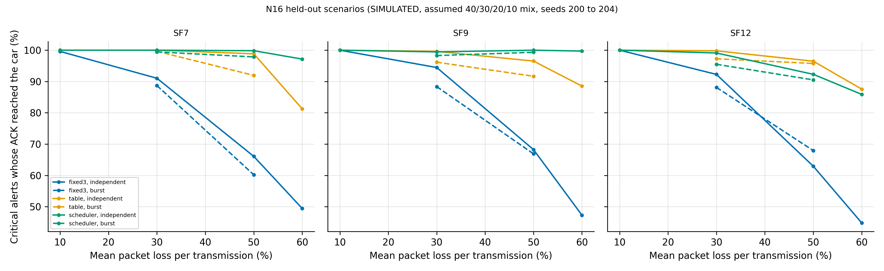

**Figure 20.** N16: truly critical alerts acknowledged for three sources of the severity class. (SIMULATED)  
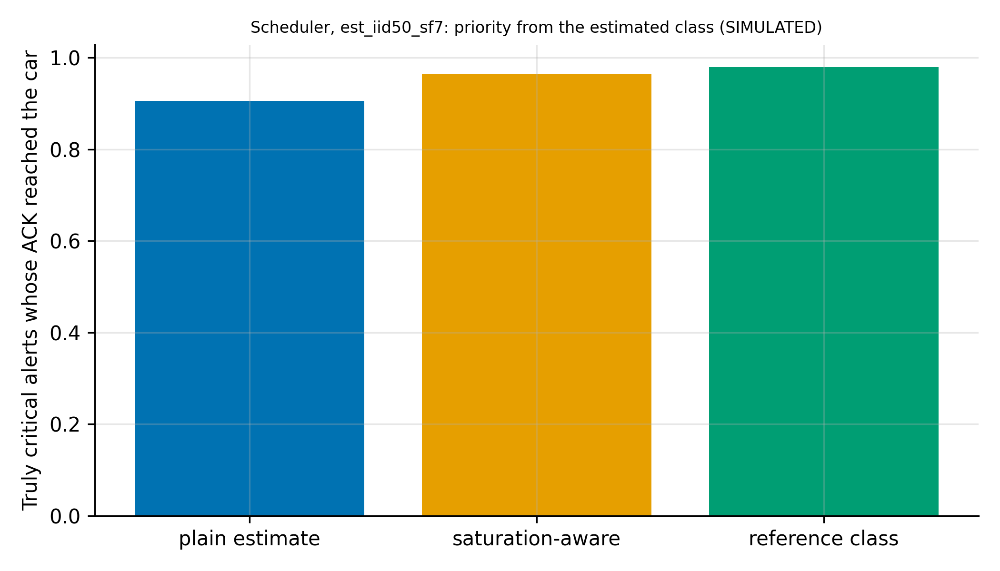

### 4.9 LoRa airtime, the earlier delivery simulation and the hardware logs

### Table 60. LoRa airtime and duty-cycle budget (ANALYTICAL)

| Spreading factor | 97 B alert (ms) | 26 B ACK (ms) | Alerts per hour at 10% duty |
|---|---|---|---|
| SF7 | 169.2 | 61.7 | 2127 |
| SF8 | 297.5 | 113.2 | 1210 |
| SF9 | 533.5 | 205.8 | 674 |
| SF10 | 985.1 | 411.6 | 365 |
| SF11 | 2134.0 | 823.3 | 168 |
| SF12 | 3940.3 | 1646.6 | 91 |

Check: a 97 B alert at SF7 takes 169.22 ms (documented value: about 169 ms). The 10% duty cycle is not verified against the WPC/DoT notification.

### Table 61. Earlier delivery simulation: strict verifier before the fix against the idempotent re-ACK (30% loss) (SIMULATED)

| Scenario | Policy | Verifier | Reached base, all | ACK received, all | ACK received, critical | Median time to ACK, critical (s) |
|---|---|---|---|---|---|---|
| A | fixed, 3 retries | strict | 0.992 | 0.701 | 0.709 | 0.5 |
| A | fixed, 3 retries | re-ACK | 0.991 | 0.928 | 0.943 | 0.6 |
| A | severity-aware | strict | 0.963 | 0.674 | 0.657 | 0.5 |
| A | severity-aware | re-ACK | 0.962 | 0.876 | 1.000 | 0.8 |
| B | fixed, 3 retries | strict | 0.993 | 0.699 | 0.663 | 8.4 |
| B | fixed, 3 retries | re-ACK | 0.991 | 0.929 | 0.943 | 10.4 |
| B | severity-aware | strict | 0.960 | 0.670 | 0.701 | 8.0 |
| B | severity-aware | re-ACK | 0.963 | 0.873 | 0.999 | 10.6 |
| C | fixed, 3 retries | strict | 0.992 | 0.697 | 0.701 | 513.8 |
| C | fixed, 3 retries | re-ACK | 0.993 | 0.932 | 0.929 | 253.9 |
| C | severity-aware | strict | 0.962 | 0.675 | 0.702 | 65.1 |
| C | severity-aware | re-ACK | 0.961 | 0.877 | 1.000 | 26.2 |

Assumptions are in `src/crashguard/delivery_sim.py` (A: SF7 with a full hourly budget; B: SF12; C: SF12 with a burst and most of the budget used). The end-to-end replay of Section 4.7 supersedes this simulation; it is kept for the strict-against-re-ACK comparison.

### Table 62. Hardware logs ingested and what is still NOT_RUN (HARDWARE)

| Protocol | Latency (ms) | Throughput (bps) | Packet size (bytes) | Loss (%) |
|---|---|---|---|---|
| HTTP | 2 to 3 | 405 to 792 | 152 to 198 | 0 |
| MQTT | 1 to 1 | 1184 to 1272 | 148 to 159 | 0 |
| CoAP | 1 to 1 | 560 to 632 | 70 to 79 | 0 |

LoRa gateway snapshots: 5 valid frames in 23 s, then 21 valid frames in 108 s; invalid frames 2; failed ACKs 0. A delivery ratio needs the transmitter total, which is missing: NOT_RUN.

Hardware experiments with no data yet (NOT_RUN): H1, H2, H3, H4, H5, H6, H2 transfer. The plan (H1 to H6) is in Section 7.

**Figure 21.** Measured Wi-Fi protocol latency next to the analytical LoRa time on air. (HARDWARE)  
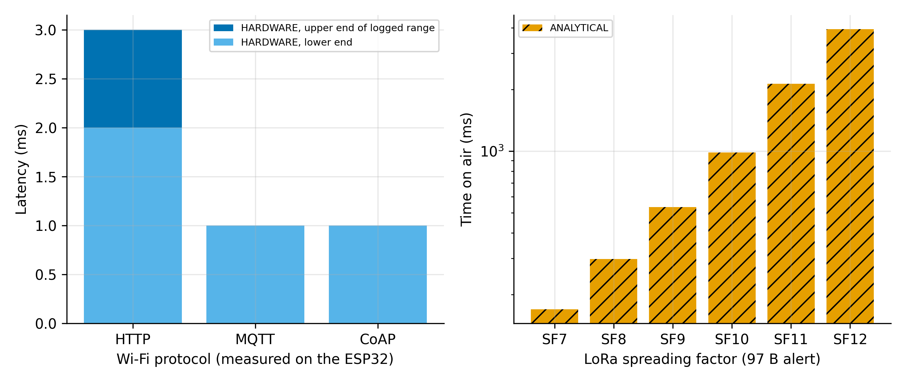

**Figure 22.** Share of alerts whose ACK reached the car with the strict verifier and with the idempotent re-ACK. (SIMULATED)  
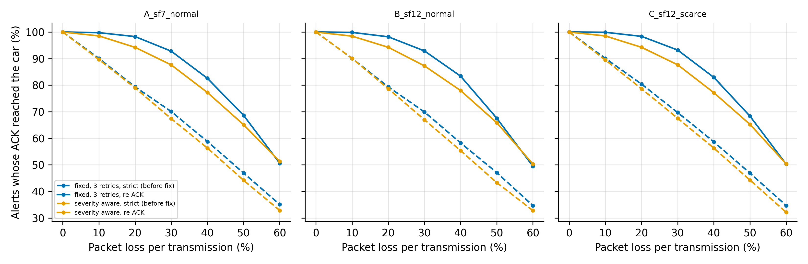

**Figure 23.** Time on air against payload size for SF7 to SF12. (ANALYTICAL)  
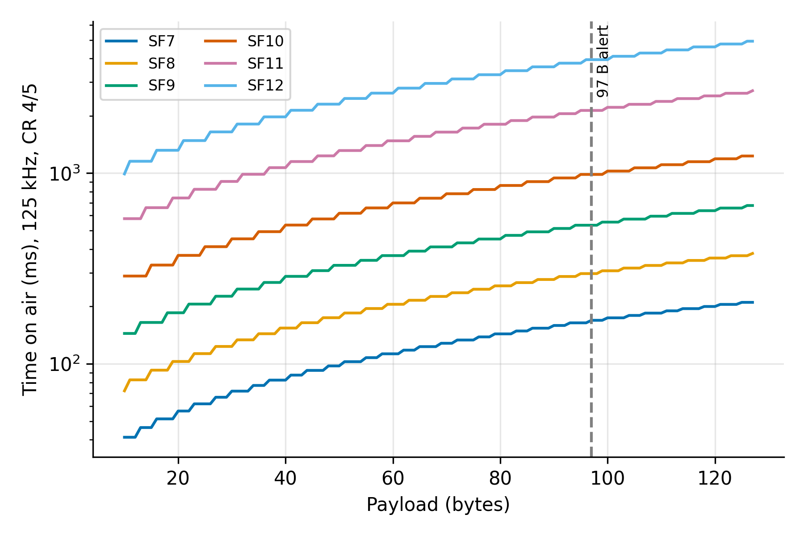

### 4.10 Extra software-only experiments (N17 to N23)

Seven experiments were added after the main results. Each was written down with its baseline, split, metrics and decision rule in `docs/02_preregistration/EXPERIMENTS_EXTRA.md` before it was run, and each is judged only by whether its gain clears the 95% bootstrap interval on data it was not tuned on. NHTSA experiments resample whole vehicle groups (make and model); VZCrash experiments use the de-duplicated splits. A null result is reported with the same detail as a success. Everything is software only; none of it is a hardware result.

#### N17. Impact direction from one IMU on real crash tests (X1)

The firmware rule sums the horizontal acceleration over the initial 60 ms after the trigger and takes the impact direction opposite to the impulse. The database offers only frontal barrier tests (116), left-side impactor tests (60) and 7 oblique frontal tests with instrumentation: rear impacts have no instrumentation records and every side test strikes the left side, so **rear and right are not scored**, the oblique angle is not scored (fewer than `10` tests), and the left-against-right decision is not independent because the sign of the lateral axis is calibrated on the left-side tests. Sign check on the raw records: the mean longitudinal acceleration over the initial 100 ms is negative in 1.00 of the 116 frontal tests (median -15.1 g), so the longitudinal axis points forward; in the left-side tests the lateral mean is positive (median 6.9 g, negative in only 0.03 of them), so the data's lateral axis points right and is flipped. The window was chosen on the tuning groups (make and model): 116.0, 116.0 and 117.0 correct tuning tests for `30`, `60` and `100` ms, so the `60` ms default stays (the rule needs a gain of more than one test).

### Table 63. X1: front against side (sign-free) on the held-out vehicle groups, by sensor range (MEASURED_SOFTWARE)

| Split | Range | Held-out front / side tests | Front accuracy [grouped 95%] | Exact lower limit | Side accuracy [grouped 95%] | Exact lower limit | Balanced accuracy [grouped 95%] | Majority baseline | Median angle error, frontal (deg) | Median angle error, side (deg) |
|---|---|---|---|---|---|---|---|---|---|---|
| make and model groups | ±16 g | 46 / 20 | 1.000 [1.000 to 1.000] | 0.923 | 0.950 [0.850 to 1.000] | 0.751 | 0.975 [0.917 to 1.000] | 0.50 | 8.5 [3.8 to 11.7] | 13.3 [12.3 to 18.2] |
| make and model groups | ±32 g | 46 / 20 | 1.000 [1.000 to 1.000] | 0.923 | 0.950 [0.850 to 1.000] | 0.751 | 0.975 [0.917 to 1.000] | 0.50 | 9.9 [3.2 to 11.8] | 12.3 [11.4 to 15.3] |
| make and model groups | ±64 g | 46 / 20 | 1.000 [1.000 to 1.000] | 0.923 | 0.950 [0.850 to 1.000] | 0.751 | 0.975 [0.917 to 1.000] | 0.50 | 9.9 [2.9 to 11.6] | 12.1 [11.2 to 13.6] |
| make, model and year groups | ±16 g | 39 / 21 | 1.000 [1.000 to 1.000] | 0.910 | 1.000 [1.000 to 1.000] | 0.839 | 1.000 [1.000 to 1.000] | 0.50 | 7.4 [2.9 to 11.4] | 13.3 [12.0 to 18.8] |
| make, model and year groups | ±32 g | 39 / 21 | 1.000 [1.000 to 1.000] | 0.910 | 1.000 [1.000 to 1.000] | 0.839 | 1.000 [1.000 to 1.000] | 0.50 | 7.5 [2.2 to 11.0] | 12.0 [10.8 to 16.0] |
| make, model and year groups | ±64 g | 39 / 21 | 1.000 [1.000 to 1.000] | 0.910 | 1.000 [1.000 to 1.000] | 0.839 | 1.000 [1.000 to 1.000] | 0.50 | 7.5 [2.2 to 11.0] | 11.9 [10.8 to 14.9] |

The grouped interval is degenerate when a class has no errors, so the exact binomial lower limit (which ignores grouping) is shown next to it. On the make-and-model split the balanced accuracy at ±16 g is 0.975 [0.917 to 1.000] against `0.5` for the majority class: **supported** as a check of a supporting feature, on two classes only. The one error at every range is test 3852 (BUICK|RENDEZVOUS, a side test whose impulse direction is 27.4 degrees); in the earlier N14 failure list it is also a short, high-peak pulse. Principal direction of force from in-vehicle accelerometers is an established topic (Kusano and Gabler; Tadic and Vukajlovic), so N17 is worded as validation of a supporting feature, not a contribution.

#### N18. Severity measures against dummy injury measures (X2)

The criteria are the dummy measurements stored with the NHTSA tests (field meanings from the NHTSA Biomechanics Data Reference Guide, opened). **They are test measurements, not human injury, and the samples are small.** Frontal tests with criteria at the driver position: 51 with HIC, 50 with chest acceleration, 50 with femur load; side tests at the struck-side front seat: 59 with HIC, 58 with TTI(d), 58 with the pelvis measure. The list of tests per criterion is in `docs/05_data_code/DATASET.md`. Only 0.32 of the frontal dummy records have a HIC interval of at most 15 ms, so most frontal HIC values are not HIC15 and the HIC15 limit is not applied to them.

### Table 64. X2: Spearman correlation of severity measures with dummy criteria at the driver or struck-side front seat (reference chain), and partial correlation controlling for impact speed (95% intervals over make-and-model groups) (MEASURED_SOFTWARE)

| Tests | Criterion | Severity measure | n | Spearman rho [95%] | Partial rho controlling for speed [95%] |
|---|---|---|---|---|---|
| frontal | HIC | delta-V | 51 | 0.38 [0.11 to 0.62] | 0.07 [-0.22 to 0.36] |
| frontal | HIC | ASI | 51 | 0.43 [0.18 to 0.61] | 0.23 [-0.07 to 0.49] |
| frontal | HIC | peak acceleration | 51 | 0.28 [-0.04 to 0.52] | 0.10 [-0.20 to 0.37] |
| frontal | HIC | specific energy | 51 | 0.38 [0.11 to 0.62] | 0.07 [-0.22 to 0.36] |
| frontal | HIC | impact speed | 51 | 0.44 [0.14 to 0.66] | - |
| frontal | chest acceleration (3 ms) | delta-V | 50 | -0.03 [-0.30 to 0.21] | -0.27 [-0.53 to -0.01] |
| frontal | chest acceleration (3 ms) | ASI | 50 | 0.65 [0.43 to 0.79] | 0.70 [0.47 to 0.82] |
| frontal | chest acceleration (3 ms) | peak acceleration | 50 | 0.54 [0.31 to 0.71] | 0.53 [0.31 to 0.70] |
| frontal | chest acceleration (3 ms) | specific energy | 50 | -0.03 [-0.30 to 0.21] | -0.27 [-0.53 to -0.01] |
| frontal | chest acceleration (3 ms) | impact speed | 50 | 0.17 [-0.11 to 0.44] | - |
| frontal | femur load | delta-V | 50 | 0.14 [-0.11 to 0.39] | -0.06 [-0.28 to 0.18] |
| frontal | femur load | ASI | 50 | 0.41 [0.21 to 0.59] | 0.36 [0.11 to 0.58] |
| frontal | femur load | peak acceleration | 50 | 0.35 [0.12 to 0.54] | 0.28 [0.04 to 0.50] |
| frontal | femur load | specific energy | 50 | 0.14 [-0.11 to 0.39] | -0.06 [-0.28 to 0.18] |
| frontal | femur load | impact speed | 50 | 0.23 [-0.05 to 0.49] | - |
| frontal | CSI | delta-V | 50 | -0.32 [-0.57 to -0.03] | -0.29 [-0.51 to -0.02] |
| frontal | CSI | ASI | 50 | 0.16 [-0.18 to 0.49] | 0.35 [0.08 to 0.58] |
| frontal | CSI | peak acceleration | 50 | 0.11 [-0.18 to 0.39] | 0.23 [-0.09 to 0.48] |
| frontal | CSI | specific energy | 50 | -0.32 [-0.57 to -0.03] | -0.29 [-0.51 to -0.02] |
| frontal | CSI | impact speed | 50 | -0.18 [-0.47 to 0.16] | - |
| side | HIC | delta-V | 63 | 0.33 [0.05 to 0.56] | 0.34 [0.06 to 0.56] |
| side | HIC | ASI | 63 | 0.31 [0.05 to 0.53] | 0.31 [0.07 to 0.53] |
| side | HIC | peak acceleration | 63 | -0.15 [-0.40 to 0.11] | -0.14 [-0.39 to 0.11] |
| side | HIC | specific energy | 63 | 0.33 [0.05 to 0.56] | 0.34 [0.06 to 0.56] |
| side | HIC | impact speed | 63 | -0.06 [-0.34 to 0.27] | - |
| side | TTI(d) | delta-V | 62 | 0.38 [0.09 to 0.62] | 0.39 [0.12 to 0.62] |
| side | TTI(d) | ASI | 62 | 0.29 [-0.00 to 0.53] | 0.30 [0.01 to 0.53] |
| side | TTI(d) | peak acceleration | 62 | -0.35 [-0.57 to -0.09] | -0.34 [-0.56 to -0.07] |
| side | TTI(d) | specific energy | 62 | 0.38 [0.09 to 0.62] | 0.39 [0.12 to 0.62] |
| side | TTI(d) | impact speed | 62 | -0.11 [-0.39 to 0.20] | - |
| side | pelvis acceleration | delta-V | 62 | 0.31 [0.05 to 0.55] | 0.31 [0.06 to 0.57] |
| side | pelvis acceleration | ASI | 62 | 0.22 [-0.04 to 0.45] | 0.22 [-0.04 to 0.48] |
| side | pelvis acceleration | peak acceleration | 62 | -0.23 [-0.49 to 0.04] | -0.22 [-0.49 to 0.06] |
| side | pelvis acceleration | specific energy | 62 | 0.31 [0.05 to 0.55] | 0.31 [0.06 to 0.57] |
| side | pelvis acceleration | impact speed | 62 | -0.14 [-0.39 to 0.11] | - |

Delta-V against impact speed alone: frontal 0.77 [0.65 to 0.85], side 0.07 [-0.21 to 0.32] (side tests are all at about the same speed). **Primary question (frontal, driver position, delta-V and chest or head criterion, controlling for speed):** the partial correlation of delta-V is 0.07 [-0.22 to 0.36] for HIC and -0.27 [-0.53 to -0.01] for chest acceleration: no interval is above zero, so **delta-V adds nothing beyond impact speed for these criteria: no improvement found**. ASI, which is built from acceleration, does track chest acceleration (0.65 [0.43 to 0.79]; partial 0.70 [0.47 to 0.82]). In side tests delta-V is related to HIC (0.34 [0.06 to 0.56] partial), TTI(d) (0.39 [0.12 to 0.62]) and the pelvis measure (0.31 [0.06 to 0.57]).

### Table 65. X2: share of tests above a regulatory limit, by severity class of the reference chain (MEASURED_SOFTWARE)

| Limit | Severity class | Tests | Share above the limit [95%] |
|---|---|---|---|
| chest acceleration above `60` g (FMVSS 208 S6.3) | Severe | 16 | 0.062 [0.000 to 0.188] |
| chest acceleration above `60` g (FMVSS 208 S6.3) | Critical | 34 | 0.029 [0.000 to 0.091] |
| femur load above `10,008` N (`2250` pounds, FMVSS 208 S6.5) | Severe | 16 | 0.000 [0.000 to 0.000] |
| femur load above `10,008` N (`2250` pounds, FMVSS 208 S6.5) | Critical | 34 | 0.000 [0.000 to 0.000] |
| HIC (36 ms) above `1000` (FMVSS 214, ES-2re limit applied to the NHTSA dummy) | Low | 7 | 0.000 [0.000 to 0.000] |
| HIC (36 ms) above `1000` (FMVSS 214, ES-2re limit applied to the NHTSA dummy) | Moderate | 44 | 0.023 [0.000 to 0.070] |
| HIC (36 ms) above `1000` (FMVSS 214, ES-2re limit applied to the NHTSA dummy) | Severe | 11 | 0.000 [0.000 to 0.000] |
| HIC (36 ms) above `1000` (FMVSS 214, ES-2re limit applied to the NHTSA dummy) | Critical | 1 | too few tests |

The limits come from the text of 49 CFR 571.208 and 571.214 (opened). The TTI(d) and pelvis limits of the older side-impact dummy are not in the current text of FMVSS 214 and are **UNVERIFIED**, so no share against them is computed. The frontal HIC15 limit is not applied because almost none of the frontal HIC records has a 15 ms interval. Almost no test exceeds a limit (these are mostly star-rated tests at 56 to 62 km/h), so the class limits of the severity scale cannot be checked against the criteria with this sample.

#### N19. Early classification: how much of the 1.8 s window is needed (X3)

The deployed forest was trained at post-trigger lengths of `50`, `100`, `200`, `400`, `800` and `1,800` ms (features recomputed). An early-exit rule decides at the earliest checkpoint where the length-specific model is very confident (alarm above `hi`, no alarm below `lo`) and otherwise waits; `hi`, `lo` and the final threshold were chosen on validation only. System level, de-duplicated test set; the trigger is the same second trigger as elsewhere.

### Table 66. X3: system recall at a fixed false-alarm rate for fixed windows and for the early-exit rule (mean ± std over seeds 0 to 4) (MEASURED_SOFTWARE)

| False-alarm target | Method | System recall | System false-alarm rate | Decision time after the trigger (ms) |
|---|---|---|---|---|
| 1% | fixed window, post-trigger ms: 50 | 0.5867 ± 0.0021 | 0.0106 ± 0.0003 | 50 |
| 1% | fixed window, post-trigger ms: 100 | 0.6208 ± 0.0038 | 0.0108 ± 0.0003 | 100 |
| 1% | fixed window, post-trigger ms: 200 | 0.6070 ± 0.0094 | 0.0112 ± 0.0005 | 200 |
| 1% | fixed window, post-trigger ms: 400 | 0.5947 ± 0.0085 | 0.0114 ± 0.0003 | 400 |
| 1% | fixed window, post-trigger ms: 800 | 0.5985 ± 0.0052 | 0.0106 ± 0.0002 | 800 |
| 1% | fixed window, post-trigger ms: 1800 | 0.6265 ± 0.0039 | 0.0105 ± 0.0004 | 1800 |
| 1% | early exit | 0.6420 ± 0.0085 | 0.0105 ± 0.0002 | 296 (crashes that alarm); 781 (all triggered crashes) |
| 5% | fixed window, post-trigger ms: 50 | 0.9178 ± 0.0018 | 0.0533 ± 0.0005 | 50 |
| 5% | fixed window, post-trigger ms: 100 | 0.9221 ± 0.0033 | 0.0529 ± 0.0003 | 100 |
| 5% | fixed window, post-trigger ms: 200 | 0.9222 ± 0.0019 | 0.0530 ± 0.0002 | 200 |
| 5% | fixed window, post-trigger ms: 400 | 0.9246 ± 0.0016 | 0.0537 ± 0.0003 | 400 |
| 5% | fixed window, post-trigger ms: 800 | 0.9283 ± 0.0013 | 0.0530 ± 0.0007 | 800 |
| 5% | fixed window, post-trigger ms: 1800 | 0.9345 ± 0.0025 | 0.0533 ± 0.0004 | 1800 |
| 5% | early exit | 0.9359 ± 0.0016 | 0.0534 ± 0.0006 | 595 (crashes that alarm); 628 (all triggered crashes) |

### Table 67. X3: early-exit rule minus the fixed 1,800 ms window (seed 42, paired bootstrap over test events) (MEASURED_SOFTWARE)

| False-alarm target | Recall difference [95%] | Mean decision time difference of crash events (ms) [95%] | Chosen early-alarm level (validation false-alarm rate of the length-specific model) | Chosen early no-alarm quantile | Decision rule |
|---|---|---|---|---|---|
| 1% | 0.0300 [0.0208 to 0.0392] | -1082 [-1106 to -1056] | 0.0050 | 0.010 | supported |
| 5% | 0.0037 [0.0005 to 0.0068] | -1069 [-1094 to -1043] | 0.0050 | 0.005 | supported |

**Reading.** The decision rule of `docs/02_preregistration/EXPERIMENTS_EXTRA.md` (decision time lower by an interval below zero and a recall loss of no more than one point) is met at both targets. Two cautions. One: the mean decision time of crash events includes crashes that are never alarmed and wait to the end; the time to alarm of the crashes that do alarm is shown in the table above. The other: the recall of the early-exit rule is slightly higher than the fixed window's because it combines six models; this is an ensemble effect, not a physical one. VZCrash events were pre-selected on the device, so these are decision times after a second trigger on pre-selected events, not for continuous driving.

**Cost on the node (ANALYTICAL).** Incremental feature updates need about 14 multiplies, 17 additions, 9 comparisons and 3 square roots per sample and 384 bytes of state (a `80` sample ring buffer dominates), plus 90 comparisons per checkpoint for the forest: about 170 cycles per sample at an ASSUMED cost per operation, 0.00007 of the sample period at `240` MHz; the real cost is NOT_RUN. **Effect on the end-to-end timing (SIMULATED, unconfirmed by hardware):** the alert is ready after 1.85 s (window plus assumed compute time) with the fixed window, and after 0.27 s (1% target) or 0.76 s (5% target) on average for the crashes that alarm, which would start the cancel window earlier by the difference.

#### N20. Guaranteed false-alarm control by split-conformal thresholds (X4)

The calibration set is the 22918 non-crash validation events (system level); the test set has 19915 non-crash events. The conformal threshold is the k-th smallest calibration score with k = ceil((n + 1)(1 - alpha)); the baseline is the validation threshold used so far. If calibration and test events are exchangeable the false-alarm rate is at most alpha on average over calibration sets. Calibration sets of `200` to `2,000` events were drawn `200` times per seed and size (seeds 0 to 4 and 42).

### Table 68. X4: test false-alarm rate of the conformal and the validation thresholds, by calibration-set size (mean over seeds and draws, 95% interval for the mean) (MEASURED_SOFTWARE)

| alpha | Calibration events | Threshold | Test false-alarm rate: mean [95% for the mean] | 97.5th percentile of single draws | Share of draws above alpha | Test recall |
|---|---|---|---|---|---|---|
| 1% | 200 | conformal | 0.0103 [0.0099 to 0.0107] | 0.0283 | 0.42 | 0.571 |
| 1% | 200 | validation | 0.0155 [0.0150 to 0.0160] | 0.0373 | 0.68 | 0.672 |
| 1% | 500 | conformal | 0.0106 [0.0104 to 0.0109] | 0.0217 | 0.47 | 0.610 |
| 1% | 500 | validation | 0.0128 [0.0126 to 0.0131] | 0.0251 | 0.64 | 0.650 |
| 1% | 1000 | conformal | 0.0107 [0.0105 to 0.0109] | 0.0181 | 0.52 | 0.622 |
| 1% | 1000 | validation | 0.0118 [0.0116 to 0.0120] | 0.0194 | 0.66 | 0.643 |
| 1% | 2000 | conformal | 0.0105 [0.0103 to 0.0106] | 0.0158 | 0.53 | 0.621 |
| 1% | 2000 | validation | 0.0110 [0.0109 to 0.0112] | 0.0163 | 0.62 | 0.632 |
| 1% | all | conformal | 0.0103 [0.0101 to 0.0105] | 0.0106 | 0.67 | 0.623 |
| 1% | all | validation | 0.0104 [0.0101 to 0.0107] | 0.0109 | 0.83 | 0.625 |
| 5% | 200 | conformal | 0.0526 [0.0517 to 0.0534] | 0.0854 | 0.54 | 0.919 |
| 5% | 200 | validation | 0.0576 [0.0567 to 0.0584] | 0.0900 | 0.67 | 0.930 |
| 5% | 500 | conformal | 0.0526 [0.0520 to 0.0531] | 0.0729 | 0.62 | 0.927 |
| 5% | 500 | validation | 0.0547 [0.0541 to 0.0552] | 0.0757 | 0.69 | 0.931 |
| 5% | 1000 | conformal | 0.0530 [0.0527 to 0.0534] | 0.0675 | 0.69 | 0.931 |
| 5% | 1000 | validation | 0.0540 [0.0537 to 0.0544] | 0.0683 | 0.74 | 0.933 |
| 5% | 2000 | conformal | 0.0531 [0.0529 to 0.0534] | 0.0619 | 0.78 | 0.932 |
| 5% | 2000 | validation | 0.0536 [0.0533 to 0.0538] | 0.0625 | 0.81 | 0.933 |
| 5% | all | conformal | 0.0532 [0.0529 to 0.0535] | 0.0537 | 1.00 | 0.934 |
| 5% | all | validation | 0.0532 [0.0529 to 0.0535] | 0.0538 | 1.00 | 0.934 |

**Result (decision rule: the interval for the mean must not be above alpha for calibration sets of `1,000` or more).** At alpha = `1%` the conformal mean is 0.0107 [0.0105 to 0.0109] and at `5%` it is 0.0530 [0.0527 to 0.0534]: both intervals are above alpha, so the guarantee is **not supported on this test set**. The conformal threshold is not better than the validation threshold (recall difference at the same calibration sets about zero; for example -0.0001 [-0.0002 to 0.0000] at `5%` with the whole validation set). The most likely cause is that validation and test events are not exchangeable here: the validation split may repeat training events (so validation scores are lower than test scores) and the de-duplicated test split has the cross-split duplicates removed. This is the explanation by elimination; it was not isolated.

### Table 69. X4: breaking exchangeability on purpose: calibrate on three vehicle-size categories and test on the fourth, and the reverse (false-alarm rate of the conformal threshold, mean over seeds) (MEASURED_SOFTWARE)

| alpha | Category | Calibrated on the other three, tested on this one | Test non-crash events | Calibrated on this one, tested on the other three |
|---|---|---|---|---|
| 1% | Light | 0.0112 | 3048 | 0.0130 |
| 1% | Medium | 0.0071 | 6965 | 0.0160 |
| 1% | Heavy | 0.0317 | 3280 | 0.0036 |
| 1% | Unknown | 0.0056 | 6622 | 0.0179 |
| 5% | Light | 0.0529 | 3048 | 0.0555 |
| 5% | Medium | 0.0393 | 6965 | 0.0726 |
| 5% | Heavy | 0.1308 | 3280 | 0.0168 |
| 5% | Unknown | 0.0301 | 6622 | 0.0790 |

The false-alarm rate on heavy vehicles is more than twice alpha when the calibration set is made of the other categories, and the guarantee fails by a smaller amount in the other directions. The conformal threshold does not repair this; it needs exchangeability. N20 is reported as a limitation study: no improvement found.

#### N21. Robustness to a bounded signal added to the accelerometer (X5)

Threat model and limits are in `docs/01_protocol/THREAT_MODEL_SPOOFING.md`: an attacker adds a signal of at most epsilon g per axis made of one to three sinusoids between `2` and `45` Hz to a stored window. **Simulation on dataset windows only; no attack code for a physical sensor was written.** The premise that a MEMS accelerometer or gyroscope can be made to report attacker-chosen low-frequency content comes from published work on acoustic and resonant injection (Tu et al., USENIX Security 2018, opened; it cites Son et al. 2015 and Trippel et al. 2017, which were not opened); the budget grid, the sinusoid restriction, the targets, the search and surrogate attacks, the defences and the evaluation on VZCrash windows are ours. Whether a real transmitter could deliver such a signal to a sensor in a car is not studied. Attacked windows: 500 triggered non-crash windows (goal a: classified as a crash) and 500 crash windows (goal b: not alarmed), a fixed random sample of the de-duplicated test set; nothing was tuned on them. Attacks: random search (`100` bounded mixtures), a structured grid (`196` single sinusoids), and a projected-gradient attack on a logistic or small neural surrogate, transferred to the forest. A black-box search counts a window as attacked if any candidate works.

### Table 70. X5: attack success against the deployed forest, by budget and attack, net of what the forest already does without an attack (MEASURED_SOFTWARE)

| Goal | Epsilon | Already true without an attack | Random search (net) | Structured search (net) | Surrogate: logistic (net) | Surrogate: network (net) | Any attack (net) |
|---|---|---|---|---|---|---|---|
| a: non-crash window alarmed | 0.1 g | 0.512 | 0.156 | 0.176 | 0.029 | 0.061 | 0.184 |
| a: non-crash window alarmed | 0.25 g | 0.512 | 0.320 | 0.365 | 0.074 | 0.086 | 0.365 |
| a: non-crash window alarmed | 0.5 g | 0.512 | 0.647 | 0.742 | 0.176 | 0.180 | 0.758 |
| a: non-crash window alarmed | 1 g | 0.512 | 0.992 | 0.996 | 0.660 | 0.623 | 0.996 |
| a: non-crash window alarmed | 2 g | 0.512 | 1.000 | 1.000 | 1.000 | 0.984 | 1.000 |
| b: crash window missed | 0.1 g | 0.040 | 0.025 | 0.027 | 0.004 | 0.006 | 0.031 |
| b: crash window missed | 0.25 g | 0.040 | 0.040 | 0.050 | 0.006 | 0.004 | 0.052 |
| b: crash window missed | 0.5 g | 0.040 | 0.056 | 0.083 | 0.008 | 0.008 | 0.085 |
| b: crash window missed | 1 g | 0.040 | 0.079 | 0.071 | 0.002 | 0.008 | 0.090 |
| b: crash window missed | 2 g | 0.040 | 0.104 | 0.098 | 0.000 | 0.000 | 0.148 |

Net success is the share of windows that were not already in the wanted state and are moved into it. A large share of triggered non-crash windows (0.51) is already alarmed at the validation threshold, which is why the net figure is shown. A structured sinusoid search turns 0.74 of the rest into alarms at `0.5` g and almost all at `1` g or more; hiding a crash is much harder (net 0.09 at `0.5` g and 0.15 at `2` g). The trigger is no obstacle: a quiet vehicle crosses `2` g when about `1` g is added along gravity (analytical).

### Table 71. X5: defences: attack success with any attack (95% intervals over windows), the paired difference from the baseline, and the clean cost (MEASURED_SOFTWARE)

| Pipeline | Epsilon | Goal a: alarmed after attack [95%] | Difference from the baseline [95%] | Goal b: missed after attack [95%] | Difference from the baseline [95%] |
|---|---|---|---|---|---|
| baseline forest | 0.25 g | 0.690 [0.650 to 0.734] | - | 0.090 [0.066 to 0.116] | - |
| baseline forest | 0.5 g | 0.882 [0.854 to 0.912] | - | 0.122 [0.096 to 0.152] | - |
| baseline forest | 1 g | 0.998 [0.994 to 1.000] | - | 0.126 [0.098 to 0.156] | - |
| baseline forest | 2 g | 1.000 [1.000 to 1.000] | - | 0.182 [0.148 to 0.216] | - |
| D1 median filter | 0.25 g | 0.628 [0.590 to 0.672] | -0.062 [-0.096 to -0.024] | 0.176 [0.144 to 0.210] | 0.086 [0.056 to 0.116] |
| D1 median filter | 0.5 g | 0.852 [0.822 to 0.882] | -0.030 [-0.056 to -0.004] | 0.212 [0.176 to 0.248] | 0.090 [0.062 to 0.118] |
| D1 median filter | 1 g | 1.000 [1.000 to 1.000] | 0.002 [0.000 to 0.006] | 0.238 [0.200 to 0.274] | 0.112 [0.080 to 0.144] |
| D1 median filter | 2 g | 1.000 [1.000 to 1.000] | 0.000 [0.000 to 0.000] | 0.250 [0.212 to 0.288] | 0.068 [0.034 to 0.104] |
| D2 delta-V and cross-axis plausibility | 0.25 g | 0.656 [0.614 to 0.700] | -0.034 [-0.052 to -0.018] | 0.120 [0.092 to 0.150] | 0.030 [0.016 to 0.046] |
| D2 delta-V and cross-axis plausibility | 0.5 g | 0.860 [0.830 to 0.892] | -0.022 [-0.036 to -0.010] | 0.164 [0.132 to 0.198] | 0.042 [0.026 to 0.060] |
| D2 delta-V and cross-axis plausibility | 1 g | 0.998 [0.994 to 1.000] | 0.000 [0.000 to 0.000] | 0.200 [0.164 to 0.236] | 0.074 [0.050 to 0.100] |
| D2 delta-V and cross-axis plausibility | 2 g | 1.000 [1.000 to 1.000] | 0.000 [0.000 to 0.000] | 0.312 [0.270 to 0.356] | 0.130 [0.098 to 0.164] |
| D3 adversarial training | 0.25 g | 0.712 [0.668 to 0.752] | 0.022 [-0.002 to 0.044] | 0.088 [0.064 to 0.114] | -0.002 [-0.016 to 0.012] |
| D3 adversarial training | 0.5 g | 0.874 [0.844 to 0.904] | -0.008 [-0.030 to 0.010] | 0.118 [0.092 to 0.146] | -0.004 [-0.022 to 0.012] |
| D3 adversarial training | 1 g | 0.978 [0.964 to 0.990] | -0.020 [-0.032 to -0.008] | 0.480 [0.436 to 0.526] | 0.354 [0.310 to 0.396] |
| D3 adversarial training | 2 g | 0.994 [0.986 to 1.000] | -0.006 [-0.014 to 0.000] | 0.602 [0.558 to 0.648] | 0.420 [0.380 to 0.462] |
| D4 minimum delta-V (physics ensemble) | 0.25 g | 0.552 [0.508 to 0.596] | -0.138 [-0.168 to -0.110] | 0.122 [0.096 to 0.150] | 0.032 [0.018 to 0.048] |
| D4 minimum delta-V (physics ensemble) | 0.5 g | 0.748 [0.708 to 0.786] | -0.134 [-0.164 to -0.104] | 0.148 [0.118 to 0.180] | 0.026 [0.012 to 0.044] |
| D4 minimum delta-V (physics ensemble) | 1 g | 0.992 [0.984 to 0.998] | -0.006 [-0.014 to 0.000] | 0.150 [0.120 to 0.182] | 0.024 [0.008 to 0.042] |
| D4 minimum delta-V (physics ensemble) | 2 g | 1.000 [1.000 to 1.000] | 0.000 [0.000 to 0.000] | 0.188 [0.154 to 0.224] | 0.006 [-0.014 to 0.024] |

| Pipeline | Clean system recall [95%] | Clean system false-alarm rate [95%] |
|---|---|---|
| baseline forest | 0.909 [0.901 to 0.918] | 0.0442 [0.0414 to 0.0470] |
| D1 median filter | 0.871 [0.861 to 0.882] | 0.0316 [0.0292 to 0.0339] |
| D2 delta-V and cross-axis plausibility | 0.901 [0.892 to 0.910] | 0.0377 [0.0351 to 0.0403] |
| D3 adversarial training | 0.913 [0.904 to 0.921] | 0.0450 [0.0422 to 0.0479] |
| D4 minimum delta-V (physics ensemble) | 0.890 [0.881 to 0.899] | 0.0329 [0.0305 to 0.0354] |

Parameters from validation: median filter of 5 samples; plausibility limits at the 0.01 quantile of the training crashes (delta-V over peak at least 1.24 km/h per g, horizontal share at least 0.51); minimum delta-V 5 km/h; adversarial training on 8000 attacked training windows. **Decision rule** (attack success below the baseline's by an interval that excludes zero AND a clean recall loss under `0.02`): D4 meets it against goal a at `0.5` g (difference -0.134 [-0.164 to -0.104], clean recall loss 0.019); D2 meets it against goal a at `0.5` g by a small margin; D1 does not (clean recall loss 0.038); D3 does not. No defence helps at `1` g or more. **Every defence that lowers the false-crash goal raises the hidden-crash goal** (the differences for goal b are positive for D1, D2 and D4), and adversarial training makes hiding a crash much easier at `1` g and `2` g. The clean recall loss is measured at each pipeline's own validation threshold (maximum F1), not at a fixed `5%` false-alarm target as the plan said; D1 and D4 also lower the clean false-alarm rate, so part of their recall loss is that trade. Verdict: at most a partial, budget-limited gain against false crashes with a cost on hidden crashes: no improvement found as a general defence.

#### N22. Many-car LoRa capacity (X6)

**ANALYTICAL.** Pure-ALOHA success of an alert packet and the base station's own limit, then an **event-driven SIMULATION** of `N` cars on one channel with Poisson alerts, periodic unconfirmed heartbeats, an optional burst of `30` critical alerts within `10` s, a half-duplex base that pays each ACK from its own `10%` duty-cycle bucket, and the three delivery policies (the scheduler with its N16 parameters, not re-tuned). Every assumption is listed in the module docstring (`src/crashguard/capacity.py`): one channel, one spreading factor, heartbeat payload `16` bytes, a `6` dB capture rule, `10%` extra loss each way, a `0.1` alerts per car per hour stress rate and a `40/30/20/10` severity mix. None of it is measured.

### Table 72. X6: airtime and the base station's ACK budget by spreading factor (ANALYTICAL) (ANALYTICAL)

| Spreading factor | 97 B alert (s) | 26 B ACK (s) | 16 B heartbeat (s) | ACKs per hour in the base's 10% duty cycle | Cars whose alerts (0.1 per car per hour) would use all of it |
|---|---|---|---|---|---|
| SF7 | 0.169 | 0.062 | 0.051 | 5835 | 58351 |
| SF9 | 0.533 | 0.206 | 0.165 | 1749 | 17491 |
| SF12 | 3.940 | 1.647 | 1.319 | 219 | 2186 |

### Table 73. X6: probability that an alert is not destroyed by another packet (pure ALOHA, and with the capture effect), heartbeat every 600 s (ANALYTICAL)

| Spreading factor | Heartbeat period | N = 10 (no capture / capture) | N = 100 | N = 500 |
|---|---|---|---|---|
| SF7 | 600 s | 0.997 / 0.998 | 0.963 / 0.974 | 0.828 / 0.877 |
| SF7 | 60 s | 0.967 / 0.977 | 0.694 / 0.775 | 0.159 / 0.278 |
| SF9 | 600 s | 0.989 / 0.993 | 0.889 / 0.921 | 0.551 / 0.660 |
| SF9 | 60 s | 0.900 / 0.929 | 0.315 / 0.447 | 0.003 / 0.017 |
| SF12 | 600 s | 0.922 / 0.945 | 0.411 / 0.538 | 0.011 / 0.044 |
| SF12 | 60 s | 0.453 / 0.576 | 0.000 / 0.002 | 0.000 / 0.000 |

### Table 74. X6: simulated critical-alert delivery and heartbeat delivery against the number of cars, by spreading factor and policy (heartbeat every 600 s, 0.1 alerts per car per hour; mean over 10 simulated hours) (SIMULATED)

| Spreading factor | Cars | Policy | Critical alerts acknowledged [95%] | All alerts acknowledged | Heartbeats received | Alert transmissions lost to collisions | Share of the base's duty budget used for ACKs |
|---|---|---|---|---|---|---|---|
| SF7 | 20 | fixed3 | 1.000 [1.000 to 1.000] | 1.000 | 0.898 | 0.000 | 0.000 |
| SF7 | 20 | severity | 1.000 [1.000 to 1.000] | 0.929 | 0.905 | 0.000 | 0.000 |
| SF7 | 20 | scheduler | 1.000 [1.000 to 1.000] | 1.000 | 0.909 | 0.000 | 0.000 |
| SF7 | 100 | fixed3 | 1.000 [1.000 to 1.000] | 1.000 | 0.886 | 0.029 | 0.002 |
| SF7 | 100 | severity | 1.000 [1.000 to 1.000] | 0.979 | 0.886 | 0.030 | 0.002 |
| SF7 | 100 | scheduler | 1.000 [1.000 to 1.000] | 1.000 | 0.895 | 0.020 | 0.002 |
| SF7 | 200 | fixed3 | 1.000 [1.000 to 1.000] | 1.000 | 0.880 | 0.041 | 0.004 |
| SF7 | 200 | severity | 1.000 [1.000 to 1.000] | 0.964 | 0.880 | 0.065 | 0.004 |
| SF7 | 200 | scheduler | 1.000 [1.000 to 1.000] | 0.975 | 0.883 | 0.032 | 0.004 |
| SF7 | 500 | fixed3 | 0.925 [0.825 to 1.000] | 0.990 | 0.843 | 0.112 | 0.010 |
| SF7 | 500 | severity | 1.000 [1.000 to 1.000] | 0.968 | 0.845 | 0.121 | 0.009 |
| SF7 | 500 | scheduler | 1.000 [1.000 to 1.000] | 0.973 | 0.844 | 0.109 | 0.010 |
| SF9 | 20 | fixed3 | 1.000 [1.000 to 1.000] | 1.000 | 0.906 | 0.000 | 0.002 |
| SF9 | 20 | severity | 1.000 [1.000 to 1.000] | 0.907 | 0.881 | 0.033 | 0.001 |
| SF9 | 20 | scheduler | 1.000 [1.000 to 1.000] | 0.963 | 0.886 | 0.020 | 0.002 |
| SF9 | 100 | fixed3 | 1.000 [1.000 to 1.000] | 1.000 | 0.872 | 0.047 | 0.006 |
| SF9 | 100 | severity | 1.000 [1.000 to 1.000] | 0.978 | 0.859 | 0.049 | 0.006 |
| SF9 | 100 | scheduler | 1.000 [1.000 to 1.000] | 0.975 | 0.865 | 0.009 | 0.006 |
| SF9 | 200 | fixed3 | 0.972 [0.917 to 1.000] | 0.979 | 0.828 | 0.181 | 0.012 |
| SF9 | 200 | severity | 1.000 [1.000 to 1.000] | 0.954 | 0.838 | 0.148 | 0.012 |
| SF9 | 200 | scheduler | 1.000 [1.000 to 1.000] | 0.924 | 0.833 | 0.104 | 0.012 |
| SF9 | 500 | fixed3 | 0.986 [0.957 to 1.000] | 0.940 | 0.732 | 0.353 | 0.030 |
| SF9 | 500 | severity | 1.000 [1.000 to 1.000] | 0.883 | 0.735 | 0.341 | 0.029 |
| SF9 | 500 | scheduler | 1.000 [1.000 to 1.000] | 0.922 | 0.733 | 0.323 | 0.029 |
| SF12 | 20 | fixed3 | 1.000 [1.000 to 1.000] | 0.980 | 0.856 | 0.126 | 0.014 |
| SF12 | 20 | severity | 1.000 [1.000 to 1.000] | 0.960 | 0.850 | 0.153 | 0.013 |
| SF12 | 20 | scheduler | 1.000 [1.000 to 1.000] | 1.000 | 0.844 | 0.178 | 0.013 |
| SF12 | 100 | fixed3 | 0.944 [0.833 to 1.000] | 0.882 | 0.655 | 0.471 | 0.042 |
| SF12 | 100 | severity | 0.944 [0.833 to 1.000] | 0.811 | 0.648 | 0.463 | 0.042 |
| SF12 | 100 | scheduler | 1.000 [1.000 to 1.000] | 0.816 | 0.653 | 0.489 | 0.042 |
| SF12 | 200 | fixed3 | 0.500 [0.167 to 0.833] | 0.636 | 0.489 | 0.704 | 0.057 |
| SF12 | 200 | severity | 1.000 [1.000 to 1.000] | 0.641 | 0.483 | 0.687 | 0.057 |
| SF12 | 200 | scheduler | 0.861 [0.694 to 1.000] | 0.598 | 0.486 | 0.705 | 0.053 |
| SF12 | 500 | fixed3 | 0.315 [0.163 to 0.494] | 0.212 | 0.205 | 0.909 | 0.059 |
| SF12 | 500 | severity | 0.495 [0.268 to 0.712] | 0.248 | 0.204 | 0.904 | 0.066 |
| SF12 | 500 | scheduler | 0.410 [0.233 to 0.588] | 0.258 | 0.203 | 0.906 | 0.067 |

### Table 75. X6: a burst of 30 critical alerts within 10 s (SF7, heartbeat every 600 s): critical alerts acknowledged and the scheduler's paired gain (SIMULATED)

| Cars | Fixed policy | Severity table | Scheduler | Scheduler minus severity table [95%] | Scheduler p95 latency of critical alerts (s) | Severity table p95 latency (s) |
|---|---|---|---|---|---|---|
| 50 | 0.280 [0.233 to 0.324] | 0.227 [0.175 to 0.302] | 0.888 [0.834 to 0.940] | 0.660 [0.570 to 0.738] | 47.4 | 11.1 |
| 100 | 0.328 [0.276 to 0.375] | 0.251 [0.203 to 0.309] | 0.866 [0.788 to 0.930] | 0.615 [0.510 to 0.713] | 47.4 | 10.4 |
| 200 | 0.330 [0.277 to 0.397] | 0.265 [0.213 to 0.322] | 0.877 [0.826 to 0.928] | 0.612 [0.533 to 0.680] | 49.4 | 10.7 |
| 350 | 0.353 [0.303 to 0.401] | 0.261 [0.218 to 0.303] | 0.799 [0.708 to 0.893] | 0.538 [0.443 to 0.646] | 44.5 | 10.6 |
| 500 | 0.397 [0.346 to 0.451] | 0.325 [0.275 to 0.367] | 0.859 [0.797 to 0.917] | 0.534 [0.462 to 0.610] | 48.9 | 10.6 |

**What changes with the assumptions.** (1) The base station's ACK budget is not the bottleneck anywhere in the grid: at the default alert rate of `0.1` per car per hour the base used at most 0.075 of its duty allowance, and at the higher rates up to 0.35 of it at SF7 and 0.69 at SF12; no simulated hour had an ACK dropped for budget (largest count 0 for the cell checked); the analytic limit is 219 ACKs per hour at SF12 and 5835 at SF7, so it would bind at the car counts in the analytic table, far above the sizes simulated. A higher alert rate (`2` and `10` alerts per car per hour, `50` to `200` cars) uses a larger part of the budget (the shares above) without dropping an ACK for budget at SF7; at SF12 delivery collapses with collisions and long packets while the base uses more than half of its allowance, so the two limits are not separated there. (2) At the default alert rate and SF7 the channel is the earlier limit: at SF12 with `100` or more cars most heartbeats and many alerts collide, and critical delivery falls (see the table); at SF7 critical delivery stays near one up to `500` cars in the steady state. The heartbeat rate matters: a `60` s heartbeat saturates the slower spreading factors at small `N` (the analytic table). (3) In a burst, immediate retries collide again and again: the fixed policy and the severity table acknowledge only a quarter to a third of the critical alerts at SF7, while the scheduler's spaced retries acknowledge most of them, at the cost of a longer latency (a tradeoff the table shows). This is the one condition in which the scheduler clearly beats the severity table, and it rests on the assumed capture rule and burst size. (4) The spreading factor decides everything else: the same car count that is harmless at SF7 breaks at SF12. All of this is simulation under the stated assumptions; hardware test H3 and a multi-node field test would be needed.

#### N23. Scale-model transfer by physical scaling of VZCrash events (X7)

Every de-duplicated test event was transformed as `b + a (x(t / tau) - b)` (`b` = the per-axis median, i.e. gravity, kept; time stretched by `tau` and resampled at `100` Hz; for `tau` below `1` a zero-phase `45` Hz low-pass applied beforehand), clipped at the sensor range, re-triggered (the trigger moves with the amplitude) and re-featured. The deployed forest (all `14` features) and the same forest on the `5` scale-free features, both trained on unscaled data, are applied unchanged with their validation thresholds (24022 test events). **This is a plausibility check. It cannot predict performance on the author's car; the hardware transfer test (H2) is the real test.** The gyro is only resampled in time (its amplitude is not scaled), which is an assumption.

### Table 76. X7: system recall, false-alarm rate and system AP over the amplitude (a) and time-scale (tau) grid, all features against scale-free features (mean over seeds 0 to 4) (MEASURED_SOFTWARE)

| a | tau | Recall, all | Recall, scale-free | False-alarm rate, all | False-alarm rate, scale-free | System AP, all | System AP, scale-free | Crashes that pass the trigger |
|---|---|---|---|---|---|---|---|---|
| 0.25 | 0.25 | 0.000 | 0.000 | 0.000 | 0.000 | 0.173 | 0.173 | 0.003 |
| 0.25 | 0.5 | 0.000 | 0.001 | 0.000 | 0.000 | 0.181 | 0.181 | 0.013 |
| 0.25 | 1 | 0.000 | 0.021 | 0.000 | 0.000 | 0.234 | 0.233 | 0.080 |
| 0.25 | 2 | 0.001 | 0.021 | 0.000 | 0.000 | 0.234 | 0.233 | 0.080 |
| 0.5 | 0.25 | 0.048 | 0.105 | 0.000 | 0.000 | 0.387 | 0.385 | 0.264 |
| 0.5 | 0.5 | 0.181 | 0.263 | 0.001 | 0.002 | 0.544 | 0.543 | 0.465 |
| 0.5 | 1 | 0.421 | 0.524 | 0.005 | 0.009 | 0.707 | 0.707 | 0.688 |
| 0.5 | 2 | 0.449 | 0.533 | 0.006 | 0.009 | 0.705 | 0.707 | 0.688 |
| 1 | 0.25 | 0.521 | 0.472 | 0.006 | 0.007 | 0.782 | 0.767 | 0.774 |
| 1 | 0.5 | 0.771 | 0.757 | 0.020 | 0.021 | 0.862 | 0.848 | 0.887 |
| 1 | 1 | 0.900 | 0.889 | 0.042 | 0.043 | 0.904 | 0.896 | 0.964 |
| 1 | 2 | 0.889 | 0.883 | 0.041 | 0.043 | 0.893 | 0.883 | 0.964 |
| 2 | 0.25 | 0.934 | 0.866 | 0.065 | 0.078 | 0.915 | 0.830 | 0.978 |
| 2 | 0.5 | 0.941 | 0.929 | 0.093 | 0.116 | 0.903 | 0.846 | 0.995 |
| 2 | 1 | 0.872 | 0.879 | 0.114 | 0.154 | 0.831 | 0.793 | 0.999 |
| 2 | 2 | 0.773 | 0.814 | 0.098 | 0.145 | 0.776 | 0.725 | 0.999 |
| 4 | 0.25 | 0.953 | 0.921 | 0.370 | 0.498 | 0.797 | 0.581 | 1.000 |
| 4 | 0.5 | 0.833 | 0.838 | 0.366 | 0.480 | 0.683 | 0.564 | 1.000 |
| 4 | 1 | 0.643 | 0.667 | 0.348 | 0.453 | 0.500 | 0.423 | 1.000 |
| 4 | 2 | 0.546 | 0.572 | 0.263 | 0.372 | 0.442 | 0.335 | 1.000 |

At a = `1` and tau = `1` the transform changes nothing, and the numbers equal the headline detector (system recall 0.909, false-alarm rate 0.044 for seed 42): a check that the pipeline is correct. Halving the amplitude cuts the recall to 0.42 (all features) because many crashes no longer pass the `2` g trigger; doubling it raises the false-alarm rate to 0.114; at a = `4` about half of all non-crash events alarm. The scale-free subset loses less recall at a = `0.5` (0.52) but gains no robustness in AP at large a (0.42 against 0.50), so it does not make the detector invariant. A scale model would therefore need its amplitude matched to real-crash amplitudes (or a re-tuned trigger), which is what H2 tests.

### Table 77. X7: median relative change of each feature when only the amplitude (x2) or only the time scale (x2) changes (MEASURED_SOFTWARE)

| Feature | Amplitude x2 | Time scale x2 |
|---|---|---|
| peak_a | 0.555 | 0.000 |
| peak_ax | 0.891 | 0.000 |
| peak_ay | 0.954 | 0.000 |
| peak_az | 0.442 | 0.000 |
| rms_a | 1.017 | 0.186 |
| jerk_peak | 0.771 | 0.462 |
| energy | 3.068 | 0.408 |
| dur_above | 4.000 | 0.333 |
| peak_ratio_xy | 0.073 | 0.000 |
| horiz_share | 0.212 | 0.000 |
| kurtosis_a | 0.355 | 0.531 |
| crest | 0.227 | 0.153 |
| post_quiet | 0.199 | 0.346 |
| gyro_peak | 0.000 | 0.000 |

The three peak features scale with the amplitude and not with time; jerk scales with both; the duration above `2` g and the energy depend on both. The five scale-free features are only nearly invariant: they are not exactly so because gravity is part of the magnitude, and because the window is re-cut at the moved trigger. The peak features are unchanged by a time scale, as expected.

### Table 78. X7: the Nyquist problem: share of triggered crash windows whose time above 2 g is shorter than 40 ms, and its median (a = 1) (MEASURED_SOFTWARE)

| tau | Crash windows with time above 2 g under 40 ms | Median time above 2 g (ms) | Recall (low-pass applied beforehand) | Recall (no low-pass, aliased) | False-alarm rate (no low-pass) |
|---|---|---|---|---|---|
| 0.25 | 0.57 | 30 | 0.521 | 0.672 | 0.022 |
| 0.5 | 0.30 | 60 | 0.771 | 0.863 | 0.035 |
| 1 | 0.10 | 130 | 0.900 | 0.909 | 0.044 |
| 2 | 0.07 | 200 | 0.889 | 0.901 | 0.045 |

For tau below `1` the pulses are compressed below about `40` ms, where a `100` Hz sensor with a `40` Hz filter cannot resolve them; the low-pass hides the problem (the pulse is smoothed) and without it the result aliases. A faster sensor sampling rate on the scale model would be needed to keep the pulse shape.

### Round 3: software follow-ups and the UA-SCT study

All results in this subsection are software-only. Origins are stated per table: MEASURED_SOFTWARE (NHTSA tests, VZCrash), SIMULATED (the simulators of `capacity.py` and `sct_sim.py`, every channel, traffic and timing value an assumption), ANALYTICAL (bounded model check). The UA-SCT hypotheses were written down in `docs/02_preregistration/PREREGISTRATION.md` before any UA-SCT run. The duty-cycle limit is a parameter; the one per cent default is NOT verified for India. NHTSA tests are mostly high-speed barrier tests and are not representative of all real crashes.

#### N20 again: conformal false-alarm control with calibration data de-duplicated by recording group (S3, A1)

The calibration pool is the non-crash validation events: all 22918; without any event whose raw recording also occurs in a training or test event (recording groups) 22916; and also without window-level near-duplicates 22867. The de-duplicated test set has 19915 non-crash events. Intervals are 95% bootstrap intervals (`1000` resamples) for the mean over seeds and calibration draws; they do not include test-set sampling error, one standard error of which is 0.0007 at alpha `1%` and 0.0015 at `5%`. The guarantee is said to hold if the upper end of the interval is at or below alpha plus one standard error (rule fixed in `docs/02_preregistration/EXPERIMENTS_EXTRA.md`).

### Table 79. N20: test false-alarm rate against alpha with the full calibration pool, by recording group and with near-duplicates removed (MEASURED_SOFTWARE)

| Calibration pool | alpha | Method | False-alarm rate [95%] | Share of runs above alpha | Guarantee holds |
|---|---|---|---|---|---|
| all validation non-crash events | 1% | conformal | 0.0103 [0.0101 to 0.0105] | 0.67 | yes |
| all validation non-crash events | 1% | validation | 0.0104 [0.0101 to 0.0107] | 0.83 | yes |
| all validation non-crash events | 1% | weighted | 0.0102 [0.0099 to 0.0104] | 0.67 | yes |
| all validation non-crash events | 5% | conformal | 0.0532 [0.0529 to 0.0535] | 1.00 | no |
| all validation non-crash events | 5% | validation | 0.0532 [0.0529 to 0.0535] | 1.00 | no |
| all validation non-crash events | 5% | weighted | 0.0524 [0.0522 to 0.0527] | 1.00 | no |
| recording groups removed | 1% | conformal | 0.0103 [0.0101 to 0.0105] | 0.67 | yes |
| recording groups removed | 1% | validation | 0.0104 [0.0101 to 0.0107] | 0.83 | yes |
| recording groups removed | 1% | weighted | 0.0102 [0.0099 to 0.0104] | 0.67 | yes |
| recording groups removed | 5% | conformal | 0.0532 [0.0529 to 0.0535] | 1.00 | no |
| recording groups removed | 5% | validation | 0.0532 [0.0529 to 0.0535] | 1.00 | no |
| recording groups removed | 5% | weighted | 0.0524 [0.0522 to 0.0527] | 1.00 | no |
| recording groups and near-duplicates removed | 1% | conformal | 0.0107 [0.0105 to 0.0109] | 1.00 | no |
| recording groups and near-duplicates removed | 1% | validation | 0.0108 [0.0106 to 0.0110] | 1.00 | no |
| recording groups and near-duplicates removed | 1% | weighted | 0.0106 [0.0104 to 0.0108] | 1.00 | no |
| recording groups and near-duplicates removed | 5% | conformal | 0.0546 [0.0542 to 0.0550] | 1.00 | no |
| recording groups and near-duplicates removed | 5% | validation | 0.0546 [0.0542 to 0.0551] | 1.00 | no |
| recording groups and near-duplicates removed | 5% | weighted | 0.0535 [0.0532 to 0.0538] | 1.00 | no |

The duplicates sit almost entirely in the crash class, so the calibration pool barely changes. The excess over alpha comes from the vehicle-level split between validation and test, not from the duplicates. The weighted variant is exploratory.

#### N8 and the headline: identical recordings and near-duplicates (S2)

A window-level scan (trigger-aligned windows, correlation above `0.999` and maximum difference below `0.01` g, fixed before the run) finds that 1305 of 5863 triggered test windows have a train or validation window that is identical to within `0.01` g; 1192 of them were not removed by the exact-hash and nearest-neighbour rules (1138 crash events). N8 is a data-quality finding, not a performance finding.

### Table 80. N8: system recall of the deployed forest on the supplied, the de-duplicated and the stricter window-level de-duplicated test sets (5-seed mean, validation F1 threshold) (MEASURED_SOFTWARE)

| Metric | Supplied test split | De-duplicated (primary) | Window-level de-duplicated | Supplied minus de-duplicated [95%] | Supplied minus window-level [95%] |
|---|---|---|---|---|---|
| System recall | 0.9009 [0.8920 to 0.9097] | 0.9004 [0.8913 to 0.9091] | 0.8729 [0.8613 to 0.8841] | 0.0006 [-0.0008 to 0.0018] | 0.0280 [0.0235 to 0.0326] |
| System false-alarm rate | 0.0415 [0.0389 to 0.0442] | 0.0416 [0.0389 to 0.0443] | 0.0397 [0.0371 to 0.0423] | -0.0000 [-0.0001 to 0.0000] | 0.0018 [0.0012 to 0.0024] |
| AP (triggered events) | 0.9338 [0.9268 to 0.9404] | 0.9315 [0.9241 to 0.9386] | 0.8922 [0.8810 to 0.9040] | 0.0023 [0.0018 to 0.0029] | 0.0415 [0.0358 to 0.0471] |
| System AP | 0.9064 [0.8981 to 0.9146] | 0.9039 [0.8950 to 0.9123] | 0.8540 [0.8416 to 0.8665] | 0.0026 [0.0017 to 0.0035] | 0.0525 [0.0463 to 0.0583] |

The primary test set was not changed; the stricter set is reported beside it and the choice is the author's.

#### N14 and N13: severity strata, the gap to the N13 target and the tail (S4)

Fill + ridge was named primary after earlier results were seen. Bins are by reference delta-V (km/h), fixed before the run; split R (repeated grouped cross-validation, `+-16` g, `100` Hz); intervals only for bins with `10` or more tests.

### Table 81. N14: median absolute delta-V error (%) by reference delta-V bin, split R, +-16 g (MEASURED_SOFTWARE)

| Reference delta-V (km/h) | Tests | Saturation test fires at +-16 g | at +-32 g | Plain | Spline | Fill | Fill + ridge | Fill + ridge, 95% interval |
|---|---|---|---|---|---|---|---|---|
| below 30 | 48 | 0.88 | 0.04 | 26.3 | 26.5 | 26.3 | 20.9 | 15.5 to 34.1 |
| `30` to `45` | 16 | 0.94 | 0.31 | 35.2 | 27.7 | 23.7 | 29.6 | 9.1 to 49.7 |
| `45` to `60` | 19 | 1.00 | 0.47 | 23.2 | 26.2 | 24.0 | 19.2 | 11.4 to 34.2 |
| 60 or more | 93 | 0.99 | 0.94 | 25.1 | 22.1 | 13.1 | 8.0 | 6.4 to 9.8 |

Gap to the N13 target of `80%` within `10%` at `+-16` g and `100` Hz (split R): plain 0.068, spline 0.157, fill 0.290, fill + ridge 0.435; within `20%`: 0.273, 0.382, 0.588, 0.668. Fill + ridge narrows the gap and does not close it. M+ capped (exploratory: the predicted log-correction clipped to the `5`th to `95`th percentile of the tuning groups) clipped 0 of 1704 predictions at `+-16` g, so it is identical to fill + ridge there: it does not improve the tail (`90`th percentile 58.5% for both).

#### N16 and N22: the burst scenario with a sensitivity sweep (S5, A4)

The burst scenario was added after the steady-state comparison against the severity table was a null result, so it is exploratory. The scheduler grid was tuned on separate tuning bursts and scored once on held-out bursts. X6 simulator (token-bucket duty rule, `10%`).

### Table 82. N16: critical delivery, scheduler minus severity table, over the burst sweep (40 paired seeds per setting) (SIMULATED)

| Setting | Table, critical delivery | Scheduler, critical delivery | Scheduler minus table [95%] | Reach within 30 s, scheduler minus table [95%] |
|---|---|---|---|---|
| default (100 cars, SF7, burst 30, 6 dB capture) | 0.247 | 0.908 | 0.661 [0.633 to 0.688] | 0.550 [0.520 to 0.577] |
| no capture (pure ALOHA) | 0.090 | 0.454 | 0.364 [0.323 to 0.401] | 0.350 [0.312 to 0.387] |
| burst 10 | 0.816 | 0.995 | 0.179 [0.126 to 0.237] | 0.177 [0.123 to 0.234] |
| burst 60 | 0.101 | 0.466 | 0.365 [0.337 to 0.391] | 0.233 [0.211 to 0.254] |
| burst 100 | 0.046 | 0.211 | 0.165 [0.151 to 0.179] | 0.106 [0.096 to 0.115] |
| 50 cars | 0.232 | 0.876 | 0.643 [0.608 to 0.681] | 0.529 [0.492 to 0.570] |
| 200 cars | 0.262 | 0.906 | 0.644 [0.609 to 0.675] | 0.536 [0.498 to 0.573] |
| heartbeat 60 s | 0.235 | 0.842 | 0.607 [0.574 to 0.643] | 0.476 [0.439 to 0.511] |
| heartbeat payload 26 B | 0.244 | 0.900 | 0.656 [0.626 to 0.684] | 0.547 [0.519 to 0.575] |
| heartbeat payload `48` B | 0.242 | 0.889 | 0.647 [0.613 to 0.680] | 0.554 [0.521 to 0.585] |
| SF9 | 0.119 | 0.296 | 0.176 [0.151 to 0.201] | 0.063 [0.051 to 0.077] |
| SF12 | 0.053 | 0.065 | 0.012 [0.003 to 0.021] | -0.002 [-0.008 to 0.003] |
| loss 30% | 0.170 | 0.791 | 0.620 [0.570 to 0.667] | 0.412 [0.370 to 0.452] |
| loss 60% | 0.092 | 0.557 | 0.465 [0.433 to 0.496] | 0.228 [0.201 to 0.255] |

In the A4 sweep (capture none and `6` dB, burst `10`, `30`, `60`, payload `16` and `26` B, cars `50`, `100`, `200`, SF `7` and `9`) the scheduler is better than the table in 8 settings; the settings where it is not better: none. The gain is smallest at SF12 (outside A4), where every policy delivers few critical alerts. The burst-tuned scheduler has no reserve, no jitter and no spreading-factor raise, so the gain is retry spacing; the critical `95`th-percentile latency is longer in every setting because more late alerts are delivered.

#### N19: early exit and ensemble effect separated (S6)

### Table 83. N19: recall at a fixed false-alarm rate and mean decision time of crash events for the single full-length forest (F), the same forest scored at the early-exit time (A) and the six-forest early-exit rule (E); the ensemble without early exit (E') has the alarms of E (MEASURED_SOFTWARE)

| False-alarm target | Difference | Mean of 5 seeds [95%] | Seed 42 [95%] |
|---|---|---|---|
| 1% | A minus F (early exit, single forest) | -0.0854 [-0.0935 to -0.0772] | -0.0567 [-0.0681 to -0.0452] |
| 1% | E' minus F (ensemble, no time saving) | 0.0155 [0.0099 to 0.0213] | 0.0300 [0.0208 to 0.0392] |
| 1% | E minus E' (early exit with the ensemble) | 0.0000 [0.0000 to 0.0000] | 0.0000 [0.0000 to 0.0000] |
| 1% | Decision time, E minus E' (ms) | -1019 [-1042 to -995] | -1082 [-1108 to -1056] |
| 5% | A minus F (early exit, single forest) | 0.0011 [0.0004 to 0.0018] | 0.0034 [0.0005 to 0.0065] |
| 5% | E' minus F (ensemble, no time saving) | 0.0015 [0.0009 to 0.0020] | 0.0037 [0.0005 to 0.0068] |
| 5% | E minus E' (early exit with the ensemble) | 0.0000 [0.0000 to 0.0000] | 0.0000 [0.0000 to 0.0000] |
| 5% | Decision time, E minus E' (ms) | -1172 [-1193 to -1149] | -1069 [-1095 to -1043] |

#### N24: conformal intervals for the clipped delta-V estimate (S9)

### Table 84. N24: grouped CV+ intervals around the fill + ridge delta-V at +-16 g: coverage, width and the class decision rule (MEASURED_SOFTWARE)

| Range | Nominal | Coverage [95%] | Median width (km/h) | Interval in one class (share) | Under-estimation, point class | Under-estimation, decision rule | Drop (point minus rule) [95%] |
|---|---|---|---|---|---|---|---|
| +-16 g | 80% | 0.835 [0.782 to 0.882] | 38.9 | 0.28 | 0.191 | 0.626 | -0.435 [-0.508 to -0.363] |
| +-16 g | 90% | 0.922 [0.882 to 0.957] | 61.2 | 0.21 | 0.191 | 0.631 | -0.440 [-0.512 to -0.368] |
| +-32 g | 80% | 0.832 [0.774 to 0.881] | 20.2 | 0.78 | 0.118 | 0.253 | -0.135 [-0.177 to -0.096] |
| +-32 g | 90% | 0.917 [0.876 to 0.953] | 38.6 | 0.60 | 0.118 | 0.386 | -0.268 [-0.330 to -0.206] |
| +-64 g | 80% | 0.800 [0.739 to 0.856] | 14.3 | 0.87 | 0.068 | 0.143 | -0.075 [-0.111 to -0.042] |
| +-64 g | 90% | 0.903 [0.864 to 0.944] | 25.5 | 0.65 | 0.068 | 0.324 | -0.256 [-0.317 to -0.193] |

The preregistered decision rule (report the class below when the lower bound is lower, plus a flag) does not improve: it lowers the reported class, so under-estimation rises. No improvement found.

#### N25: prevalence-adaptive threshold and cancel-window cost model (S10)

Populations of `1,000,000` events resampled from the de-duplicated test pool (`200` repeats), conditional on the device's own pre-selection. Costs are assumptions: a miss costs `1000` times a false alarm and the driver cancels `90%` of false alarms in time. Precision at prevalence `0.02%` with the existing threshold is 0.0043.

### Table 85. N25: system recall, precision and false alarms per 100,000 events by prevalence and threshold rule (deployed forest, mean over seeds) (MEASURED_SOFTWARE)

| Prevalence | Rule | Recall [95%] | Precision [95%] | False alarms per 100,000 events |
|---|---|---|---|---|
| `0.02%` | existing (F1) | 0.902 [0.863 to 0.942] | 0.0043 [0.0040 to 0.0046] | 4162 |
| `0.02%` | 1% target | 0.627 [0.563 to 0.689] | 0.0119 [0.0101 to 0.0141] | 1046 |
| `0.02%` | prior-shift adjusted | 0.009 [0.003 to 0.017] | 0.3910 [0.2000 to 0.4000] | 0 |
| `0.02%` | minimum cost | 0.961 [0.935 to 0.984] | 0.0024 [0.0023 to 0.0025] | 7909 |
| `0.02%` | target precision 10% | 0.039 [0.023 to 0.060] | 0.4800 [0.2419 to 0.6603] | 5 |
| `0.02%` | target precision 50% | 0.015 [0.005 to 0.028] | 0.6517 [0.3333 to 0.6667] | 0 |
| 0.1% | existing (F1) | 0.901 [0.879 to 0.920] | 0.0213 [0.0200 to 0.0225] | 4160 |
| 0.1% | 1% target | 0.627 [0.597 to 0.653] | 0.0568 [0.0499 to 0.0643] | 1046 |
| 0.1% | prior-shift adjusted | 0.009 [0.006 to 0.013] | 0.5100 [0.4000 to 0.6000] | 0 |
| 0.1% | minimum cost | 0.964 [0.951 to 0.977] | 0.0110 [0.0105 to 0.0115] | 8648 |
| 0.1% | target precision 10% | 0.452 [0.423 to 0.482] | 0.0983 [0.0822 to 0.1174] | 419 |
| 0.1% | target precision 50% | 0.015 [0.009 to 0.021] | 0.6667 [0.6667 to 0.6667] | 0 |
| 1% | existing (F1) | 0.901 [0.891 to 0.911] | 0.1799 [0.1719 to 0.1880] | 4119 |
| 1% | 1% target | 0.626 [0.611 to 0.642] | 0.3780 [0.3457 to 0.4112] | 1035 |
| 1% | prior-shift adjusted | 0.274 [0.262 to 0.286] | 0.6825 [0.6198 to 0.7436] | 146 |
| 1% | minimum cost | 0.964 [0.957 to 0.971] | 0.1007 [0.0966 to 0.1043] | 8608 |
| 1% | target precision 10% | 0.964 [0.957 to 0.971] | 0.0976 [0.0936 to 0.1011] | 8915 |
| 1% | target precision 50% | 0.491 [0.476 to 0.507] | 0.4825 [0.4446 to 0.5341] | 531 |
| 16% | existing (F1) | 0.901 [0.893 to 0.909] | 0.8049 [0.7955 to 0.8131] | 3497 |
| 16% | 1% target | 0.626 [0.611 to 0.640] | 0.9195 [0.9101 to 0.9293] | 878 |
| 16% | prior-shift adjusted | 0.875 [0.865 to 0.883] | 0.8244 [0.8151 to 0.8330] | 2983 |
| 16% | minimum cost | 0.964 [0.957 to 0.969] | 0.6785 [0.6689 to 0.6874] | 7307 |
| 16% | target precision 10% | 0.964 [0.957 to 0.969] | 0.6709 [0.6615 to 0.6796] | 7567 |
| 16% | target precision 50% | 0.964 [0.957 to 0.969] | 0.6709 [0.6615 to 0.6796] | 7567 |

#### UA-SCT B1: severity class from delta-V at the three sensor ranges and two sampling rates

The plain (unrestored) estimate is reported at `100` and `200` Hz; fill + ridge at `200` Hz is NOT_RUN because its constants (pulse-fit offsets in samples, saturation level, ridge strength) were tuned at `100` Hz and were not re-tuned. The reference class uses the reference delta-V and ASI.

### Table 86. UA-SCT B1: plain delta-V estimate: median absolute error, share within 10% and class agreement, by range and rate (grouped bootstrap 95% intervals) (MEASURED_SOFTWARE)

| Rate | Range | Median error (%) [95%] | Within 10% [95%] | Class agrees with the reference [95%] | Class under-estimated |
|---|---|---|---|---|---|
| 100 Hz | +-16 g | 25.7 [24.4 to 27.9] | 0.068 [0.033 to 0.106] | 0.210 [0.148 to 0.274] | 0.784 |
| 100 Hz | +-32 g | 6.8 [4.9 to 7.6] | 0.659 [0.582 to 0.731] | 0.830 [0.772 to 0.888] | 0.165 |
| 100 Hz | +-64 g | 3.9 [3.2 to 4.9] | 0.784 [0.722 to 0.844] | 0.926 [0.882 to 0.968] | 0.068 |
| 200 Hz | +-16 g | 25.0 [22.9 to 28.1] | 0.068 [0.030 to 0.113] | 0.250 [0.188 to 0.308] | 0.744 |
| 200 Hz | +-32 g | 4.9 [4.0 to 5.9] | 0.733 [0.663 to 0.797] | 0.858 [0.807 to 0.908] | 0.136 |
| 200 Hz | +-64 g | 2.9 [2.6 to 3.6] | 0.881 [0.830 to 0.927] | 0.955 [0.923 to 0.983] | 0.040 |

Fill + ridge at `100` Hz for comparison (split R, median error): 11.9% at `+-16` g, 5.4% at `+-32` g, 3.8% at `+-64` g.

#### UA-SCT B2: conformal severity classes per sensor range

Point estimate: fill + ridge at `100` Hz. Calibration groups are disjoint from tuning and test groups (identical recordings merged). Class-conditional (per predicted class), one-sided upper end; coverage is of the two-sided interval over the four ordered classes.

### Table 87. UA-SCT: interval coverage against target and mean width in classes, per sensor range (grouped bootstrap 95% intervals) (MEASURED_SOFTWARE)

| Range | Target | Version | Two-sided coverage [95%] | Upper end valid (one-sided) | Mean width (classes) | Upper end above point class |
|---|---|---|---|---|---|---|
| +-16 g | 90% | pooled | 0.955 [0.923 to 0.981] | 0.963 | 2.44 | 0.44 |
| +-16 g | 90% | class-conditional | 0.950 [0.922 to 0.975] | 0.967 | 2.33 | 0.43 |
| +-16 g | 95% | pooled | 0.982 [0.967 to 0.993] | 0.978 | 3.01 | 0.44 |
| +-16 g | 95% | class-conditional | 0.978 [0.961 to 0.993] | 0.984 | 2.84 | 0.44 |
| +-32 g | 90% | pooled | 0.983 [0.964 to 0.997] | 0.959 | 2.33 | 0.35 |
| +-32 g | 90% | class-conditional | 0.967 [0.945 to 0.987] | 0.963 | 1.87 | 0.38 |
| +-32 g | 95% | pooled | 0.986 [0.968 to 1.000] | 0.986 | 2.50 | 0.45 |
| +-32 g | 95% | class-conditional | 0.988 [0.973 to 0.999] | 0.994 | 2.50 | 0.45 |
| +-64 g | 90% | pooled | 0.940 [0.899 to 0.974] | 0.941 | 1.41 | 0.10 |
| +-64 g | 90% | class-conditional | 0.960 [0.927 to 0.987] | 0.960 | 1.55 | 0.28 |
| +-64 g | 95% | pooled | 0.986 [0.970 to 0.999] | 0.984 | 2.25 | 0.39 |
| +-64 g | 95% | class-conditional | 0.988 [0.972 to 1.000] | 0.985 | 2.19 | 0.42 |

The nominal coverage lies below the interval in every row: the intervals are conservative (integer scores and small calibration sets), not exact. Class-conditional intervals fall back to the pooled quantile where a predicted class has fewer than `10` calibration tests.

#### UA-SCT B3 to B7: transmission policies P0 to P4 (S11)

P0 fixed 3-retry; P1 severity table (point class); P2 SCT (point class); P3 UA-SCT (upper end of the class interval, alpha `0.10`); P4 P3 with the fast-path airtime capped at a share of the duty budget (tuned on separate scenarios: Severe hold 0 s, reserved share 0.35, cap share 0.10). Duty limit `1%` of every trailing hour (not verified for India), `100` cars, SF `7`, `40` paired seeds per cell. Runs in which an independent scan found more airtime than the limit: 0 of 13280.

### Table 88. UA-SCT: policy comparison at +-16 g, steady state (default cell; mean over seeds) (SIMULATED)

| Policy | Mis-triage | Escalation of non-severe events | Critical reach within 10 s | within 30 s | Critical 95th-percentile latency (s, delivered) | Fast-path airtime, share of allowance | Airtime, share of allowance |
|---|---|---|---|---|---|---|---|
| P0 fixed 3-retry | 0.072 | 0.204 | 0.978 | 1.000 | 7.6 | 0.000 | 0.011 |
| P1 severity table | 0.072 | 0.204 | 0.978 | 1.000 | 7.6 | 0.000 | 0.011 |
| N16 scheduler | 0.072 | 0.204 | 0.970 | 1.000 | 8.0 | 0.000 | 0.011 |
| P2 SCT | 0.072 | 0.204 | 0.967 | 1.000 | 4.5 | 0.001 | 0.011 |
| P3 UA-SCT | 0.044 | 0.690 | 0.991 | 1.000 | 3.4 | 0.001 | 0.011 |
| P4 UA-SCT, capped | 0.044 | 0.690 | 0.991 | 1.000 | 3.4 | 0.001 | 0.011 |

### Table 89. UA-SCT: policy comparison at +-16 g, burst of 30 critical alerts (default cell; mean over seeds) (SIMULATED)

| Policy | Mis-triage | Escalation of non-severe events | Critical reach within 10 s | within 30 s | Critical 95th-percentile latency (s, delivered) | Fast-path airtime, share of allowance | Airtime, share of allowance |
|---|---|---|---|---|---|---|---|
| P0 fixed 3-retry | 0.048 | 0.206 | 0.447 | 0.455 | 8.5 | 0.000 | 0.015 |
| P1 severity table | 0.048 | 0.206 | 0.336 | 0.376 | 10.2 | 0.000 | 0.024 |
| N16 scheduler | 0.048 | 0.206 | 0.436 | 0.798 | 44.6 | 0.000 | 0.020 |
| P2 SCT | 0.048 | 0.206 | 0.636 | 0.886 | 35.6 | 0.012 | 0.022 |
| P3 UA-SCT | 0.006 | 0.647 | 0.644 | 0.857 | 39.6 | 0.014 | 0.024 |
| P4 UA-SCT, capped | 0.006 | 0.647 | 0.644 | 0.857 | 39.2 | 0.013 | 0.024 |

### Table 90. UA-SCT: policy comparison at +-32 g, steady state (default cell; mean over seeds) (SIMULATED)

| Policy | Mis-triage | Escalation of non-severe events | Critical reach within 10 s | within 30 s | Critical 95th-percentile latency (s, delivered) | Fast-path airtime, share of allowance | Airtime, share of allowance |
|---|---|---|---|---|---|---|---|
| P0 fixed 3-retry | 0.055 | 0.052 | 1.000 | 1.000 | 7.3 | 0.000 | 0.011 |
| P1 severity table | 0.055 | 0.052 | 1.000 | 1.000 | 7.3 | 0.000 | 0.011 |
| N16 scheduler | 0.055 | 0.052 | 1.000 | 1.000 | 7.6 | 0.000 | 0.011 |
| P2 SCT | 0.055 | 0.052 | 0.991 | 1.000 | 3.8 | 0.001 | 0.011 |
| P3 UA-SCT | 0.005 | 0.694 | 0.994 | 1.000 | 3.1 | 0.001 | 0.011 |
| P4 UA-SCT, capped | 0.005 | 0.694 | 0.994 | 1.000 | 3.1 | 0.001 | 0.011 |

### Table 91. UA-SCT: policy comparison at +-32 g, burst of 30 critical alerts (default cell; mean over seeds) (SIMULATED)

| Policy | Mis-triage | Escalation of non-severe events | Critical reach within 10 s | within 30 s | Critical 95th-percentile latency (s, delivered) | Fast-path airtime, share of allowance | Airtime, share of allowance |
|---|---|---|---|---|---|---|---|
| P0 fixed 3-retry | 0.021 | 0.016 | 0.435 | 0.440 | 8.1 | 0.000 | 0.015 |
| P1 severity table | 0.021 | 0.016 | 0.326 | 0.371 | 10.3 | 0.000 | 0.024 |
| N16 scheduler | 0.021 | 0.016 | 0.445 | 0.815 | 42.7 | 0.000 | 0.020 |
| P2 SCT | 0.021 | 0.016 | 0.649 | 0.864 | 38.4 | 0.013 | 0.024 |
| P3 UA-SCT | 0.002 | 0.665 | 0.655 | 0.866 | 39.2 | 0.013 | 0.024 |
| P4 UA-SCT, capped | 0.002 | 0.665 | 0.654 | 0.866 | 39.7 | 0.013 | 0.023 |

### Table 92. UA-SCT: policy comparison at +-64 g, steady state (default cell; mean over seeds) (SIMULATED)

| Policy | Mis-triage | Escalation of non-severe events | Critical reach within 10 s | within 30 s | Critical 95th-percentile latency (s, delivered) | Fast-path airtime, share of allowance | Airtime, share of allowance |
|---|---|---|---|---|---|---|---|
| P0 fixed 3-retry | 0.008 | 0.052 | 1.000 | 1.000 | 7.2 | 0.000 | 0.011 |
| P1 severity table | 0.008 | 0.052 | 1.000 | 1.000 | 7.2 | 0.000 | 0.011 |
| N16 scheduler | 0.008 | 0.052 | 0.992 | 1.000 | 7.5 | 0.000 | 0.011 |
| P2 SCT | 0.008 | 0.052 | 0.994 | 1.000 | 3.2 | 0.001 | 0.011 |
| P3 UA-SCT | 0.008 | 0.528 | 0.994 | 1.000 | 3.2 | 0.001 | 0.011 |
| P4 UA-SCT, capped | 0.008 | 0.528 | 0.994 | 1.000 | 3.2 | 0.001 | 0.011 |

### Table 93. UA-SCT: policy comparison at +-64 g, burst of 30 critical alerts (default cell; mean over seeds) (SIMULATED)

| Policy | Mis-triage | Escalation of non-severe events | Critical reach within 10 s | within 30 s | Critical 95th-percentile latency (s, delivered) | Fast-path airtime, share of allowance | Airtime, share of allowance |
|---|---|---|---|---|---|---|---|
| P0 fixed 3-retry | 0.003 | 0.016 | 0.427 | 0.427 | 7.9 | 0.000 | 0.015 |
| P1 severity table | 0.003 | 0.016 | 0.313 | 0.357 | 10.3 | 0.000 | 0.025 |
| N16 scheduler | 0.003 | 0.016 | 0.443 | 0.785 | 44.2 | 0.000 | 0.020 |
| P2 SCT | 0.003 | 0.016 | 0.648 | 0.857 | 37.8 | 0.014 | 0.024 |
| P3 UA-SCT | 0.003 | 0.553 | 0.659 | 0.858 | 39.6 | 0.014 | 0.025 |
| P4 UA-SCT, capped | 0.003 | 0.553 | 0.658 | 0.858 | 39.9 | 0.014 | 0.024 |

### Table 94. UA-SCT: paired differences over all held-out cells by range (mean over cells; 95% intervals resample the seeds inside every cell) (SIMULATED)

| Range | Cells | Comparison | Mis-triage [95%] | Escalation [95%] | Critical reach within 10 s [95%] | within 30 s [95%] |
|---|---|---|---|---|---|---|
| +-16 g | steady cells | P3 minus P1 | -0.038 [-0.047 to -0.029] | 0.519 [0.479 to 0.562] | -0.002 [-0.012 to 0.007] | 0.002 [0.000 to 0.004] |
| +-16 g | steady cells | P2 minus P1 | 0.000 [0.000 to 0.000] | 0.000 [0.000 to 0.000] | -0.027 [-0.035 to -0.018] | 0.001 [-0.002 to 0.004] |
| +-16 g | steady cells | P3 minus P2 | -0.038 [-0.047 to -0.029] | 0.519 [0.479 to 0.562] | 0.024 [0.016 to 0.032] | 0.001 [0.000 to 0.003] |
| +-16 g | steady cells | P4 minus P3 | 0.000 [0.000 to 0.000] | 0.000 [0.000 to 0.000] | 0.000 [0.000 to 0.000] | 0.000 [0.000 to 0.000] |
| +-16 g | burst cells | P3 minus P1 | -0.037 [-0.040 to -0.033] | 0.477 [0.440 to 0.513] | 0.256 [0.247 to 0.266] | 0.385 [0.376 to 0.395] |
| +-16 g | burst cells | P2 minus P1 | 0.000 [0.000 to 0.000] | 0.000 [0.000 to 0.000] | 0.247 [0.238 to 0.256] | 0.410 [0.401 to 0.420] |
| +-16 g | burst cells | P3 minus P2 | -0.037 [-0.040 to -0.033] | 0.477 [0.440 to 0.513] | 0.010 [0.004 to 0.016] | -0.025 [-0.032 to -0.017] |
| +-16 g | burst cells | P4 minus P3 | 0.000 [0.000 to 0.000] | 0.000 [0.000 to 0.000] | 0.001 [-0.000 to 0.001] | 0.007 [0.006 to 0.009] |
| +-32 g | steady cells | P3 minus P1 | -0.040 [-0.050 to -0.031] | 0.663 [0.625 to 0.704] | -0.015 [-0.025 to -0.006] | 0.000 [0.000 to 0.001] |
| +-32 g | steady cells | P2 minus P1 | 0.000 [0.000 to 0.000] | 0.000 [0.000 to 0.000] | -0.020 [-0.028 to -0.012] | -0.000 [-0.002 to 0.001] |
| +-32 g | steady cells | P3 minus P2 | -0.040 [-0.050 to -0.031] | 0.663 [0.625 to 0.704] | 0.005 [-0.004 to 0.013] | 0.001 [0.000 to 0.002] |
| +-32 g | steady cells | P4 minus P3 | 0.000 [0.000 to 0.000] | 0.000 [0.000 to 0.000] | 0.000 [0.000 to 0.000] | 0.000 [0.000 to 0.000] |
| +-32 g | burst cells | P3 minus P1 | -0.021 [-0.024 to -0.018] | 0.666 [0.627 to 0.701] | 0.265 [0.256 to 0.276] | 0.388 [0.377 to 0.398] |
| +-32 g | burst cells | P2 minus P1 | 0.000 [0.000 to 0.000] | 0.000 [0.000 to 0.000] | 0.258 [0.249 to 0.268] | 0.392 [0.381 to 0.402] |
| +-32 g | burst cells | P3 minus P2 | -0.021 [-0.024 to -0.018] | 0.666 [0.627 to 0.701] | 0.007 [0.002 to 0.013] | -0.005 [-0.010 to 0.001] |
| +-32 g | burst cells | P4 minus P3 | 0.000 [0.000 to 0.000] | 0.000 [0.000 to 0.000] | 0.000 [-0.001 to 0.001] | 0.008 [0.007 to 0.009] |
| +-64 g | steady cells | P3 minus P1 | -0.009 [-0.014 to -0.005] | 0.530 [0.486 to 0.573] | -0.016 [-0.024 to -0.009] | 0.000 [0.000 to 0.001] |
| +-64 g | steady cells | P2 minus P1 | 0.000 [0.000 to 0.000] | 0.000 [0.000 to 0.000] | -0.022 [-0.030 to -0.014] | 0.000 [0.000 to 0.001] |
| +-64 g | steady cells | P3 minus P2 | -0.009 [-0.014 to -0.005] | 0.530 [0.486 to 0.573] | 0.005 [-0.000 to 0.011] | 0.000 [0.000 to 0.000] |
| +-64 g | steady cells | P4 minus P3 | 0.000 [0.000 to 0.000] | 0.000 [0.000 to 0.000] | 0.000 [0.000 to 0.000] | 0.000 [0.000 to 0.000] |
| +-64 g | burst cells | P3 minus P1 | -0.002 [-0.003 to -0.001] | 0.555 [0.517 to 0.589] | 0.266 [0.257 to 0.276] | 0.387 [0.377 to 0.396] |
| +-64 g | burst cells | P2 minus P1 | 0.000 [0.000 to 0.000] | 0.000 [0.000 to 0.000] | 0.262 [0.253 to 0.271] | 0.390 [0.381 to 0.400] |
| +-64 g | burst cells | P3 minus P2 | -0.002 [-0.003 to -0.001] | 0.555 [0.517 to 0.589] | 0.004 [0.000 to 0.009] | -0.004 [-0.009 to 0.001] |
| +-64 g | burst cells | P4 minus P3 | 0.000 [0.000 to 0.000] | 0.000 [0.000 to 0.000] | -0.000 [-0.001 to 0.001] | 0.008 [0.007 to 0.010] |

**H-a** (P3 lowers mis-triage against P1 at `+-16` g): pool-level paired difference -0.048 [-0.079 to -0.021] (grouped bootstrap), simulated steady cells -0.038 [-0.047 to -0.029]: supported, a reduction of more than two points. **H-b** (the cost is more fast-path escalations; P4 bounds it): escalation rises by 0.512 [0.390 to 0.638]; P4 stays under its cap share but the cap binds only in few cells (P4 minus P3 in bursts: reach within 10 s 0.001 [-0.000 to 0.001], node airtime -0.0084 [-0.0086 to -0.0082]): the cost is large in escalations and small in airtime. **H-c** (the gain shrinks at `+-64` g): the mis-triage reduction at `+-16` g minus that at `+-64` g is 0.039 [0.008 to 0.070] and the mean width is narrower by -0.78 [-0.87 to -0.70] classes: supported. **B7:** in steady state P3 against P1 changes critical reach within 10 s by -0.002 [-0.012 to 0.007] (no gain); the gain is in mis-triage and in bursts, where P2 and P3 gain 0.247 and 0.256 against P1; P3 against P2 in bursts changes reach within 10 s by 0.010 [0.004 to 0.016] and within 30 s by -0.025 [-0.032 to -0.017].

**Where it is worse.** P3 sends many more non-severe events through the fast path (escalation above); with false alarms at the `5%` target the fast path carries 21.4 false alerts per hour at `100` cars against 1.8 for the table (EXPLORATORY; the false-alarm class mix is a worst-case assumption). For a single car with `60%` loss, critical reach within 10 s is 0.473 for SCT against 0.768 for the table (EXPLORATORY): fixed `5` s spacing is worse than immediate retries when there is no collision.

**Which SCT element matters (EXPLORATORY ablations, P2, `+-16` g, burst, critical reach within 10 s):** full 0.633; no flash 0.509; no severity-dependent hold 0.491; no preemption 0.633; no reserve 0.633; no spreading-factor raise 0.608.

#### N26: SCT against a severity table with spaced retries (S13)

### Table 95. N26: critical reach, SCT (P2) minus the severity table with spaced retries (P1b), and the spaced table minus the plain table (SIMULATED)

| Range | Burst: P1b minus P1, within 10 s | within 30 s | Burst: P2 minus P1b, within 10 s | within 30 s | Steady: P2 minus P1b, within 10 s | Decision rule |
|---|---|---|---|---|---|---|
| +-16 g | 0.075 [0.065 to 0.085] | 0.341 [0.331 to 0.351] | 0.172 [0.163 to 0.180] | 0.069 [0.060 to 0.078] | 0.096 [0.079 to 0.114] | improves |
| +-32 g | 0.082 [0.072 to 0.092] | 0.347 [0.337 to 0.358] | 0.176 [0.168 to 0.185] | 0.045 [0.036 to 0.054] | 0.087 [0.070 to 0.104] | improves |
| +-64 g | 0.085 [0.076 to 0.095] | 0.339 [0.330 to 0.348] | 0.176 [0.166 to 0.185] | 0.052 [0.043 to 0.060] | 0.089 [0.073 to 0.106] | improves |

#### N27: bounded model check of the alert protocol (S12, Part C)

ANALYTICAL. A check of a model within stated bounds, not a proof of the firmware or of the reference code. TLC was NOT_RUN (the tool could not be fetched); the search is an explicit-state level-by-level search in Python. Bounds are in `docs/01_protocol/PROTOCOL_MODEL.md`.

### Table 96. N27: properties checked (holds = no counterexample within the bounds) (ANALYTICAL)

| Variant and bounds | States | S1 replay or forgery | S2 spoofed ACK | S3 repeat re-ACK, budget | S4 counters increase | L1 liveness | C1 CANCEL signature | C2 send after ACK | L1b new event refused |
|---|---|---|---|---|---|---|---|---|---|
| design, attacker bound | 2733655 | holds | holds | holds | holds | not checked | holds | holds | holds |
| strict anti-replay, attacker bound | 759600 | holds | holds | holds | holds | not checked | holds | holds | holds |
| design, base reboot | 1448162 | holds | holds | holds | holds | not checked | holds | holds | holds |
| base reboot without persistence | 3799806 | **FAILS** | holds | holds | **FAILS** | not checked | holds | holds | holds |
| design, car reboot | 359071 | holds | holds | holds | holds | not checked | holds | holds | **FAILS** |
| car reboot without persistence | 188541 | holds | **FAILS** | holds | holds | not checked | holds | holds | holds |
| design, liveness | 1373 | holds | holds | holds | holds | holds | holds | holds | holds |
| strict anti-replay, liveness | 701 | holds | holds | holds | holds | **FAILS** | holds | holds | holds |

Cross-check: 13 of 14 mapped attack cases give the same decision in the model as in the reference verifier; the one disagreement is an abstraction gap (the model has no event id).

#### Negative results of round 3

### Table 97. Results that did not clear their interval or that went against the idea (MEASURED_SOFTWARE / SIMULATED)

| Point | Result | Number |
|---|---|---|
| N20 | the false-alarm guarantee does not hold at alpha `5%`, with or without duplicates | 0.0546 [0.0542 to 0.0550] |
| N24 | the class rule on conformal delta-V intervals raises under-estimation | -0.440 [-0.512 to -0.368] |
| N25 | no threshold rule raises precision within five points of recall at low prevalence | -0.893 |
| N14 | M+ capped does not change fill + ridge at +-16 g | 0.000 |
| N26 | SCT is not better than the table in steady state and is worse for a single car at high loss | -0.027 [-0.035 to -0.018] |
| N28 | UA-SCT adds little critical delivery over SCT and many escalations | -0.025 [-0.032 to -0.017] |

### Closing block: equal-escalation comparison, trade-off curves, costs, robustness and component evidence

The analyses T1 to T4, T6 and T8 were written down in `docs/02_preregistration/PREREGISTRATION.md` (Addendum 1) before they ran, after the main UA-SCT results had been seen (the addendum lists what had been seen). T5, T7 and T9 to T13 are EXPLORATORY. NHTSA tests are mostly high-speed barrier tests and are not representative of all real crashes. Every simulated value is an ASSUMPTION of the simulator; the duty limit is NOT verified for India.

#### T1: equal-escalation comparison

P1e and P2e use the point estimates of P1 and P2 with every class boundary divided by a factor f, chosen on the pooled held-out rows so that they send the same share of non-severe events to the fast path as P3. No simulated outcome was used to choose f.

### Table 98. T1: P3 against the severity table with thresholds lowered to the same escalation (pool-level grouped bootstrap; simulated cells for delivery) (MEASURED_SOFTWARE / SIMULATED)

| Range | Factor f | Escalation P3 | Escalation P1e and P2e | Mis-triage P1e [95%] | Mis-triage P3 [95%] | P3 minus P1e [95%] | Steady: reach within 10 s, P3 minus P2e [95%] | Burst: reach within 10 s [95%] | Burst: within 30 s [95%] | P3 wins at equal escalation |
|---|---|---|---|---|---|---|---|---|---|---|
| +-16 g | 0.637 | 0.683 | 0.688 | 0.033 [0.008 to 0.068] | 0.030 [0.008 to 0.058] | -0.003 [-0.011 to 0.003] | -0.001 [-0.004 to 0.002] | -0.002 [-0.004 to 0.001] | 0.004 [0.000 to 0.007] | no |
| +-32 g | 0.735 | 0.683 | 0.688 | 0.008 [0.000 to 0.025] | 0.016 [0.003 to 0.035] | 0.008 [0.002 to 0.017] | -0.003 [-0.009 to 0.003] | -0.001 [-0.004 to 0.003] | -0.000 [-0.004 to 0.003] | no |
| +-64 g | 0.833 | 0.575 | 0.583 | 0.008 [0.000 to 0.025] | 0.014 [0.000 to 0.035] | 0.006 [0.000 to 0.017] | 0.002 [-0.005 to 0.009] | -0.002 [-0.005 to 0.001] | 0.002 [-0.002 to 0.006] | no |

Plainly: at equal escalation P3 does not lower mis-triage beyond what lowering the thresholds of the plain table does (at `+-32` g and `+-64` g the lowered table is at or below P3), and delivery is the same within the intervals. The preregistered rule is not met at any range. The earlier statement that P3 lowers mis-triage against P1 is true only because P3 escalates many more events: at `+-16` g the table with the current thresholds escalates 0.171 of the non-severe events and P3 escalates 0.683; at `+-32` g the table escalates 0.021 and P3 0.683.

#### T2: trade-off curves

### Table 99. T2: area under the mis-triage against escalation curve (lower is better), by family and range, with the matched-escalation comparison at `+-16` g (EXPLORATORY) (MEASURED_SOFTWARE)

| Range | Point-class family (P0, P1, P2) [95%] | Interval family (P3, P4) [95%] | Interval minus point [95%] |
|---|---|---|---|
| +-16 g | 0.0543 [0.0269 to 0.0923] | 0.1258 [0.0730 to 0.1861] | 0.0715 [0.0321 to 0.1101] |
| +-32 g | 0.0172 [0.0056 to 0.0471] | 0.0391 [0.0123 to 0.0730] | 0.0219 [-0.0136 to 0.0454] |
| +-64 g | 0.0122 [0.0045 to 0.0424] | 0.0253 [0.0033 to 0.0543] | 0.0131 [-0.0249 to 0.0289] |

| Escalation | Mis-triage, point-class family | Mis-triage, interval family | Interval minus point [95%] (EXPLORATORY) |
|---|---|---|---|
| `20%` | 0.067 | 0.074 | 0.013 [0.000 to 0.041] |
| `30%` | 0.049 | 0.068 | 0.019 [0.003 to 0.041] |
| `40%` | 0.041 | 0.058 | 0.017 [0.001 to 0.038] |
| `50%` | 0.035 | 0.047 | 0.011 [-0.004 to 0.032] |
| `60%` | 0.033 | 0.036 | 0.002 [-0.009 to 0.020] |
| `70%` | 0.028 | 0.027 | -0.002 [-0.014 to 0.015] |

The areas close each curve with the endpoints `(0, 1)` and `(1, 0)` as preregistered; the interval family cannot reach low escalation, which penalises it, so the matched-escalation table is given too. Figure: `results/figures/t2_pareto.png` (all grid points plotted, none selected).

#### T3: expected-cost view

### Table 100. T3: break-even ratio C_u / C_o above which P3 costs less than P1 (grouped bootstrap), by range and share of Severe or Critical events (MEASURED_SOFTWARE)

| Range | Share of true Severe or Critical events | Break-even C_u / C_o [95%] |
|---|---|---|
| +-16 g | `0.1` | 95.23 [55.26 to 237.51] |
| +-16 g | `0.3` | 24.69 [14.33 to 61.58] |
| +-16 g | observed | 3.97 [2.08 to 10.00] |
| +-16 g | `0.9` | 1.18 [0.68 to 2.93] |
| +-32 g | `0.1` | 146.77 [77.58 to 474.78] |
| +-32 g | `0.3` | 38.05 [20.11 to 123.09] |
| +-32 g | observed | 6.12 [2.88 to 19.82] |
| +-32 g | `0.9` | 1.81 [0.96 to 5.86] |
| +-64 g | `0.1` | 532.00 [197.80 to NOT_RUN] |
| +-64 g | `0.3` | 137.93 [51.28 to NOT_RUN] |
| +-64 g | observed | 22.17 [7.60 to NOT_RUN] |
| +-64 g | `0.9` | 6.57 [2.44 to NOT_RUN] |

| C_u / C_o | Cost P1 (also P0, P2) | Cost P3 (also P4) | P3 minus P1 [95%] | P3 minus the equal-escalation table [95%] |
|---|---|---|---|---|
| `0.1` | 0.052 | 0.189 | 0.136 [0.103 to 0.170] | -0.001 [-0.019 to 0.014] |
| `0.3` | 0.064 | 0.193 | 0.129 [0.095 to 0.164] | -0.002 [-0.019 to 0.014] |
| `1` | 0.103 | 0.208 | 0.104 [0.066 to 0.143] | -0.003 [-0.021 to 0.012] |
| `3` | 0.217 | 0.251 | 0.034 [-0.038 to 0.105] | -0.008 [-0.032 to 0.013] |
| `10` | 0.615 | 0.402 | -0.212 [-0.432 to -0.002] | -0.024 [-0.085 to 0.028] |
| `30` | 1.751 | 0.834 | -0.917 [-1.576 to -0.327] | -0.069 [-0.243 to 0.079] |
| `100` | 5.728 | 2.345 | -3.383 [-5.589 to -1.418] | -0.228 [-0.799 to 0.244] |
| `300` | 17.092 | 6.664 | -10.428 [-17.018 to -4.488] | -0.683 [-2.385 to 0.718] |
| `1000` | 56.865 | 21.777 | -35.087 [-56.995 to -15.233] | -2.274 [-7.940 to 2.417] |

Costs are per crash event in units of the over-triage cost at `+-16` g with the observed class mix (not representative of real traffic). Against the table with lowered thresholds, P3 is not shown to be cheaper at any ratio listed (every interval includes zero). At `+-64` g the upper end of the break-even interval is unbounded (shown as NOT_RUN): some resamples contain no mis-triage gain for P3 at all.

#### T4: two clarifications

**(a)** The S9 rule reports the class from the LOWER bound of a delta-V interval (the class below plus a flag); H-a uses the UPPER end of a class interval. Under-estimation is the share of rows whose reported class is below the true class; mis-triage is the share of true Severe or Critical rows assigned below Severe. They are different rules, so both statements hold.

### Table 101. T4: under-estimation and mis-triage under three rules, 90% level, by range (grouped bootstrap; per-class values are in `results.json`, keys `t4.a.*`) (MEASURED_SOFTWARE)

| Range | Rule | Under-estimation, any class [95%] | Mis-triage [95%] |
|---|---|---|---|
| +-16 g | point class | 0.191 [0.132 to 0.251] | 0.078 [0.035 to 0.123] |
| +-16 g | S9 rule, lower bound | 0.631 [0.555 to 0.696] | 0.114 [0.062 to 0.170] |
| +-16 g | upper end of the class interval | 0.033 [0.013 to 0.059] | 0.030 [0.008 to 0.058] |
| +-32 g | point class | 0.118 [0.071 to 0.168] | 0.062 [0.024 to 0.110] |
| +-32 g | S9 rule, lower bound | 0.386 [0.311 to 0.457] | 0.086 [0.036 to 0.142] |
| +-32 g | upper end of the class interval | 0.037 [0.018 to 0.060] | 0.016 [0.003 to 0.035] |
| +-64 g | point class | 0.068 [0.028 to 0.117] | 0.023 [0.000 to 0.054] |
| +-64 g | S9 rule, lower bound | 0.324 [0.252 to 0.391] | 0.041 [0.011 to 0.076] |
| +-64 g | upper end of the class interval | 0.040 [0.012 to 0.074] | 0.014 [0.000 to 0.035] |

**(b)** Setup: one car, no collisions, `20` alerts per hour, SF`7`, duty limit `1%` (not verified for India), both directions lost with the stated probability, `40` seeds, class pool at `+-16` g.

### Table 102. T4: single car, critical reach within 10 s, by loss (SIMULATED) and the analytical expectation from the number of rounds that fit (SIMULATED / ANALYTICAL)

| Loss | Table (P1) [95%] | SCT (P2) [95%] | SCT with quick retries, `0.3` s spacing (EXPLORATORY) [95%] | Analytical, table | Analytical, SCT |
|---|---|---|---|---|---|
| `10%` | 0.984 [0.974 to 0.993] | 0.978 [0.965 to 0.989] | 0.981 [0.970 to 0.991] | 1.000 | 0.999 |
| `30%` | 0.987 [0.976 to 0.996] | 0.908 [0.880 to 0.936] | 0.984 [0.973 to 0.993] | 0.999 | 0.932 |
| `60%` | 0.768 [0.734 to 0.799] | 0.473 [0.429 to 0.515] | 0.971 [0.954 to 0.986] | 0.825 | 0.502 |

Cause: a round of SCT is a flash and an alert followed by a `5` s wait, so only about two rounds fit before `10` s; the table waits its `5` s cancel window and then retries every few tenths of a second. At `60%` loss a message and its ACK both get through in about one case in six, so more tries within the deadline win. Quick retries remove the weakness for a single car; whether they cost anything in bursts is tested in T9.

#### T5: near-duplicate sensitivity (EXPLORATORY)

Matching rule: a triggered test event is a near-duplicate if a train or validation window has correlation above `0.999` and maximum difference below `0.01` g with it (trigger-aligned, `2.8` s, `2` g trigger; the same ids are removed for every trigger level). Standard set: 24022 events; strict set: 22830 events. The standard set stays primary.

### Table 103. T5: standard test set against the set without window-level near-duplicates (5-seed means, validation-chosen operating points) (MEASURED_SOFTWARE)

| Metric | Standard set [95%] | Strict set [95%] | Difference [95%] |
|---|---|---|---|
| System recall, validation F1 threshold | 0.9004 [0.8919 to 0.9089] | 0.8729 [0.8612 to 0.8839] | 0.0275 [0.0233 to 0.0317] |
| Recall at the `1%` false-alarm target | 0.6265 [0.6118 to 0.6392] | 0.5584 [0.5408 to 0.5740] | 0.0682 [0.0597 to 0.0763] |
| Recall at the `5%` false-alarm target | 0.9345 [0.9273 to 0.9414] | 0.9140 [0.9040 to 0.9237] | 0.0205 [0.0172 to 0.0239] |
| AP, triggered events | 0.9315 [0.9242 to 0.9382] | 0.8922 [0.8799 to 0.9033] | 0.0392 [0.0338 to 0.0449] |
| System AP | 0.9039 [0.8952 to 0.9121] | 0.8540 [0.8410 to 0.8669] | 0.0499 [0.0440 to 0.0560] |

| N19, target | Recall gain, standard | Recall gain, strict | Decision time difference (ms), standard | Decision time difference (ms), strict |
|---|---|---|---|---|
| `1%` | 0.0155 [0.0099 to 0.0213] | 0.0231 [0.0165 to 0.0301] | -1019 [-1042 to -995] | -959 [-988 to -929] |
| `5%` | 0.0015 [0.0009 to 0.0020] | 0.0018 [0.0011 to 0.0026] | -1172 [-1193 to -1149] | -1117 [-1145 to -1088] |

| N9, trigger level | Crash trigger rate, standard | strict | Model-level recall, standard | strict | System recall, standard | strict |
|---|---|---|---|---|---|---|
| `1.5` g | 0.997 | 0.996 | 0.808 | 0.803 | 0.805 | 0.800 |
| `2` g | 0.964 | 0.950 | 0.934 | 0.919 | 0.900 | 0.873 |
| `2.5` g | 0.890 | 0.858 | 0.957 | 0.943 | 0.852 | 0.809 |
| `3` g | 0.785 | 0.733 | 0.967 | 0.954 | 0.759 | 0.700 |

#### T6: severity-threshold sensitivity

### Table 104. T6: H-a and H-c under shifted delta-V class limits (all limits together, and each limit alone, by `-2`, `-1`, `+1`, `+2` km/h) (MEASURED_SOFTWARE)

| Shift | Limits (km/h) | Mis-triage, upper end minus point class, `+-16` g [95%] | H-a survives | Reduction at `+-16` g minus at `+-64` g [95%] | H-c survives |
|---|---|---|---|---|---|
| none | `24,40,56` | -0.048 [-0.079 to -0.021] | yes | 0.039 [0.008 to 0.070] | yes |
| all `-2` | `22,38,54` | -0.027 [-0.045 to -0.009] | yes | 0.017 [-0.006 to 0.038] | no |
| all `-1` | `23,39,55` | -0.042 [-0.069 to -0.018] | yes | 0.033 [0.005 to 0.060] | yes |
| all `+1` | `25,41,57` | -0.052 [-0.083 to -0.022] | yes | 0.034 [0.002 to 0.068] | yes |
| all `+2` | `26,42,58` | -0.055 [-0.087 to -0.023] | yes | 0.037 [0.003 to 0.072] | yes |
| low `-2` | `22,40,56` | -0.045 [-0.073 to -0.020] | yes | 0.036 [0.007 to 0.066] | yes |
| low `-1` | `23,40,56` | -0.048 [-0.079 to -0.021] | yes | 0.039 [0.008 to 0.070] | yes |
| low `+1` | `25,40,56` | -0.048 [-0.079 to -0.021] | yes | 0.039 [0.008 to 0.070] | yes |
| low `+2` | `26,40,56` | -0.048 [-0.079 to -0.021] | yes | 0.039 [0.008 to 0.070] | yes |
| mid `-2` | `24,38,56` | -0.033 [-0.058 to -0.011] | yes | 0.023 [-0.003 to 0.050] | no |
| mid `-1` | `24,39,56` | -0.041 [-0.067 to -0.017] | yes | 0.031 [0.005 to 0.058] | yes |
| mid `+1` | `24,41,56` | -0.052 [-0.083 to -0.022] | yes | 0.034 [0.002 to 0.068] | yes |
| mid `+2` | `24,42,56` | -0.055 [-0.087 to -0.023] | yes | 0.037 [0.003 to 0.072] | yes |
| high `-2` | `24,40,54` | -0.050 [-0.080 to -0.021] | yes | 0.041 [0.010 to 0.072] | yes |
| high `-1` | `24,40,55` | -0.050 [-0.080 to -0.021] | yes | 0.041 [0.010 to 0.072] | yes |
| high `+1` | `24,40,57` | -0.048 [-0.079 to -0.021] | yes | 0.039 [0.008 to 0.070] | yes |
| high `+2` | `24,40,58` | -0.048 [-0.079 to -0.021] | yes | 0.039 [0.008 to 0.070] | yes |

A delta-V severity scale from an opened source was not available (candidate pages returned an access error), so that setting is NOT_RUN. The mis-triage gain of the upper end over the point class (H-a) keeps its sign and interval in all `17` settings. The larger gain at `+-16` g than at `+-64` g (H-c) loses its interval when all limits move down by `2` km/h and when only the middle limit moves down by `2` km/h; it keeps it in the other `15` settings.

#### T7: conformal variants (EXPLORATORY)

### Table 105. T7: class intervals at the `90%` level: the current pooled split-conformal intervals against group-wise calibration by test kind, a one-class margin and class-conditional intervals (MEASURED_SOFTWARE)

| Range | Variant | Coverage on held-out vehicles [95%] | Mean width (classes) | Mis-triage | Escalation |
|---|---|---|---|---|---|
| +-16 g | current (pooled) | 0.955 [0.923 to 0.981] | 2.44 | 0.030 | 0.692 |
| +-16 g | group-wise by test kind | 0.967 [0.945 to 0.985] | 2.59 | 0.031 | 0.912 |
| +-16 g | margin of one class | 0.990 [0.977 to 0.999] | 2.70 | 0.000 | 1.000 |
| +-16 g | class-conditional | 0.950 [0.922 to 0.975] | 2.33 | 0.030 | 0.683 |
| +-32 g | current (pooled) | 0.983 [0.964 to 0.997] | 2.33 | 0.022 | 0.617 |
| +-32 g | group-wise by test kind | 0.958 [0.932 to 0.983] | 2.02 | 0.023 | 0.804 |
| +-32 g | margin of one class | 0.998 [0.994 to 1.000] | 2.64 | 0.000 | 0.925 |
| +-32 g | class-conditional | 0.967 [0.945 to 0.987] | 1.87 | 0.016 | 0.683 |
| +-64 g | current (pooled) | 0.940 [0.899 to 0.974] | 1.41 | 0.019 | 0.212 |
| +-64 g | group-wise by test kind | 0.963 [0.935 to 0.987] | 1.77 | 0.009 | 0.792 |
| +-64 g | margin of one class | 0.992 [0.980 to 1.000] | 1.82 | 0.006 | 0.883 |
| +-64 g | class-conditional | 0.960 [0.927 to 0.987] | 1.55 | 0.014 | 0.575 |

### Table 106. T7: the N20 false-alarm guarantee with conformal variants (clean calibration pool; test false-alarm rate, 95% bootstrap interval over test events) (MEASURED_SOFTWARE)

| alpha | Variant | False-alarm rate [95%] | Recall | Guarantee holds |
|---|---|---|---|---|
| `1%` | current (pooled) | 0.0107 [0.0094 to 0.0122] | 0.632 | no |
| `1%` | group-wise by vehicle size | 0.0109 [0.0097 to 0.0124] | 0.648 | no |
| `1%` | widening margin | 0.0094 [0.0082 to 0.0108] | 0.606 | no |
| `1%` | class-conditional (not deployable: needs the true class) | 0.0110 [0.0096 to 0.0124] | 0.632 | no |
| `5%` | current (pooled) | 0.0546 [0.0517 to 0.0576] | 0.937 | no |
| `5%` | group-wise by vehicle size | 0.0529 [0.0501 to 0.0561] | 0.912 | no |
| `5%` | widening margin | 0.0522 [0.0494 to 0.0551] | 0.931 | no |
| `5%` | class-conditional (not deployable: needs the true class) | 0.0550 [0.0522 to 0.0582] | 0.937 | no |

The guarantee is said to hold if the upper end of the interval is at or below alpha plus one binomial standard error of the test negatives. No variant is shown to restore it at `5%`; the widening margin comes within one standard error of it, so for that variant the guarantee is not established rather than clearly broken.

#### T8: simulator assumption sweep for the UA-SCT policies

P0 to P4 at `+-16` g, one factor at a time from the default; 5760 runs, 40 paired seeds per cell, runs above the duty limit: 0. A policy beats another in a cell for a metric only if the whole paired interval is on the favourable side.

### Table 107. T8: cells in which P3 beats, ties or loses against P1 and P2 (SIMULATED)

| Baseline | Metric | P3 beats | Tie | P3 loses | Cells | Cells where P3 does not beat the baseline |
|---|---|---|---|---|---|---|
| P1 | reach within 10 s | 16 | 6 | 2 | 24 | steady:base,steady:capture_none,steady:cars200,steady:duty0p1,steady:loss0,steady:loss20,steady:loss40,steady:loss60 |
| P1 | reach within 30 s | 15 | 9 | 0 | 24 | steady:base,steady:capture_none,steady:cars200,steady:cars50,steady:duty0p1,steady:hbpayload26,steady:loss0,steady:loss20,steady:sf9 |
| P1 | mis-triage | 24 | 0 | 0 | 24 | none |
| P2 | reach within 10 s | 11 | 13 | 0 | 24 | burst:base,burst:burst10,burst:burst60,burst:capture_none,burst:cars200,burst:cars50,steady:duty0p1,burst:loss0,steady:loss0,burst:loss20,steady:loss20,burst:loss40,steady:loss60 |
| P2 | reach within 30 s | 1 | 17 | 6 | 24 | burst:base,steady:base,burst:burst10,burst:burst60,burst:capture_none,steady:capture_none,burst:cars200,steady:cars200,burst:cars50,steady:cars50,burst:duty0p1,steady:duty0p1,burst:hbpayload26,steady:hbpayload26,burst:loss0,steady:loss0,burst:loss20,steady:loss20,burst:loss40,burst:loss60,steady:loss60,burst:sf9,steady:sf9 |
| P2 | mis-triage | 24 | 0 | 0 | 24 | none |

Reading the cells in `results.json` (keys `t8.diff.*`): against P1, P3 gains `0.10` to `0.36` in critical reach within 10 s in the burst cells and loses in the steady cells with `40%` and `60%` loss (`-0.09` and `-0.26`; the spaced retries of the SCT cost a single car at high loss, as T4 explained). Against P2, the gain within 10 s is small (at most `0.064`) and the loss within 30 s in six burst cells is small (at most `0.040`). The mis-triage difference in this table is the class-level difference of P3 and P1 and is the one T1 shows to come from escalation.

#### T9: ablations of the SCT components (EXPLORATORY)

### Table 108. T9: change in critical reach within 10 s when one SCT part is changed (P2, variant minus full SCT, paired by seed, 95% interval). For the five removals a negative value means the part helps; for quick retries (a change that adds a faster retry spacing, not a removal) a negative value means the change lowers reach (SIMULATED)

| Cell | No flash [95%] | No hold [95%] | No reserve [95%] | No SF raise [95%] | No CANCEL message [95%] | Quick retries, `0.3` s spacing [95%] |
|---|---|---|---|---|---|---|
| steady | -0.093 [-0.129 to -0.059] | -0.030 [-0.050 to -0.013] | 0.000 [0.000 to 0.000] | 0.000 [0.000 to 0.000] | 0.000 [0.000 to 0.000] | 0.000 [0.000 to 0.000] |
| burst of 30 | -0.126 [-0.146 to -0.104] | -0.170 [-0.188 to -0.153] | 0.000 [0.000 to 0.000] | -0.034 [-0.044 to -0.024] | 0.000 [0.000 to 0.000] | -0.061 [-0.078 to -0.043] |
| burst of 60 | -0.086 [-0.102 to -0.070] | -0.116 [-0.128 to -0.104] | 0.000 [0.000 to 0.000] | -0.038 [-0.047 to -0.027] | 0.000 [0.000 to 0.000] | -0.067 [-0.078 to -0.056] |
| burst, SF9 | -0.071 [-0.088 to -0.054] | -0.073 [-0.088 to -0.058] | 0.000 [0.000 to 0.000] | -0.032 [-0.043 to -0.023] | 0.000 [0.000 to 0.000] | -0.042 [-0.062 to -0.023] |
| burst, loss `30%` | -0.167 [-0.192 to -0.141] | -0.165 [-0.191 to -0.141] | 0.000 [0.000 to 0.000] | -0.025 [-0.038 to -0.011] | 0.000 [0.000 to 0.000] | -0.026 [-0.057 to 0.003] |
| steady with false alarms at the `5%` target | -0.029 [-0.056 to -0.006] | -0.035 [-0.065 to -0.008] | 0.000 [0.000 to 0.000] | 0.000 [0.000 to 0.000] | -0.006 [-0.015 to 0.000] | 0.000 [0.000 to 0.000] |

The same table for P3 is in `results.json` (keys `t9.diff.*.P3.*`); the signs agree. In these cells the reserved duty share never binds (removing it changes nothing, to the last digit) and the CANCEL message only matters where false alarms happen. Quick retries help a single car at high loss (T4) but, with many cars sharing the channel, they lower critical reach within `30` s; the weakness found in T4 is a trade-off, not a defect.

### Table 109. T9: transmissions of the CANCEL message and critical reach within 10 s with and without it, steady cell with false alarms (P2) (SIMULATED)

| Variant | CANCEL transmissions per hour [95%] | Fast-path transmissions for false alarms per hour [95%] | Critical reach within 10 s [95%] | Largest trailing-hour airtime (s) [95%] |
|---|---|---|---|---|
| with CANCEL message | 9.15 [7.58 to 10.80] | 17.18 [16.17 to 18.20] | 0.9940 [0.9847 to 1.0000] | 3.01 [2.84 to 3.18] |
| without CANCEL message | 0.00 [0.00 to 0.00] | 17.18 [16.17 to 18.20] | 0.9881 [0.9763 to 0.9979] | 3.00 [2.83 to 3.17] |

#### T10: airtime and energy accounting (ANALYTICAL formulas; simulated counts; ASSUMED currents)

Assumptions (ours, not datasheet-verified): supply 3.3 V, transmit current 120 mA, receive current 12 mA while listening for an ACK, idle and sleep ignored. These are estimates, not measurements.

### Table 110. T10: time on air (s) by message and spreading factor (Semtech formula, `125` kHz, coding rate `4/5`) (ANALYTICAL)

| SF | Flash or CANCEL (14 B) | Alert (97 B) | ACK (26 B) | Heartbeat (16 B) | Listen window per try |
|---|---|---|---|---|---|
| SF7 | 0.0463 | 0.1692 | 0.0617 | 0.0515 | 0.2617 |
| SF8 | 0.0824 | 0.2975 | 0.1132 | 0.0927 | 0.3131 |
| SF9 | 0.1649 | 0.5335 | 0.2058 | 0.1649 | 0.4058 |
| SF10 | 0.2888 | 0.9851 | 0.4117 | 0.3297 | 0.6117 |
| SF11 | 0.6595 | 2.1340 | 0.8233 | 0.6595 | 1.0233 |
| SF12 | 1.1551 | 3.9404 | 1.6466 | 1.3189 | 1.8466 |

### Table 111. T10: transmit airtime and estimated energy per crash event, simulated counts at SF7 (default cells, +-16 g; ASSUMED currents) (SIMULATED)

| Cell | Policy | Transmissions per event | Airtime per event (s) | Energy per event (mJ, estimate) |
|---|---|---|---|---|
| steady | P0 | 1.26 | 0.214 | 97.9 |
| steady | P1 | 1.23 | 0.208 | 95.1 |
| steady | P2 | 2.03 | 0.244 | 117.8 |
| steady | P3 | 2.16 | 0.248 | 120.7 |
| steady | P4 | 2.16 | 0.248 | 120.7 |
| burst | P0 | 2.78 | 0.470 | 215.0 |
| burst | P1 | 7.40 | 1.253 | 572.9 |
| burst | P2 | 6.38 | 0.790 | 379.0 |
| burst | P3 | 7.15 | 0.877 | 421.4 |
| burst | P4 | 7.07 | 0.868 | 416.8 |

In the steady cell the SCT policies send about one more message per event than the table (the flash), at 0.244 s of airtime against 0.208 s. In the burst cell the SCT policies send fewer transmissions and less airtime than the table (P2: 0.790 s, P1: 1.253 s). Energy values multiply the airtime by the assumed transmit current and supply and add the listening window of the assumed receive current; they are estimates, not measurements.

#### T11: attack-suite review

The 48 original cases are listed by category in `docs/01_protocol/ATTACK_CASES.md` (48 behave as expected). 10 additional DESIGNED TEST CASES (not independent attackers; expected outcomes fixed before the run) were added: counter wrap of the 16-bit flash counter, a bounded brute force of the 8-byte tag (200000 random tags, expected successes 1.08e-14), late and old ACKs, duplicate and early CANCEL, a short-id collision, type confusion and a flash ACK shown to a node waiting for the alert; 10 behave as expected. Two of them document known weaknesses (CANCEL before its alert is refused; two nodes with the same short id refuse each other).

#### T12: model-check extension (ANALYTICAL)

### Table 112. T12: flash and CANCEL properties of the bounded model (holds = no counterexample within the bounds; a check of the model, not of the implementation) (ANALYTICAL)

| Variant | States | S1 | S2 | S3 | S4 | C1 | C2 | C3 CANCEL lost by reordering | C4 late ACK restarts sending | F1 flash ACK ends retries |
|---|---|---|---|---|---|---|---|---|---|---|
| design | 351754 | holds | holds | holds | holds | holds | holds | **FAILS** | holds | holds |
| CANCEL remembered | 351754 | holds | holds | holds | holds | holds | holds | holds | holds | holds |

#### T13: a second public dataset

NOT_RUN. Reason: no candidate dataset could be opened in this environment, so the finding was not repeated on a second source (see `results.json`, key `t13.second_dataset.analysis`).

#### T14: statistics audit

### Table 113. T14: the preregistered hypotheses with Holm correction (grouped-bootstrap p-values, 1,000 resamples, so the smallest p-value that can be shown is `0.002`) (MEASURED_SOFTWARE)

| Hypothesis | Raw p | Holm-adjusted p | Survives |
|---|---|---|---|
| H-a | 0.0020 | 0.0040 | yes |
| H-b | below `0.002` (no resample crossed zero) | below `0.002` (no resample crossed zero) | yes |
| H-c | 0.0180 | 0.0180 | yes |

The families of comparisons, their tests and intervals, and the table of post-hoc choices are in `docs/03_results/STATS_AUDIT.md`.

### Other figures

**Figure 24.** Events per class in each supplied split. (MEASURED_SOFTWARE)  
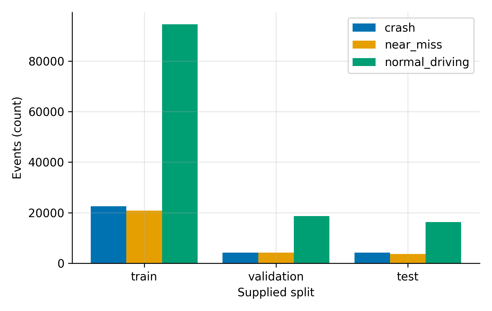

**Figure 25.** AP and F1 with all features, without the gyro feature, and with scale-free features only. (MEASURED_SOFTWARE)  
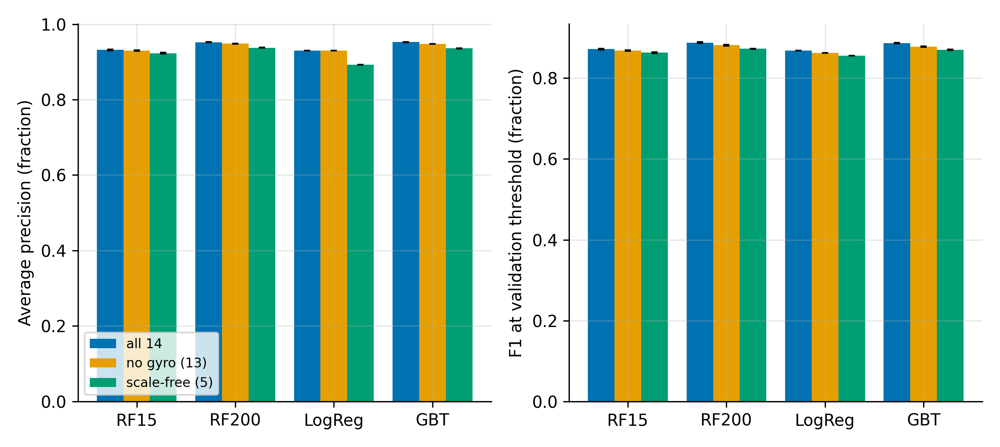

**Figure 26.** AP when a vehicle-size category is held out of training. (MEASURED_SOFTWARE)  
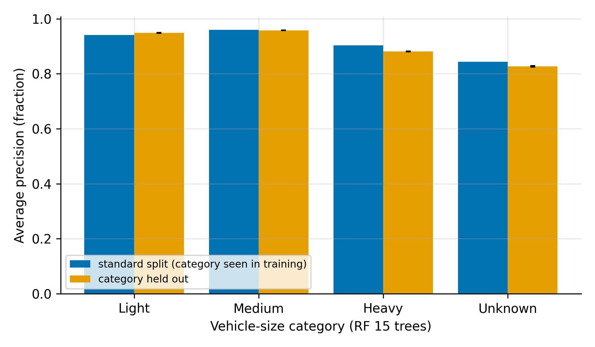

**Figure 27.** Attack suite outcomes. (SIMULATED)  
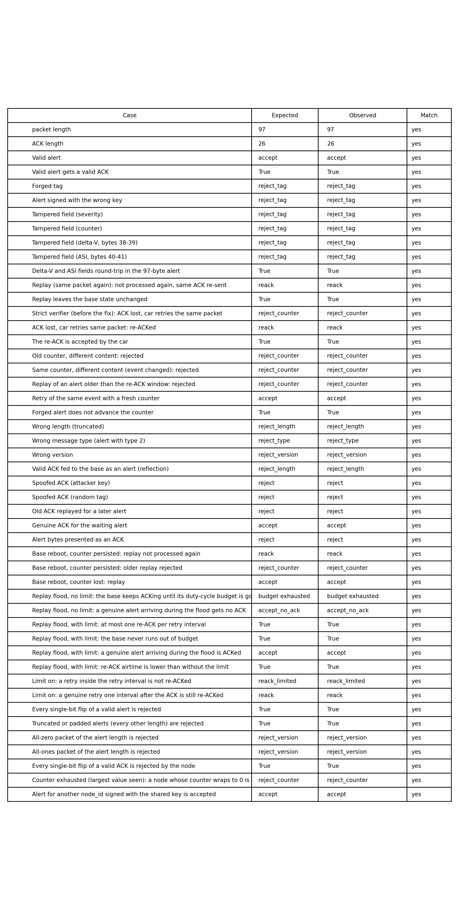

**Figure 28.** Reliability curves from the original model comparison (seed 42). (MEASURED_SOFTWARE)  
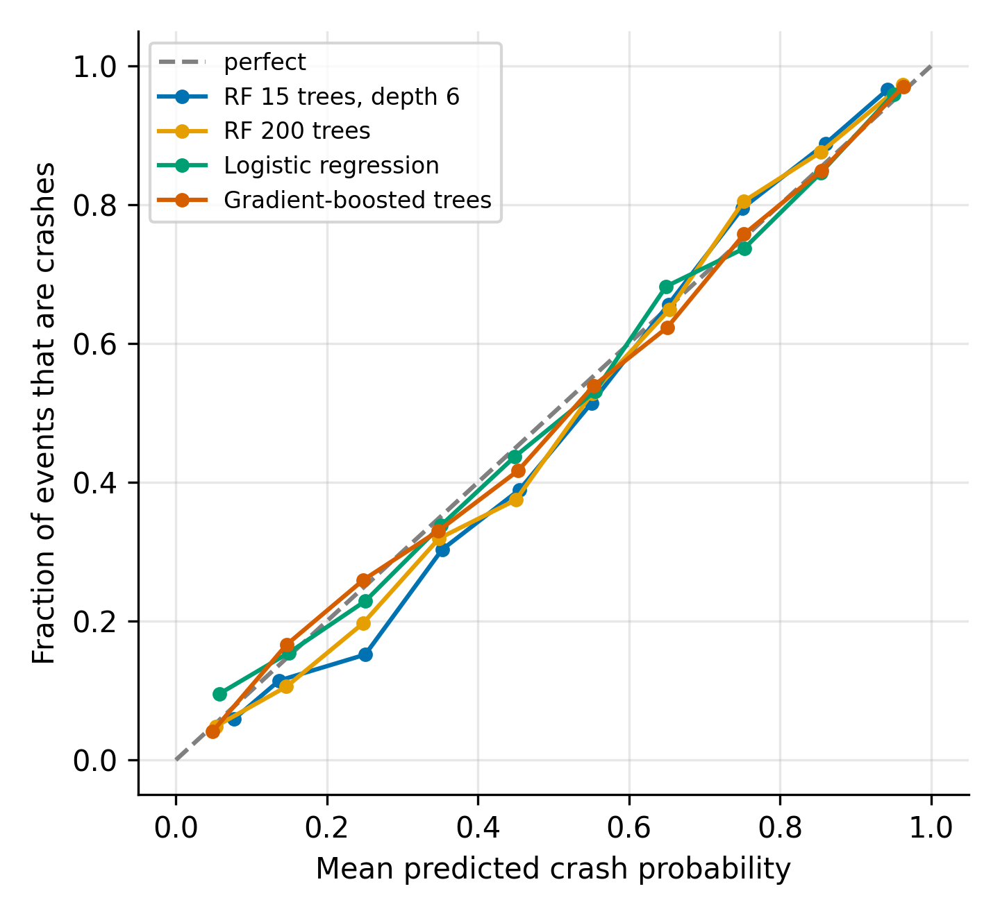

## 5. Limitations

### What these results do and do not show

**They show:**
- On the de-duplicated VZCrash test set, the deployable 15-tree forest finds crashes with system recall 0.900 [0.892 to 0.909] at a system false-alarm rate of 0.042 [0.039 to 0.044] (mean of 5 seeds, interval for the mean; seed 42 alone: 0.909 [0.901 to 0.918] and 0.044 [0.041 to 0.047]); with the false-alarm rate fixed at 1% on validation, recall is 0.626 ± 0.004.
- Fitting on the ESP32 costs AP: the 200-tree forest is higher by 0.0206 and gradient-boosted trees by 0.0208. A 10-tree depth-9 forest chosen on validation is close to the deployed model.
- Sensor errors move recall by a few points at most, except a 0.5 g offset on the vertical axis and some misalignments (Section 4.3).
- For severity, the range of the accelerometer is the limit: a ±16 g sensor at 100 Hz is within 10% of the reference delta-V on 0.07 of crash tests; ±64 g at 200 Hz reaches 80%.
- The security design behaves as intended in software tests. Our own testing found the retry-against-replay problem; the idempotent re-ACK with a rate limit fixes it, at the cost of a flood that can still spend airtime.
- N14 holds at ±16 g only and not as a blind test; N15 gives no improvement beyond the interval; the scheduler (N16) improves on a weak fixed policy but not on the severity table and is supporting evidence only (Section 4.8).
- The forest is evaluated where the VZCrash paper left a gap: that paper benchmarks neural and transformer models and a peak-acceleration baseline, tested no tree models and ran no embedded test. We do not run a transformer comparison.

**They do not show:**
- Injury. The severity classes indicate crash severity, not diagnosed injury, and VZCrash has no severity labels.
- That the severity scale is a published standard. The 13 Hz filter and the THIV flail-space distances are unverified; the delta-V class limits, the class names and the release rule are our choices (`docs/05_data_code/SEVERITY.md`).
- A reliable rollover flag. Both the integrated-angle flag and the gravity-corrected flag fire on more than 0.5% of normal driving, so the flag is reported but kept out of the severity class.
- Anything about the car. No hardware crash has been classified here; every MEASURED_SOFTWARE number comes from full-size vehicle data or crash tests, not the scale model. The transfer test is part of H2 and is NOT_RUN.
- Timing or memory on the ESP32. Sizes are host estimates; the benchmark sketch is built but not run.
- Real radio behaviour. Airtime is a formula, delivery results are simulations with stated assumptions (one node, no collisions, assumed stage times), and the 10% duty cycle is not verified against the official notification.
- Security beyond integrity, authenticity and replay rejection. Alerts are not encrypted; one key is shared; there is no key rotation; a lost counter store allows a replay.
- Results for the final trigger and sensor settings. The trigger level and sensor range are placeholders until confirmed from firmware v2, and every system-level number moves with them.

### Limitations in a list

- The trigger level (2.0 g) and sensor range (16 g), the window lengths (1.0 s before and 1.8 s after the trigger) are placeholders in `src/crashguard/config.py`.
- Prevalence. Results on a dataset with roughly `16%` crashes do not describe precision in real driving: the VZCrash paper reports `143` confirmed crashes among `735,000` real-world harsh-driving events (under `0.02%`), where its best model's average precision fell to about `86%`. Precision at lower prevalence in Table 'prevalence' is ANALYTICAL and assumes the measured false-alarm rate carries over.
- VZCrash events were already triggered on the device: the dataset is pre-selected and the trigger here is a second stage. Results do not apply to continuous driving.
- VZCrash has no vehicle or trip ID, so the stated vehicle-level separation of its splits cannot be checked; repeated recordings were found across splits and removed from the primary test set.
- Duplicates: the validation split may also repeat training events (not corrected), which may make validation scores optimistic.
- The severity class limits (24, 40 and 56 km/h) and the class names are our choice, supported by cited literature but not a published four-class scale; the class mix moves when the limits move by 20%.
- The MPU-6050 range is ±16 g: it clips crash pulses and underestimates delta-V in full-speed crashes. A wider-range part is needed to measure severity.
- The NHTSA tests are frontal barrier and side impactor tests of cars; the reference delta-V is a defined integral, not a measured vehicle velocity change. The sensor model is generic and ours.
- Unverified constants: the 13 Hz ASI pre-filter; the THIV flail-space distances (`0.6 m` used, `0.8 m` in one read source); the class names and cut points. The ASI level C limit was read in a secondary source, not the standard.
- Simulation assumptions: Poisson arrivals, independent or Gilbert-Elliott loss, assumed stage times and cancel windows, one node, no collisions, the base receives every spreading factor, loss falls by an assumed factor with the spreading factor.
- Replay flood and shared key: a sustained flood can still exhaust the base station's budget; one key is shared on both nodes with no rotation; the lost-counter-store replay is documented, not fixed.
- Hardware: the 433 MHz band is for the testbed only; scale-model impact forces are not real-vehicle forces; severity against impact strength and runs at 200 m are not in the minimum plan.
- Compiled C checks can be blocked by Windows Application Control; then they are recorded as NOT_RUN and the pure-Python mirror is the remaining check.

## 6. Threats to validity

- **Selection of events.** VZCrash events passed a device-side trigger before release. A detector that works here may not work on continuous driving, where the false-alarm exposure is far larger.
- **Leakage.** Identical recordings occur across the official splits. We removed the ones we found (exact and near-identical); other correlations (the same vehicle in train and test) cannot be checked without a vehicle ID, so scores may be optimistic.
- **Small crash-test set.** The NHTSA set is a few dozen frontal tests per speed class and many side tests; held-out parts have a few dozen tests, so intervals are wide. The reference delta-V is our own definition.
- **Tuning on small sets.** The release fraction and the N14 settings were chosen on tuning tests; held-out tests were scored once, but a development run with all tests together had been looked at before the wider NHTSA set was fixed (logged in `docs/07_log/DECISIONS.md`).
- **Simulation validity.** The replay and the scheduler depend on assumed loss processes, stage times and a spreading-factor model. Conclusions are stated per assumption, and hardware test H3 is the check.
- **Single seed in paired intervals.** Paired intervals resample test events for one model draw; the trigger study therefore uses the seed-averaged difference after a seed-42 difference proved unstable.
- **Multiple comparisons.** Many cells and metrics are reported; an interval that excludes zero in a single cell is not a claim. Claims are stated for pre-set endpoints.
- **Environment.** Python, package versions and the operating system are recorded in `results/results.json` (`env.*`); results reproduce exactly on this machine; other platforms may differ in the last digit.

## 7. What hardware must still show (Still needed from hardware)

- Confirm from firmware v2: trigger level, sensor range, window lengths, the packet byte layout (little-endian is assumed), the sampling rate and the sensor count (`docs/05_data_code/FIRMWARE_SYNC.md`).
- Implement the idempotent re-ACK with its limit on the base station and decide how many alerts it remembers. Without it, a lost ACK is never repaired when the car repeats a counter.
- The minimum hardware plan, logged in `hw_events.csv`, `hw_windows.csv`, `hw_attacks.csv` and `hw_memory.csv` (schemas in `docs/05_data_code/HARDWARE_SCHEMA.md`), then `make merge`: **H1** impact side (10 hits on each of 4 sides and 10 vertical drops); **H2** crash against not-crash and the transfer test from VZCrash; **H3** LoRa delivery (20 alerts each at 10, 50 and 100 m), which would replace the replay; **H4** security (forged, tampered, replay, spoofed ACK, base reboot, ACK-lost retry); **H5** edge cost (compile report and microseconds), which would replace the host size estimates; **H6** SW-420 ablation. `docs/05_data_code/HARDWARE_READINESS.md` has the schemas and a dry run of the merge on dummy files.
- Transmitter totals for the LoRa tests, so a delivery ratio can be computed.
- Run `benchmark_rf.ino` on the ESP32 and compile the generated headers with the Arduino toolchain (gcc), including `crashguard_rf_candidate.h` and `severity.h`.
- Choose an accelerometer of at least ±64 g sampled at 200 Hz or faster if severity is to be measured, or accept the partial repair of N14 at ±16 g.
- Verify the 433 MHz limits and duty cycle against the WPC/DoT notification, and the EN 1317-2 constants against the standard (`docs/06_references/MANUAL_SEARCH_CHECKLIST.md`).

## 8. Reproduce

Environment recorded in the run: Python `3.12.10` on `Windows-11-10.0.26300-SP0`. The exact commands are in `docs/05_data_code/REPRODUCE.md`; in short, `.\scripts\run_all.ps1 -Clean` rebuilds every output from a clean checkout (it fails loudly if a result the report cites is NOT_RUN without a stated reason), and `PYTHONPATH=src python -m pytest -q` runs the tests. On Linux, `make all`.

The trigger level and sensor range in `config.py` are placeholders; change them there only and re-run.
